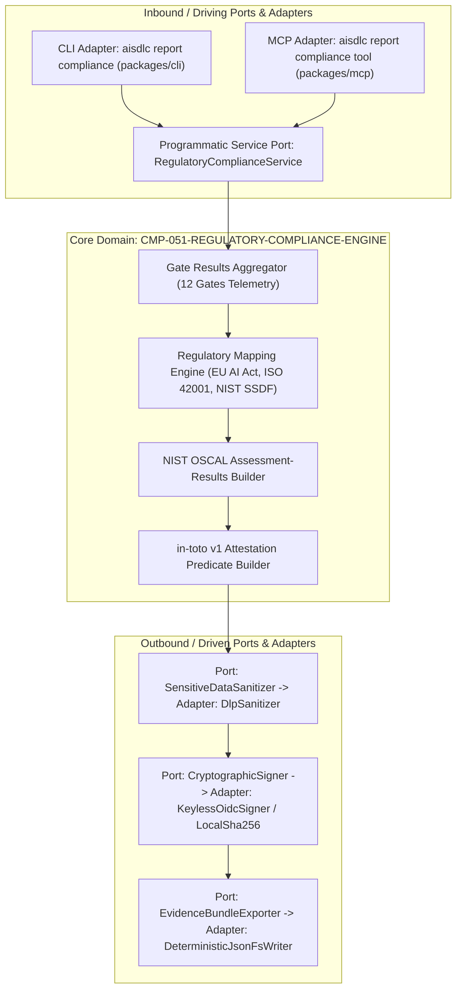

# CMP-051-REGULATORY-COMPLIANCE-ENGINE: Motor de Cumplimiento Normativo y Evidencias de Auditoría

## 1. Propósito, Responsabilidad y Bounded Context
El componente **CMP-051-REGULATORY-COMPLIANCE-ENGINE** es el subsistema de gobernanza técnica y consolidación de evidencias de auditoría dentro del contexto acotado **AI-SDLC Governance**. Su responsabilidad primordial es:
1. Recopilar deterministamente los veredictos, métricas y artefactos de las 12 Quality Gates de AI-SDLC.
2. Mapear bidireccionalmente cada evidencia hacia las cláusulas normativas de **EU AI Act** (Artículos 9 a 15), **ISO/IEC 42001** y **NIST SSDF** (SP 800-218).
3. Construir modelos estándar **NIST OSCAL** (`assessment-results`) y atestaciones de procedencia de cadena de suministro **in-toto v1**.
4. Sanitizar metadatos mediante filtros DLP (Data Loss Prevention) para prevenir filtraciones de secretos o PII conforme a GDPR Art. 32 y EU AI Act Art. 10.
5. Gestionar la firma criptográfica o sellado keyless (OIDC Sigstore / Rekor) y persistir el bundle final `reports/audit-evidence-bundle.json`.

---

## 2. Diagrama de Estructura y Arquitectura Hexagonal (Puertos y Adaptadores)

---

## 3. Contratos de Interfaces y Políticas de Ejecución
- **Puertos de Entrada (Inbound Ports)**:
  - `IRegulatoryComplianceService`: Orquestador in-process con interfaz fuertemente tipada TypeScript (`generateBundle(options: ComplianceBundleOptions): Promise<ComplianceBundleResult>`).
  - Adaptadores CLI (`packages/cli/src/commands/report.ts` -> subcomando `compliance`) y MCP (`packages/mcp/src/tools/index.ts` -> herramienta `report_compliance`).
- **Núcleo de Dominio (Domain Core)**:
  - `GateResultsAggregator`: Ingesta y normaliza resultados de las 12 Quality Gates (`verify_quality`, `verify_traceability`, `verify_governance`, `verify_testing`, `verify_licenses`, `verify_schemas`, `verify_duplicates`, `verify_security`, `verify_privacy`, `verify_friction`, `verify_pdac`, `verify_gherkin`).
  - `RegulatoryControlMapper`: Correlaciona IDs de gates y hallazgos con Artículos 9-15 de EU AI Act, requisitos de ISO/IEC 42001 (A.5-A.10) y prácticas NIST SSDF SP 800-218 (PO, PS, PW, RV).
  - `OscalAssessmentBuilder`: Modela la salida bajo el esquema NIST OSCAL `assessment-results` v1.0.
  - `InTotoAttestationBuilder`: Genera el envelope in-toto Statement v1 con predicado link/evaluation y subjects asociados con hashes SHA-256 canónicos Unix LF.
- **Puertos de Salida (Outbound Ports)**:
  - `ISensitiveDataSanitizer`: Ejecuta la detección y enmascaramiento determinista de secretos (`[REDACTED_SECRET]`, `[REDACTED_SECRET_KEY]`) y PII de autores Git (`[REDACTED_PII]`). Cubre credenciales embebidas en URIs (`://user:pass@`), tokens Bearer, cabeceras de claves privadas PEM (`BEGIN ... PRIVATE KEY`), y envuelve recursivamente `diagnostics[]`, `rawOutput`, `error.message` y `stackTrace`.
  - `ICryptographicSigner`: Soporta firma local SHA-256 canónica o atestación keyless enlazada a claims OIDC (`https://token.actions.githubusercontent.com`) y registros de transparencia (Rekor). Aplica estricta lista blanca HTTPS para endpoints OIDC autorizados, timeout estricto de red (5s) que falla cerrado (`ERR_OIDC_NETWORK_UNREACHABLE`) previniendo cuelgues indefinidos en entornos aislados o air-gapped, y soporte explícito para modo offline (`--offline`).
  - `IEvidenceBundleExporter`: Serializa bajo el estándar RFC 8785 (JSON Canonicalization Scheme - JCS) con ordenamiento secundario determinista de arrays por clave identificadora (`id`, `ruleId`, `path`) y codificación Unix LF (`\n`) en UTF-8. Valida la presencia completa de las 12 Quality Gates y la frescura de procedencia con el commit actual (`git rev-parse HEAD`), escribiendo atómicamente en `reports/audit-evidence-bundle.json`.

---

## 4. Historial de Revisiones

| Versión | Fecha | Autor / Agente | Descripción del Cambio | Referencia de Cambio (Change/PR) |
| :--- | :--- | :--- | :--- | :--- |
| **1.0.0** | 2026-11-10 | agent-system-architect | Definición formal del componente de motor de cumplimiento normativo (EU AI Act, ISO 42001, NIST SSDF) | CHG-051-REGULATORY-COMPLIANCE-BUNDLE |
| **1.1.0** | 2026-11-10 | agent-system-architect | Mitigaciones de Vectores Adversarios 1-4: RFC 8785, ordenamiento de arrays, LF/UTF-8, 12 gates + HEAD, OIDC whitelist/timeout/offline y DLP ampliado | CHG-051-REGULATORY-COMPLIANCE-BUNDLE |
