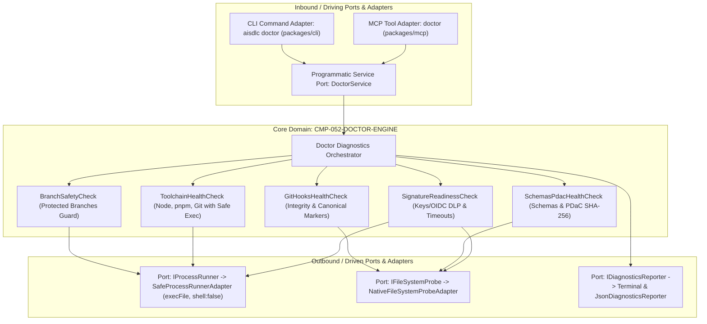

# CMP-052-DOCTOR-ENGINE: Motor Determinista de Diagnóstico de Salud de Entorno y Repositorio

## 1. Propósito, Responsabilidad y Bounded Context
El componente **CMP-052-DOCTOR-ENGINE** es el subsistema central de diagnóstico previo ("health check" determinista) dentro del contexto acotado **AI-SDLC Diagnostics & Quality Gates**. Su responsabilidad primordial es proporcionar a desarrolladores humanos y agentes autónomos una evaluación integral y determinista de la salud operativa del espacio de trabajo antes de iniciar ciclos de desarrollo o pipelines:
1. **Verificación Estructural de Hooks Git y Defensa contra Symlinks**:
   - Comprobación de existencia real, permisos ejecutables y no vacuidad (`size > 0`).
   - Verificación de enlaces simbólicos mediante `fs.lstatSync(hookPath).isSymbolicLink()`, rechazando enlaces a destinos arbitrarios.
   - Verificación estructural anti-bypass diferenciada:
     * `.git/hooks/pre-commit`: DEBE contener el encabezado identificador `# AI-SDLC: Universal Protected Branches Guard` Y la lógica estructural de rechazo/bloqueo de ramas protegidas (`main|master|release` y `exit 1`).
     * `.git/hooks/prepare-commit-msg`: DEBE contener el encabezado identificador `# AI-SDLC: Automated Commit Trailers Injection Hook` y lógica de trailers.
   - En modo auto-reparación (`--fix`), creación preventiva de copia de respaldo (`.bak.<timestamp>`) antes de sobreescribir hooks no canónicos.
2. **Salvaguarda de Ramas Protegidas (Branch Safety Guard)**: Detección estricta de la rama Git activa impidiendo operaciones directas sobre `main`, `master` o `release/*`.
3. **Consistencia e Integridad de Esquemas JSON y PDaC**: Validación de esquemas JSON (`Draft 2020-12`) y verificación de deriva de firmas SHA-256 en especificaciones y sidecars PDaC.
4. **Sondeo Seguro y Aislado de Toolchains con Higienización de Entorno**:
   - Invocación segura mediante `SafeProcessRunnerAdapter` (`execFile` con `{ shell: false }` y argumentos inmutables).
   - Lista blanca estricta inmutable: `node`, `pnpm`, `git`.
   - Higienización estricta de entorno: purga forzosa de `NODE_OPTIONS`, `NODE_PATH`, `LD_PRELOAD`, `DYLD_INSERT_LIBRARIES`, y `GIT_EXEC_PATH`. Restricción a lista blanca segura (`PATH`, `SYSTEMROOT`, `TMP`, `TEMP`, `HOME`, `USERPROFILE`).
   - Truncamiento de buffer (`maxBuffer: 1024`) y timeout de 2000ms.
5. **Preparación Criptográfica, Redacción Recursiva DLP y Modo Offline**:
   - Evaluación de presencia de credenciales de firma enmascarando cualquier secreto.
   - Redacción DLP recursiva obligatoria con `DlpSanitizer` en todos los campos (`finding.message`, `finding.details`, `err.stack`, `err.message`).
   - Soporte nativo para modo desconectado / air-gapped (`--offline` o `AI_SDLC_OFFLINE=1`), omitiendo proactivamente sondas remotas sin inducir falsos positivos bajo `--strict`.

El componente retorna códigos de estado deterministas: `0` (saludable / green), `1` (advertencias no bloqueantes / yellow), y `2` (defectos críticos bloqueantes / red).

---

## 2. Diagrama de Estructura y Arquitectura Hexagonal (Puertos y Adaptadores)

---

## 3. Contratos de Interfaces y Políticas de Ejecución
- **Puertos de Entrada (Inbound Ports)**:
  - `IDoctorService`: Interfaz programmatic in-process TypeScript (`runDiagnostics(options: DoctorOptions): Promise<DoctorReport>`).
  - Adaptador CLI: `aisdlc doctor` (`packages/cli/src/commands/doctor.ts`) con soporte de flags `--json`, `--fix`, `--strict`, `--timeout <ms>`, `--root <dir>`.
  - Adaptador MCP: herramienta `doctor` (`packages/mcp/src/tools/doctor.ts`).
- **Núcleo de Dominio (Domain Core)**:
  - `DoctorOrchestrator`: Coordina la ejecución secuencial o paralela de las 5 categorías de salud, consolida advertencias y errores críticos, y determina el código de salida final (0, 1, 2).
  - `GitHooksHealthCheck`: Enforce `SEC-REQ-052-TAMPER-RESISTANT-HOOK-VERIFICATION-001`. Inspecciona `.git/hooks/pre-commit` y `.git/hooks/prepare-commit-msg` validando que no sean symlinks (`isSymbolicLink`), presencia, tamaño no nulo, permisos de ejecución y contenido canónico estructural específico (`pre-commit` con guard y `prepare-commit-msg` con trailers). Realiza backup `.bak.<timestamp>` en `--fix`.
  - `SafeProcessRunnerAdapter`: Enforce `SEC-REQ-052-SAFE-TOOLCHAIN-PROBE-001`. Aísla el entorno de subprocesos eliminando `NODE_OPTIONS`, `NODE_PATH`, `LD_PRELOAD`, `DYLD_INSERT_LIBRARIES`, `GIT_EXEC_PATH` y ejecutando sin shell.
  - `SignatureReadinessCheck`: Enforce `SEC-REQ-052-NO-SECRET-LEAK-DIAGNOSTICS-001` y `SEC-REQ-052-RESILIENT-DIAGNOSTIC-TIMEOUTS-001`. Aplica DLP recursivo (`DlpSanitizer`) a mensajes, detalles y stack traces, y omite sondas remotas cuando `--offline` o `AI_SDLC_OFFLINE=1` están activos.
  - `BranchSafetyCheck`: Enforce de la Directiva 1 de AGENTS.md y `FR-052-CLI-DOCTOR-001`. Identifica la rama actual e intercepta si coincide con `main`, `master` o `release/*`.
  - `SchemasPdacHealthCheck`: Invoca la validación de esquemas y hash drift de PDaC.
  - `ToolchainHealthCheck`: Enforce `SEC-REQ-052-SAFE-TOOLCHAIN-PROBE-001`. Ejecuta sondas seguras con lista blanca estricta (`node`, `pnpm`, `git`) sin shell intermedio y truncamiento a 1024 caracteres.
  - `SignatureReadinessCheck`: Enforce `SEC-REQ-052-NO-SECRET-LEAK-DIAGNOSTICS-001` y `SEC-REQ-052-RESILIENT-DIAGNOSTIC-TIMEOUTS-001`. Valida disponibilidad de firmas sin exponer secretos y limita timeouts de sondeo remoto a 2000ms degradando con aviso `[WARN]` sin bloquear.
- **Puertos de Salida (Outbound Ports)**:
  - `IProcessRunner`: Ejecutor seguro de subprocesos (`execFile` con `{ shell: false }`, timeout configurable por llamada y truncamiento de buffers).
  - `IFileSystemProbe`: Acceso y sondeo de metadatos del filesystem (existencia, stat, permisos POSIX, lectura de firmas).
  - `IDiagnosticsReporter`: Formateador determinista de reportes para salida en terminal estilizada o serialización JSON estructurada.

---

## 4. Historial de Revisiones

| Versión | Fecha | Autor / Agente | Descripción del Cambio | Referencia de Cambio (Change/PR) |
| :--- | :--- | :--- | :--- | :--- |
| **1.0.0** | 2026-11-11 | agent-system-architect | Diseño arquitectónico inicial de CMP-052-DOCTOR-ENGINE con Arquitectura Hexagonal | CHG-052-CLI-DOCTOR |
