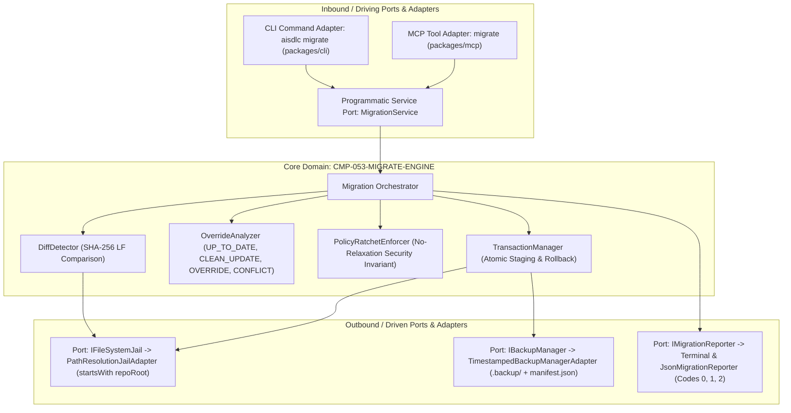

# CMP-053-MIGRATE-ENGINE: Motor Determinista de Migración y Sincronización de Esquemas, Plantillas y Políticas

## 1. Propósito, Responsabilidad y Bounded Context
El componente **CMP-053-MIGRATE-ENGINE** es el subsistema central encargado de la sincronización automatizada, no destructiva y verificada de los artefactos canónicos distribuidos por el framework AI-SDLC hacia los repositorios de los proyectos consumidores, dentro del contexto acotado **AI-SDLC Lifecycle & Asset Synchronization**.

Su misión y responsabilidades fundamentales abarcan:
1. **Detección Determinista de Diferencias (DiffDetector)**:
   - Inspección y comparación de artefactos locales (`schemas/`, `templates/`, `quality-policy.yaml`, `license-policy.yaml`, `privacy-policy.yaml`, `dlp-policy.yaml`) contra las versiones canónicas distribuidas en el paquete AI-SDLC.
   - Cálculo de digests criptográficos SHA-256 normalizados en Unix LF (`\n`) para identificar si un archivo local es idéntico al upstream previo o si contiene personalizaciones del usuario.
2. **Análisis y Clasificación de Modificaciones (OverrideAnalyzer)**:
   - Clasificación de cada artefacto en uno de cuatro estados formales:
     * `UP_TO_DATE`: El artefacto local coincide byte a byte con la versión canónica distribuida.
     * `CLEAN_UPDATE`: El artefacto local no tenía cambios respecto a la versión upstream anterior y puede actualizarse sin riesgo.
     * `LOCAL_OVERRIDE_PRESERVED`: El archivo local difiere de la base previa; se preserva intacto por omisión para no sobreescribir personalizaciones del usuario, retornando código `1`.
     * `CONFLICT`: Conflicto irreconciliable de estructura o degradación de políticas que requiere flag explícito (`--force` o `--allow-policy-downgrade`).
3. **Invariante Ratchet de No Degradación de Seguridad (PolicyRatchetEnforcer)**:
   - Enforce estricto de `SEC-REQ-053-POLICY-RATCHET-PRESERVATION-001`.
   - Al sincronizar políticas de gobernanza, impide relajar umbrales más estrictos definidos por el usuario (ej. cobertura de pruebas, complejidad ciclomática, licencias prohibidas) o eliminar reglas aditivas de DLP y PII.
   - Bloquea cualquier degradación silenciosa a menos que el usuario proporcione deliberadamente `--allow-policy-downgrade`.
4. **Transaccionalidad Atómica y Mecanismo de Rollback (TransactionManager)**:
   - Enforce estricto de `SEC-REQ-053-ATOMIC-ROLLBACK-001` y `SEC-REQ-053-NON-DESTRUCTIVE-BACKUP-001`.
   - Conduce todas las escrituras a un área de staging aislada y unívoca (`.backup/.staging-<uuid>/` o staging in-memory) para prevenir colisiones concurrentes, y ejecuta una validación pre-commit de integridad y sintaxis (esquemas JSON Draft 2020-12 y YAML).
   - Registra manejadores de señales del proceso (`SIGINT`, `SIGTERM`) para invocar `rollbackSync()` inmediatamente ante cancelaciones o interrupciones intempestivas.
   - En caso de interrupción o fallo de I/O, ejecuta rollback automático restaurando el estado previo desde el respaldo `.backup/migration-<timestamp>-<random6>/` y retornando código `2`.
   - Garantiza que `.gitignore` contenga la regla `.backup/` antes de que el directorio de respaldo sea creado físicamente en el disco.
5. **Confinamiento Seguro y Defensa Anti-Traversal (FileSystemJail)**:
   - Enforce de `SEC-REQ-053-PATH-TRAVERSAL-DEFENSE-001`.
   - Validación estricta con `path.resolve` y verificación de pertenencia ineludible a `repoRoot` (`resolvedPath === repoRoot || resolvedPath.startsWith(repoRoot + path.sep)`, o mediante `path.relative`). Normaliza la letra de unidad en Windows y gestiona prefijos extendidos (`\\?\`).
   - Resuelve rutas reales con `fs.realpathSync` para neutralizar junction escapes y symlinks arbitrarios que apunten fuera de `repoRoot`. Rechazo inmediato de secuencias `../`, `..\` y caracteres nulos.
6. **Protección de Ramas Protegidas (Protected Branch Guard con Soporte Detached HEAD)**:
   - Cumplimiento de la Directiva 1 de `AGENTS.md`. Prohíbe mutaciones directas en `main`, `master` o `release/*`, abortando con código `2` (`ERR_PROTECTED_BRANCH_MIGRATION`).
   - Gestiona escenarios de Detached HEAD inspeccionando de forma robusta `git symbolic-ref --short HEAD`, `git rev-parse --abbrev-ref HEAD`, y variables de entorno de CI (`GITHUB_REF_NAME`, `CI_COMMIT_REF_NAME`). Si la rama no puede determinarse de forma unívoca durante una operación mutante (no `--dry-run`), aplica principio de fail-closed y aborta la migración con código `2`.

---

## 2. Diagrama de Estructura y Arquitectura Hexagonal (Puertos y Adaptadores)



---

## 3. Contratos de Interfaces y Políticas de Ejecución

### 3.1 Puertos de Entrada (Inbound Ports)
- **`IMigrationService`**:
  ```typescript
  export interface MigrationOptions {
    root?: string;
    dryRun?: boolean;
    backup?: boolean;
    force?: boolean;
    allowPolicyDowngrade?: boolean;
    json?: boolean;
    verbose?: boolean;
  }

  export interface MigrationResult {
    success: boolean;
    exitCode: 0 | 1 | 2;
    summary: {
      upToDate: number;
      cleanUpdated: number;
      overridesPreserved: number;
      conflicts: number;
    };
    backupPath?: string;
    details: Array<{
      file: string;
      status: 'UP_TO_DATE' | 'CLEAN_UPDATE' | 'LOCAL_OVERRIDE_PRESERVED' | 'CONFLICT';
      message?: string;
    }>;
  }

  export interface IMigrationService {
    migrate(options: MigrationOptions): Promise<MigrationResult>;
    preview(options: MigrationOptions): Promise<MigrationResult>;
  }
  ```
- **Adaptador CLI**: `aisdlc migrate` (`packages/cli/src/commands/migrate.ts`).
  Soporta opciones: `-r, --root <path>`, `--dry-run`, `--backup`, `--force`, `--allow-policy-downgrade`, `--json`, `--verbose`.
- **Adaptador MCP**: `migrate` tool (`packages/mcp/src/tools/migrate.ts`).

### 3.2 Componentes del Núcleo de Dominio (Domain Core)
1. **`MigrationOrchestrator`**:
   - Orquesta el ciclo de vida: (1) validación de confinamiento y rama activa, (2) inventariado de activos locales y canónicos, (3) detección de diffs y overrides, (4) evaluación de invariantes ratchet de políticas, (5) generación de plan o ejecución transaccional con respaldo preventivo, (6) reporte y emisión de código de salida.
2. **`DiffDetector`**:
   - Normaliza buffers a Unix LF (`\n`) y computa SHA-256 para evaluar correspondencia byte a byte.
3. **`OverrideAnalyzer`**:
   - Determina si las modificaciones locales son intencionales del usuario frente a la versión base previa, clasificando el destino en `UP_TO_DATE`, `CLEAN_UPDATE`, `LOCAL_OVERRIDE_PRESERVED` o `CONFLICT`.
4. **`PolicyRatchetEnforcer`**:
   - Parsea archivos YAML de políticas (`quality-policy.yaml`, `license-policy.yaml`, `privacy-policy.yaml`, `dlp-policy.yaml`) aplicando validación estricta de tipos previa a comparaciones relacionales numéricas (fallando cerrado con `ERR_INVALID_POLICY_FORMAT` ante anomalías o `NaN`), asegurando que los umbrales numéricos locales no se flexibilicen (ej. mayor cobertura exigida, menor complejidad tolerada), normalizando identificadores SPDX de licencias a mayúsculas para uniones y bloqueos precisos, y unificando aditivamente reglas de privacidad y DLP sin sobreescrituras desprotegidas.
5. **`TransactionManager`**:
   - Administra el ciclo transaccional: preparación de staging unívoco `.backup/.staging-<uuid>/`, copia validada, verificación previa sintáctica de esquemas (`JSON.parse` / `yaml.parse`), captura de señales `SIGINT`/`SIGTERM` para `rollbackSync()`, y atomic swap / rollback ante fallos.

### 3.3 Puertos de Salida (Outbound Ports)
1. **`IFileSystemJail`**:
   - Abstracción de acceso al filesystem que aplica rigurosamente `path.resolve(repoRoot, relativePath)`.
   - Verifica `resolvedPath === repoRoot || resolvedPath.startsWith(repoRoot + path.sep)` o `path.relative` rechazando con `ERR_PATH_TRAVERSAL_DETECTED` cualquier escape fuera de la raíz o sibling directory bypass.
   - Maneja la letra de unidad de Windows y prefijos extendidos (`\\?\`).
   - Resuelve symlinks y junctions con `fs.realpathSync` validando que permanezcan dentro del realpath del repositorio (`ERR_SYMLINK_ESCAPE_DETECTED`).
2. **`IBackupManager`**:
   - Gestiona la creación de `.backup/migration-<timestamp>-<random6>/`.
   - Asegura la entrada en `.gitignore` antes de crear el directorio físico en disco para prevenir filtraciones de respaldos al repositorio remoto.
   - Genera `manifest.json` conteniendo el listado de archivos respaldados con sus digests SHA-256 y permisos correspondientes (`0700` por defecto en directorio).
3. **`IMigrationReporter`**:
   - Emite resultados en formato consola interactiva o JSON determinista con códigos de retorno:
     * `0`: Migración exitosa sin conflictos pendientes.
     * `1`: Overrides locales retenidos o advertencias de gobernanza no forzadas.
     * `2`: Error crítico, fallo I/O o rama protegida detectada.

---

## 4. Historial de Revisiones

| Versión | Fecha | Autor / Agente | Descripción del Cambio | Referencia de Cambio (Change/PR) |
| :--- | :--- | :--- | :--- | :--- |
| **1.0.0** | 2026-11-11 | AI-SDLC Integration Engine | Integración de incremento de entrega chg-053-cli-migrate | chg-053-cli-migrate |
| **1.0.0** | 2026-11-11 | agent-system-architect | Diseño arquitectónico inicial de CMP-053-MIGRATE-ENGINE con Arquitectura Hexagonal | CHG-053-CLI-MIGRATE |
