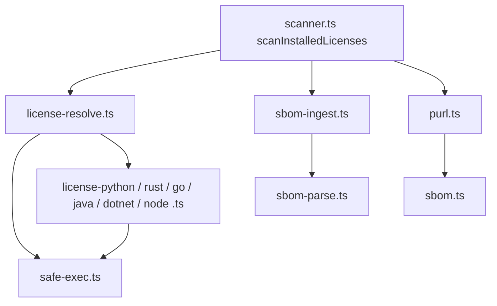

# CMP-054-SCA-LICENSE-RESOLUTION: Resolución de licencias, PURL e ingesta de SBOM (SCA)

## 1. Responsabilidad
Subconjunto de `CMP-CORE` bajo `packages/core/src/verifiers/sca/` que extiende `scanner.ts` (patrón `scanXDependencies(rootDir, seen)`) con:
1. **Integridad de atribución** (FR-054, BR-SCA-LICENSE-ATTRIBUTION-INTEGRITY): una dependencia Maven nunca hereda la licencia del `pom.xml` raíz (`UNKNOWN`); PURL por ecosistema real en componentes y `affects.ref` (`purl.ts`, `ScaVulnerability.ecosystem`).
2. **Resolución offline** (FR-055, BR-SCA-EXTERNAL-CLI-SAFE-EXECUTION): parseo de archivos → CLI endurecido (todos los de issue #161 con archivos bloqueantes) → `UNRESOLVED` (≡ `UNKNOWN` para Gate 6) con `unresolvedReason`.
3. **Ingesta de SBOM** (FR-056): solo por ruta explícita (flag CLI); CycloneDX/SPDX JSON confinado a la raíz; **solo rellena huecos** (la resolución local siempre gana; procedencia `sbom-declared`); verificación cruzada contra lockfiles. Independiente de `buildPurl`. OSV fuera de alcance (issue #194).

Los fallbacks externos existentes `scanWithTrivy`/`scanWithSyft` permanecen **sin cambios** de ejecución (solo el fallback de PURL deja de ser `pkg:npm`).

Diseño YAGNI: funciones planas por ecosistema, sin interfaces/factorías; sin dependencias nuevas.

## 2. Estructura interna

## 3. Restricciones
- Ejecución según BR-SCA-EXTERNAL-CLI-SAFE-EXECUTION (tabla endurecida y archivos bloqueantes); SEC-REQ-055-SAFE-EXEC-HARDENING-001 y SEC-REQ-055-CLI-HIJACK-RESISTANCE-001.
- Entradas no confiables (CLI, metadatos, SBOM): SEC-REQ-055-OUTPUT-SANITIZATION-INTEGRITY-001 y SEC-REQ-055-SBOM-INGESTION-SAFETY-001.
- Lecturas por descriptor (`fstat` sobre fd), confinadas con `path.relative`, solo archivos regulares; sin UNC ni symlinks fuera de la raíz.
- CC ≤ 10 y funciones ≤ 40 líneas (`quality-policy.yaml`); un archivo por ecosistema.
