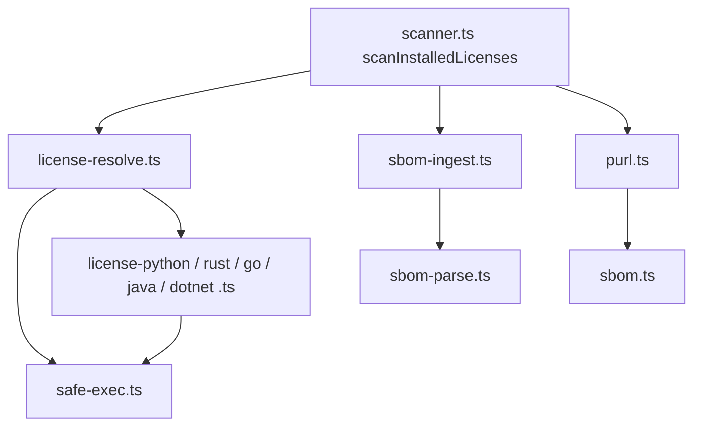

# CMP-054-SCA-LICENSE-RESOLUTION: Resolución de licencias, PURL e ingesta de SBOM (SCA)

## 1. Responsabilidad
Subconjunto de `CMP-CORE` bajo `packages/core/src/verifiers/sca/` que extiende `scanner.ts` (patrón `scanXDependencies(rootDir, seen)`) con:
1. **Integridad de atribución** (FR-054, BR-SCA-LICENSE-ATTRIBUTION-INTEGRITY): una dependencia Maven nunca hereda la licencia del `pom.xml` raíz (`UNKNOWN`); PURL por ecosistema real en componentes y `affects.ref`.
2. **Resolución offline** (FR-055, BR-SCA-EXTERNAL-CLI-SAFE-EXECUTION): metadatos locales → CLI local → `UNRESOLVED` con motivo, para Python, Rust, Go, Java, .NET y Node.
3. **Ingesta de SBOM** (FR-056): CycloneDX/SPDX JSON confinado a la raíz; el SBOM **sustituye siempre** a la resolución local (sin fusión). OSV queda fuera de alcance (issue #194).

Diseño YAGNI: funciones planas por ecosistema, sin interfaces/factorías de proveedores; sin dependencias nuevas.

## 2. Estructura interna

## 3. Restricciones
- `spawnSync`/`execFile` sin shell, binario y argumentos de lista cerrada, `cwd` acotado, timeout y límite de salida (BR-SCA-EXTERNAL-CLI-SAFE-EXECUTION).
- CC ≤ 10 y funciones ≤ 40 líneas (`quality-policy.yaml`); un archivo por ecosistema.
