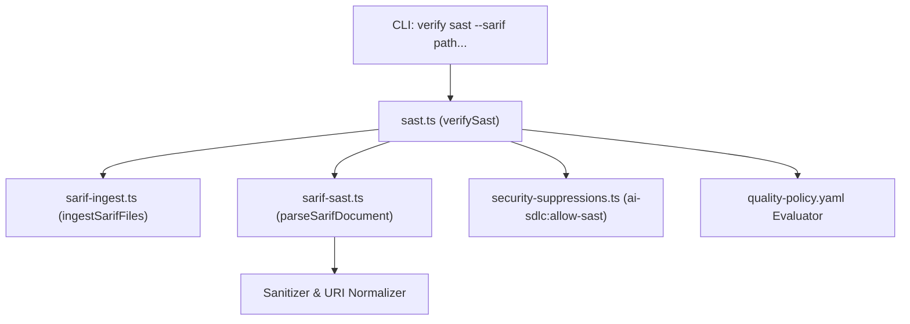

# CMP-057-SARIF-SAST-INGESTION: Ingesta Determinista de Reportes OASIS SARIF v2.1.0 para Evaluación SAST

## 1. Responsabilidad y Estructura Modular
Subconjunto de `CMP-CORE` bajo `packages/core/src/verifiers/` (con adaptador CLI en `packages/cli`) que extiende `verifySast` mediante funciones exportadas simples (`ingestSarifFiles`, `parseSarifDocument`) sin abstracciones innecesarias:

1. **Ingesta Segura (`sarif-ingest.ts` — `ingestSarifFiles`)**:
   - Invocación estrictamente explícita (sin autodescubrimiento de archivos `.sarif`).
   - Protección anti-TOCTOU de symlinks: `lstat` + apertura por descriptor (`open` + `fstat` sobre el fd) verificando `isFile()` y coincidencia `dev`/`ino` (`ERR_SARIF_NOT_FOUND`, `ERR_SARIF_NOT_REGULAR_FILE`).
   - Confinamiento a `rootDir` mediante `realpath` + `path.relative` (normalizando letra de unidad en Windows), rechazando rutas UNC (`\\server\share`, `file://host/...`), escapes `..` y symlinks fuera de la raíz (`ERR_SARIF_PATH_OUTSIDE_ROOT`).
   - Límites anti-DoS antes y durante el parseo: tamaño máximo **50 MiB** (`ERR_SARIF_TOO_LARGE`), escáner iterativo de profundidad JSON (`<= 64`) **previo a `JSON.parse()`** (`ERR_SARIF_LIMIT_EXCEEDED` evitando desbordamiento de pila V8) y máximo **100 000** resultados acumulados (`ERR_SARIF_LIMIT_EXCEEDED`).
   - Protección contra Prototype Pollution: rechazo de claves `__proto__`, `constructor` y `prototype` en cualquier nivel (`ERR_SARIF_UNSAFE_KEY`).
   - Validación estructural estricta y 100% offline: JSON válido (`ERR_SARIF_MALFORMED`), `version === "2.1.0"` y `Array.isArray(runs)` (`ERR_SARIF_UNSUPPORTED_VERSION`), sin descarga de `$schema`.
2. **Normalizador y Saneador de Salida (`sarif-sast.ts` — `parseSarifDocument`)**:
   - Sanea `message.text`, `ruleId`, `artifactLocation.uri` y `tool.driver.name` eliminando secuencias ANSI/VT (CSI/OSC), caracteres de control C0/C1 (`\x00-\x1F`, `\x7F-\x9F`) e inyecciones Markdown/HTML (`SEC-REQ-057-SARIF-OUTPUT-SANITIZATION-001`).
   - Normaliza `artifactLocation.uri`: `decodeURIComponent` seguro (`URIError` -> `ERR_SARIF_MALFORMED`), resolución de `uriBaseId` contra `run.originalUriBaseIds` (rechazando traversal), rechazo de UNC y escapes fuera de `rootDir` (normalizando letra de unidad Windows) con `ERR_SARIF_PATH_OUTSIDE_ROOT`. Ante `result.locations` ausente o vacío emite `relPath: '<unknown>'`, `lineNumber: 1`.
   - Mapea deterministamente con precedencia `result.properties['security-severity']` -> `rule.properties['security-severity']` -> `result.level` -> `rule.defaultConfiguration.level` -> `'MEDIUM'` (excluyendo `level: 'none'` sin `security-severity` de `SastViolation[]` bloqueantes), deduplica `(relPath, lineNumber, ruleId)` conservando la mayor severidad y ordena canónicamente por `relPath`, `lineNumber` y `ruleId`.
3. **Integración de Supresiones y Políticas (`sast.ts`)**:
   - En modo SARIF (`sarifPaths.length > 0`), omite `collectSastFiles`, regex y `runSemgrepCli`, fija `totalFilesScanned = sarifPaths.length` y actualiza `formatSastViolationRow` para `CRITICAL`/`HIGH`/`MEDIUM`/`LOW`.
   - Confina lecturas fuente para `ai-sdlc:allow-sast` a `rootDir` (`realpath` + `open`/`fstat` y guarda `lineNumber > lines.length`), exigiendo `supp.kind === 'sast'` y `supp.rule === ruleId` (o `'*'`), y falla si existen supresiones caducadas o inválidas.
   - Carga `quality-policy.yaml` desde `rootDir` (con defaults seguros si falta) y evalúa contra `sast_analysis.fail_on_severity` (opcional, fallback `options.minSeverity ?? 'HIGH'`), `sast_analysis.max_vulnerabilities` (default `0`) y `enforcement_mode: 'PERMISSIVE'`.
4. **Adaptador CLI (`packages/cli`)**:
   - Expone `--sarif <path...>` en `aisdlc verify sast` permitiendo múltiples rutas explícitas, manteniendo comportamiento fail-closed sin emitir resultados parciales.

## 2. Estructura Interna

## 3. Límites YAGNI y Restricciones
- **Sin ejecución de analizadores externos**: `CHG-057` no invoca `bandit`, `gosec`, `semgrep` u otras CLIs a partir del contenido SARIF.
- **Sin autodescubrimiento**: si no se pasa `--sarif`, no se buscan archivos SARIF automáticamente.
- **Sin dependencias externas nuevas**: solo módulos nativos de Node.js (`fs`, `path`, `url`).
- **Umbrales de código**: `CC <= 10` y funciones `<= 40` líneas según `quality-policy.yaml`.
