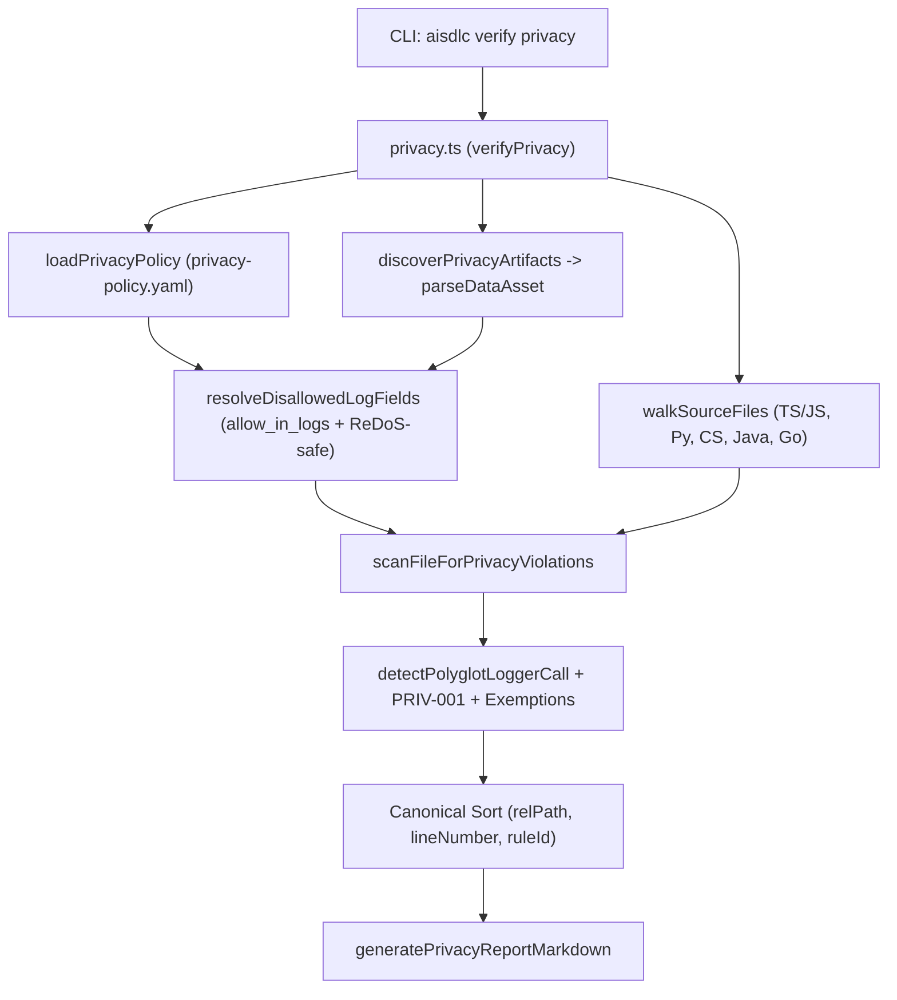

# CMP-058-POLYGLOT-PII-LOGGING: Inspección Políglota de PII-SAST en Logs Cruzada con DATA-ASSET-* y privacy-policy.yaml

## 1. Responsabilidad y Estructura Modular
Subconjunto de `CMP-CORE` en `packages/core/src/verifiers/privacy.ts` (y contratos de tipos en `packages/core/src/types/index.ts`) que extiende Gate 12 (`verifyPrivacy`) mediante funciones exportadas simples y cohesivas sin interfaces ni puertos especulativos (YAGNI):

1. **Extracción Segura de Campos `DATA-ASSET-*` (`parseDataAsset`)**:
   - Extrae `fields` (`name`, `sensitivity`, `maskingStrategy`) desde el frontmatter YAML de cada artefacto `DATA-ASSET-*` descubierto.
   - Descarta de forma segura entradas malformadas (no-objeto, `name` ausente, no-string, vacío o con longitud excesiva) y rechaza claves de prototipo (`__proto__`, `constructor`, `prototype`, `toString`, `valueOf`, `hasOwnProperty`) sin interrumpir el análisis.
2. **Resolución de Campos Prohibidos en Logs (`resolveDisallowedLogFields`, `normalizeIdentifierToSnakeCase`)**:
   - Normaliza identificadores de clasificación entre artefactos `DATA-ASSET-*` (`confidential-pii` → `confidential_pii`, `special-category-sensitive` → `special_category_sensitive`) y consulta `policy.classifications` mediante `Object.hasOwn(policy.classifications, key)`.
   - Evalúa `sensitivity` a nivel de campo: `'internal'` y `'public'` permiten el registro en logs según su clasificación en política (`allow_in_logs: true`); `'pii'`, `'sensitive'`, `'special'` o valores omitidos heredan la regla `allow_in_logs` de la clasificación del activo padre.
   - Valida que los nombres de campo cumplan `/^[a-zA-Z_][a-zA-Z0-9_]{0,127}$/` (rechazando claves de prototipo), normaliza a `snake_case` canónico en $O(n)$ (`Email` → `email`, `PhoneNumber`/`phoneNumber` → `phone_number`, `getNationalId` → `national_id`) y almacena el resultado en `Map<string, string>` para búsqueda $O(1)$ sin riesgo de ReDoS.
3. **Detección Políglota de Loggers, Stripper de Enmascaramiento y Escaneo (`stripMaskingCalls`, `detectPolyglotLoggerCall`, `scanFileForPrivacyViolations`)**:
   - Aplica un stripper unificado $O(n)$ con balanceo de paréntesis y conciencia de literales de cadena (`'...'`, `"..."`, `` `...` ``) para eliminar `mask(...)`, `redact(...)`, `pseudonymize(...)`, `sha256(...)`, `tokenize(...)` *antes* de evaluar tanto los patrones estáticos `PRIV-001` como los campos dinámicos `DATA-ASSET-*`.
   - Utiliza un escáner acotado por profundidad de paréntesis entre líneas (registrando el `lineNumber` exacto de la línea del argumento infractor) para capturar invocaciones multilínea y con paréntesis anidados en TypeScript/JS (`console.*`, `logger.*`, `log.*`, `Logger.*`), Python (`logging.*`, `logger.*`, `structlog.*`, `print(...)`), .NET/C# (`_?logger|log|Logger`, `ILogger`, `Console.WriteLine(...)`, `Serilog.Log.*`), Java (`LOGGER.*`, `LOG.*`, `logger.*`, `log.*`, `System.out.println(...)`, `System.err.println(...)`) y Go (`slog.*`, `slog.*Context`, `zap.*`, `logrus.*`, `zerolog.*` con colas encadenadas `.Str(...)`/`.Interface(...)`, `log.Print*`).
   - Normaliza cada token identificador extraído a `snake_case` canónico en $O(n)$ antes de consultar `Map<string, string>`.
   - Mantiene `scanFileForPrivacyViolations(filePath, rootDir, policy?, disallowedLogFields?)` retrocompatible para llamadores de 3 argumentos mediante el 4.º parámetro opcional.
   - Respeta exenciones en línea (`ai-sdlc:allow-pii`, `ai-sdlc:allow-sast`, `nosec`) y la bandera `policy.ci_gates.fail_on_pii_in_logs`.
4. **Diagnóstico Saneado, Deduplicación y Ordenamiento Canónico (`verifyPrivacy`)**:
   - Emite `PrivacyViolation` con `ruleId`, `relPath`, `lineNumber` y `message` identificando regla, campo y activo sin exponer valores PII literales ni el `rootDir` absoluto del host, omitiendo/redactando `snippet` para violaciones `PRIV-001` y `PRIV-004`.
   - Deduplica hallazgos por `(relPath, lineNumber, ruleId)` y ordena canónicamente todas las violaciones por `relPath` (lexicográfico ascendente), `lineNumber` (numérico ascendente) y `ruleId` (lexicográfico ascendente).

## 2. Estructura Interna

## 3. Límites YAGNI y Restricciones
- **100 % estático y offline**: sin ejecución de código fuente ni peticiones de red.
- **Sin dependencias externas nuevas**: reutiliza `js-yaml`, `walkSourceFiles` y utilidades existentes en `packages/core`.
- **Cero ReDoS**: prohibido construir `new RegExp(rawField)` con cadenas sin validar/escapar.
- **Umbrales de código**: complejidad ciclomática `CC <= 10` y funciones `<= 40` líneas según `quality-policy.yaml`.
