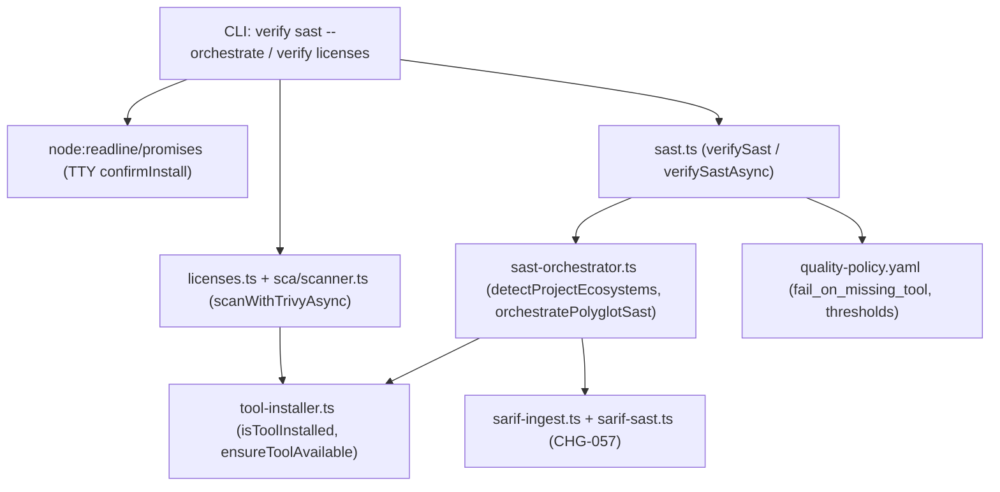

# CMP-059-POLYGLOT-CLI-ORCHESTRATION: Orquestación Políglota de CLIs SAST Nativos vía SARIF v2.1.0 e Instalador Interactivo de Herramientas

## 1. Responsabilidad y Estructura Modular
Subconjunto de `CMP-CORE` bajo `packages/core/src/verifiers/` (con adaptador CLI en `packages/cli`) diseñado bajo YAGNI estricto mediante funciones exportadas simples y cero dependencias npm nuevas:

1. **Instalador Seguro de Herramientas (`packages/core/src/verifiers/tool-installer.ts`)**:
   - Catálogo estático e inmutable (`Object.freeze`) por herramienta (`semgrep`, `trivy`, `bandit`, `ruff`, `gosec`, `dotnet`, `spotbugs`, `eslint`) y sistema operativo (`win32`, `darwin`, `linux`), sin `sudo` ni evaluación en shell.
   - Resolución segura de binarios (`CWE-426`): resuelve binarios a ruta absoluta estrictamente desde directorios de `process.env.PATH` (omitiendo `.` y `rootDir`) antes de invocar `spawnSync`/`execFileSync`; en Windows maneja shims `.cmd`/`.bat` (`eslint`, `npm`) de forma segura desde entradas confiables de `PATH` (resolviendo el entrypoint JS para `process.execPath` o manejando `PATHEXT` sin ejecutar desde `cwd`).
   - `isToolInstalled(tool)`: verifica disponibilidad mediante resolución segura en `PATH` con `shell: false` y timeout acotado.
   - `getToolInstallSpec(tool, platform?)`: resuelve la especificación inmutable de instalación o rechaza herramientas fuera de la allowlist o con escalación de privilegios.
   - `ensureToolAvailable(tool, options)`: respeta `nonInteractive`, `noInstallPrompt`, `ci`, `CI` normalizado (`process.env.CI?.toLowerCase() === 'true' || process.env.CI === '1'`) y `process.stdin.isTTY && process.stdout.isTTY`; en sesión interactiva solicita confirmación vía callback inyectable `confirmInstall`, ejecuta el comando allowlisted con `shell: false` y timeout explícito, redacta todos los fragmentos de `stderr` mediante `redactSensitiveDiagnostics`, y verifica la disponibilidad posterior. Aplica `fail_on_missing_tool: true` de forma consistente ante herramienta faltante en no-interactivo, rechazo interactivo del usuario y fallo de instalación.
2. **Orquestador Políglota SAST (`packages/core/src/verifiers/sast-orchestrator.ts`)**:
   - `detectProjectEcosystems(rootDir)`: inspección determinista de marcadores estándar para Python (`pyproject.toml`, `requirements.txt`, `setup.py`, `Pipfile`, `.py`), Go (`go.mod`, `.go`), .NET (`.sln`, `.csproj`), Java (`pom.xml`, `build.gradle`, `build.gradle.kts`, `.java`) y Node/TS (`package.json`, `tsconfig.json`, `.ts`/`.tsx`/`.js`/`.jsx`), sin ejecutar código del proyecto.
   - `orchestratePolyglotSast(rootDir, options)`: crea `tmpDir` exclusivo con `fs.mkdtempSync(path.join(os.tmpdir(), 'aisdlc-sast-'))` (`0o700`), resuelve cada binario desde `PATH` confiable (omitiendo `.` y `rootDir`, con manejo seguro de shims `.cmd`/`.bat` en Windows), invoca los CLIs nativos disponibles y `semgrep` vía `spawnSync` con `shell: false` y timeout acotado escribiendo OASIS SARIF v2.1.0 en `tmpDir`. Acepta códigos de salida `0` y `1` para `bandit`, `ruff`, `gosec`, `eslint`, `semgrep` cuando el `.sarif` fue creado y no está vacío; trata `error` (`ETIMEDOUT`/`ENOENT`), `status === null`, `status > 1`, salida SARIF faltante/inválida o ausencia de `@microsoft/eslint-formatter-sarif` como diagnóstico de herramienta no bloqueante (con `stderr` redactado vía `redactSensitiveDiagnostics`).
   - Ingesta en dos raíces: llama a `ingestSarifFiles(tmpDir, tmpSarifPaths)` (confinando lecturas SARIF a `tmpDir`) y pasa los `SarifDocument[]` devueltos a `parseSarifDocuments(rootDir, docs)` (resolviendo URIs de fuente relativas a `rootDir`), garantizando `fs.rmSync(tmpDir, { recursive: true, force: true })` en `try/finally`.
3. **Integración en Verificadores (`sast.ts`, `sca/scanner.ts`, `licenses.ts`)**:
   - `sast.ts`: cuando `orchestrate: true` (o `--orchestrate`), delega en `orchestratePolyglotSast` y combina con reglas integradas `SAST_RULES`; gestiona `semgrep` faltante mediante `ensureToolAvailable` leyendo `fail_on_missing_tool` desde `quality-policy.yaml` (`release_thresholds.sast_analysis.fail_on_missing_tool` o `fail_on_missing_tool` en raíz). Preserva `verifySast` síncrono.
   - `sca/scanner.ts` y `licenses.ts`: incorpora `ensureTrivyAvailable` y `scanWithTrivyAsync` para gestionar `trivy` faltante; `verifyLicensesAsync` lee `fail_on_missing_tool` desde `quality-policy.yaml` / `license-policy.yaml` (`ci_gates.fail_on_missing_tool`), manteniendo `scanWithTrivy` y `verifyLicenses` síncronos compatibles.
4. **Adaptador CLI (`packages/cli/src/index.ts`, `packages/cli/src/commands/verify.ts`)**:
   - Expone `--orchestrate`, `--non-interactive`, `--no-install-prompt` y `--ci` en `aisdlc verify sast`, y `--non-interactive`, `--no-install-prompt` y `--ci` en `aisdlc verify licenses`.
   - Preserva `runVerifySast` y `runVerifyLicenses` síncronos para llamadores existentes, añade `runVerifySastAsync` y `runVerifyLicensesAsync`, y actualiza `runVerifySecurity`, `runVerifyAll` y los handlers `.action(async ...)` de Commander según corresponda.
   - Implementa el prompt TTY mediante `node:readline/promises` cuando la sesión es interactiva y ningún flag de supresión está activo.

## 2. Estructura Interna

## 3. Límites YAGNI y Restricciones
- **Sin dependencias externas nuevas**: solo módulos nativos de Node.js (`node:child_process`, `node:fs`, `node:path`, `node:os`, `node:readline/promises`).
- **Sin abstracciones especulativas**: funciones exportadas directas sin factorías genéricas, puertos o clases base innecesarias.
- **Seguridad por defecto**: `shell: false` obligatorio, allowlist congelada con `Object.freeze`, prohibición absoluta de `sudo`, timeouts explícitos, `mkdtempSync` `0o700` con `finally` `rmSync`, y redacción de rutas absolutas del host y variables de entorno sensibles.
- **Umbrales de calidad**: `CC <= 10` y funciones `<= 40` líneas según `quality-policy.yaml`.
