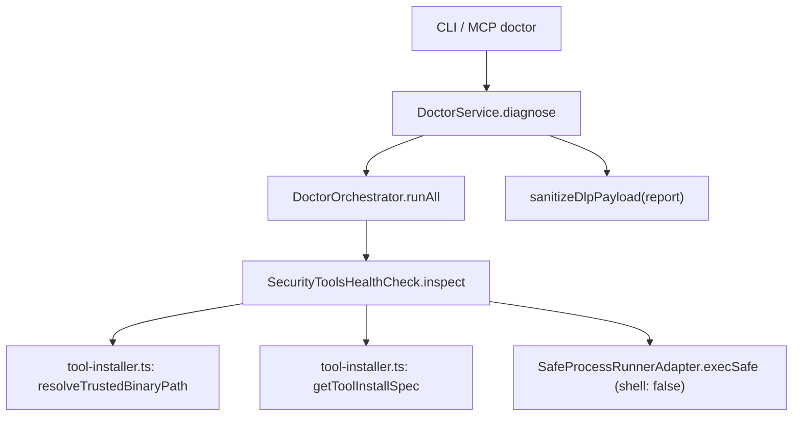

# CMP-060-DOCTOR-SECURITY-TOOLS: Diagnóstico de Herramientas Opcionales de Seguridad en aisdlc doctor

## 1. Responsabilidad y Estructura Modular
Extensión minimalista (YAGNI) de `CMP-052-DOCTOR-ENGINE` dentro de `CMP-CORE` bajo `packages/core/src/doctor/` para inspeccionar la disponibilidad y versión de las herramientas opcionales de seguridad (`semgrep`, `trivy`, `gitleaks`) en la categoría `'security_tools'`, reutilizando las utilidades de seguridad de `CMP-059-POLYGLOT-CLI-ORCHESTRATION`:

1. **Contrato de Categoría y Ejecutor Seguro (`packages/core/src/types/doctor.ts`, `packages/core/src/doctor/process-runner.ts`)**:
   - Extiende `DiagnosticCategory` con `'security_tools'`.
   - Extiende la lista blanca de `IProcessRunner.execSafe` y `ALLOWED_TOOLS` en `SafeProcessRunnerAdapter` con `'semgrep' | 'trivy' | 'gitleaks'`.
   - Tras validar la allowlist, `SafeProcessRunnerAdapter.execSafe` (para `semgrep`/`trivy`/`gitleaks` y herramientas existentes) resuelve el binario mediante `resolveTrustedBinaryPath(executable, cwd)` y ejecuta ese `trustedPath` absoluto (nunca el nombre bare con `cwd: rootDir`, CWE-426), depura `.` y `cwd` de `PATH` en `buildSafeEnvironment`, inyecta `SEMGREP_ENABLE_VERSION_CHECK: '0'` y `SEMGREP_SEND_METRICS: 'off'` para evitar telemetría saliente en `semgrep --version`, y maneja shims `.cmd`/`.bat` en Windows vía `ComSpec` (`/d /s /c`, `shell: false`, validación `WIN_CMD_META_RE`) reutilizando/espejando `tool-installer.ts`.
2. **Reutilización de Allowlist Canónica (`packages/core/src/verifiers/tool-installer.ts`)**:
   - Incorpora `'gitleaks'` a `InstallableTool` y `TOOL_INSTALL_ALLOWLIST` (`win32`: `winget install Gitleaks.Gitleaks`, `darwin`: `brew install gitleaks`, `linux`: `go install github.com/gitleaks/gitleaks/v8@latest`).
   - `SecurityToolsHealthCheck` reutiliza `getToolInstallSpec(tool, platform)` y `resolveTrustedBinaryPath(binaryName, rootDir)` directamente desde `tool-installer.ts`, evitando tablas de comandos duplicadas.
3. **Chequeo de Herramientas de Seguridad (`packages/core/src/doctor/security-tools-check.ts`)**:
   - `SecurityToolsHealthCheck` sondea `semgrep --version`, `trivy --version` y `gitleaks version` únicamente cuando `resolveBinary` encuentra el binario en un directorio confiable de `PATH` (omitiendo `.` y `rootDir`, CWE-426).
   - Si falta el binario, emite `WARN_SECURITY_TOOL_<TOOL>_MISSING` (`status: 'warn'`, nunca `'fail'`) con `remediation` obtenido de `getToolInstallSpec`.
   - Si el binario existe pero el probe falla (código distinto de `0`, salida vacía, error o timeout), pasa `stderr` y mensajes de error explícitamente por `redactSensitiveDiagnostics(text, rootDir)` (de `tool-installer.ts`) y `sanitizeDlpText` (de `security/dlp-sanitizer.ts`) antes de almacenarlos en `finding.details` / `finding.message`, emitiendo `WARN_SECURITY_TOOL_<TOOL>_ISSUE` (`status: 'warn'`) con `remediation` canónico.
   - Nunca ejecuta instalaciones ni realiza peticiones de red.
4. **Orquestación y Reporte (`packages/core/src/doctor/doctor-service.ts`, `packages/core/src/doctor/index.ts`, `packages/core/src/doctor/reporter.ts`, `packages/cli/src/commands/doctor.ts`)**:
   - `DoctorOrchestrator.runAll` registra `SecurityToolsHealthCheck` y añade su `CategoryReport` (`category: 'security_tools'`, `title: 'Optional Security CLIs (Semgrep, Trivy, Gitleaks)'`).
   - `DoctorReporter.formatTerminal` renderiza dinámicamente `[${cat.category.toUpperCase()}] ${cat.title}` sin mapeos estáticos, por lo que CLI y MCP soportan `'security_tools'` de forma nativa.

## 2. Estructura Interna

## 3. Límites YAGNI y Restricciones de Calidad
- **Cero dependencias externas nuevas**.
- **Complejidad y tamaño**: todas las funciones nuevas o modificadas mantienen `CC <= 10`, `Cognitive <= 15`, `MI >= 50` y `Lines <= 100`.
- **Seguridad**: `shell: false`, resolución `CWE-426` en `PATH`, cero `sudo`, cero descargas o instalaciones automáticas, y sanitización DLP en el reporte final.

## Historial de Revisiones

| Versión | Fecha | Autor / Agente | Descripción del Cambio | Referencia de Cambio (Change/PR) |
| :--- | :--- | :--- | :--- | :--- |
| **1.0.0** | 2026-11-14 | AI-SDLC Integration Engine | Integración de incremento de entrega chg-060-doctor-security-tools | chg-060-doctor-security-tools |
