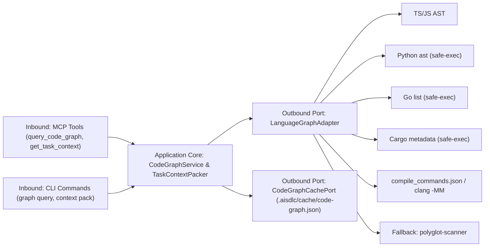

# CMP-065-CODE-GRAPH-CONTEXT-ENGINE: Motor Hexagonal de Code Graph (Repo-Map) y Task Context Packer

## 1. Responsabilidad y Arquitectura Hexagonal (Ports & Adapters)
Subconjunto modular de `CMP-CORE` bajo `packages/core/src/code-graph/` con adaptadores de entrada en `CMP-MCP-SERVER` (`packages/mcp`) y `CMP-CLI` (`packages/cli`), diseñado bajo Arquitectura Hexagonal estricta:

### 1.1 Núcleo de Dominio y Aplicación (`packages/core/src/code-graph/`)
1. **`CodeGraphService` (`code-graph-service.ts`)**:
   - Mantiene el grafo incremental de símbolos exportados (nombres, clases, interfaces, tipos, firmas sin cuerpos de función ni literales) y aristas de importación/dependencia.
   - Valida `depth` como entero finito `0 <= depth <= 5` (por defecto `1`; rechaza negativos, `NaN`, `Infinity`, no enteros o valores `> 5` con error de validación estructurado) y valida `target` (tanto rutas de archivo como nombres de símbolo) rechazando traversal/caracteres de control (`..`, `\0`, separadores de escape).
   - Ejecuta recorrido BFS acotado con conjunto `visited` (`Set<string>` por `realpath` / ID de nodo) y búsquedas seguras contra Prototype Pollution (`Object.create(null)` / `Object.hasOwn`) para terminar ciclos de importación y bucles de symlinks en `O(V + E)`.
   - Excluye directorios ignorados/sensibles (`.git`, `node_modules`, `.aisdlc/cache`, `dist`, `build`), archivos `> 2 MiB` y archivos `.env`/claves/secretos; aplica topes estrictos (`MAX_NODES = 100`, `MAX_EDGES = 250`, `MAX_SYMBOLS_PER_NODE = 64`, `MAX_SIGNATURE_CHARS = 240`, `MAX_INDEX_FILES = 5000`, `MAX_PAYLOAD_BYTES = 65536`) con indicador `truncated: boolean`.
   - Normaliza todas las rutas relativas a `repoRoot` y redacta rutas absolutas del host en diagnósticos.
2. **`TaskContextPacker` (`task-context-packer.ts`)**:
   - Valida `taskId` contra `^TSK-[A-Z0-9-]+$` y cada referencia citada contra `^[A-Z]+(?:-[A-Z0-9]+)+$` + `assertConfinedPath` antes de cualquier acceso a disco.
   - Resuelve la tarea en `specs/changes/` y busca artefactos citados únicamente en raíces canónicas (`specs/changes/`, `product/requirements/`, `architecture/components/`, `architecture/decisions/`, `security/requirements/`, `specs/privacy/requirements/`), extrayendo resúmenes concisos (`id`, `title`, `status`, resumen normativo/criterios clave) y reportando referencias faltantes sin fallar silenciosamente.
   - Agrega y fusiona de forma determinista (deduplicada y acotada por `MAX_NODES`/`MAX_EDGES`/`MAX_PAYLOAD_BYTES`) los subgrafos k-hop correspondientes a todos los `files-touched` de la tarea `TSK-*` (via `CodeGraphService`), omitiendo cuerpos de archivo y especificaciones no citadas.

### 1.2 Puertos de Salida (Outbound Ports & Adapters)
1. **`LanguageGraphAdapter` (`packages/core/src/code-graph/adapters/`)**:
   - Interfaz de puerto único para extracción estructural por lenguaje:
     - **TypeScript / JavaScript**: compilador/AST nativo de TypeScript (`typescript-ast.ts`).
     - **Python**: módulo estándar `ast` ejecutado mediante `spawnSync` con `shell: false`, `python3 -I -P` (más `PYTHONSAFEPATH=1`, `PYTHONNOUSERSITE=1`), `cwd` fijado a un directorio temporal vacío y seguro (nunca `repoRoot`), binario resuelto desde `PATH` confiable (omitiendo `.`, `cwd`, `rootDir`, `.venv`/`venv`), entorno purgado (`PYTHONPATH`, `PYTHONSTARTUP`), ruta confinada pasada por `stdin` o `-- <absConfinedPath>` y timeout `<= 10000 ms`.
     - **Go**: `go list -json` con `shell: false` y variables de entorno separadas como claves independientes: `GOFLAGS='-mod=readonly'`, `GOPROXY='off'`, `GOTOOLCHAIN='local'`, `GOWORK='off'`.
     - **Rust**: `cargo metadata --offline --locked --frozen --format-version 1` con `shell: false` y purga de `RUSTC`, `CARGO_BUILD_RUSTC`, `CARGO_BUILD_RUSTC_WRAPPER`, `RUSTC_WRAPPER`, `RUSTC_WORKSPACE_WRAPPER` y `CARGO_HOME` (o fijado a un directorio temporal vacío); antes de invocar `cargo`, se escanea `repoRoot` (incluyendo subdirectorios y ancestros) buscando `.cargo/config*` o `rust-toolchain*` y, si existen, se delega en `polyglot-scanner`.
     - **C / C++**: parseo estrictamente de datos de `compile_commands.json` extrayendo únicamente rutas `-I`/`-isystem` validadas con `assertConfinedPath` (sin ejecutar `command`/`arguments`), `clang -MM -- <file>` con `shell: false`, rechazo de `-` inicial y `@` inicial (`@response-file`), y revalidación de todas las rutas emitidas por `clang -MM` contra `repoRoot` vía `assertConfinedPath` (descartando cabeceras del sistema fuera de raíz).
     - **Fallback Políglota (`polyglot-scanner`)**: activado automáticamente para Java, C# o ante ausencia, timeout, bloqueo de configuración o fallo de cualquier toolchain nativo.
2. **`CodeGraphCachePort` (`packages/core/src/code-graph/cache/fs-code-graph-cache.ts`)**:
   - Persiste el índice incremental en `.aisdlc/cache/code-graph.json` (excluido en `.gitignore`) validando `mtime` y hash SHA-256 por archivo.
   - Aplica **FS-Jail estricto** (`ERR_PATH_TRAVERSAL_DETECTED`, `ERR_SYMLINK_ESCAPE_DETECTED` vía `fs.realpathSync` y normalización de unidad Windows).
   - Parseo seguro contra **Prototype Pollution** (`CWE-1321`): usa objetos con prototipo nulo (`Object.create(null)` / `Object.hasOwn`), rechaza/elimina `__proto__`, `constructor` y `prototype`, valida esquema y re-verifica cada ruta cacheada contra `repoRoot`; descarta y reconstruye cachés corruptas usando escritura atómica con nombre temporal único por escritura (`code-graph.json.<pid>.<uuid>.tmp`) y `fs.renameSync` con reintento/backoff acotado ante `EPERM`/`EBUSY`/`EACCES` en Windows dentro de `.aisdlc/cache/`.
   - **Minimización y Redacción (`PRIV-REQ-065-CODE-GRAPH-DATA-MINIMIZATION-001`)**: elimina cuerpos de funciones, literales de cadena/parámetros por defecto, comentarios/JSDoc, correos electrónicos incidentales y tokens/secretos antes de escribir caché o emitir payloads.

### 1.3 Puertos de Entrada (Inbound Ports & Adapters)
1. **MCP Server (`CMP-MCP-SERVER`, `packages/mcp/src/tools/code-graph.ts`)**:
   - Expone `query_code_graph(target, depth?)` y `get_task_context(taskId, depth?)` bajo `executeSecuredTool` y filtrado DLP.
2. **CLI (`CMP-CLI`, `packages/cli/src/commands/graph.ts`, `packages/cli/src/commands/context.ts`)**:
   - Expone `aisdlc graph query <target> [--depth <n>] [--json]` y `aisdlc context pack <taskId> [--depth <n>] [--json]`.

## 2. Diagrama Hexagonal de Estructura Interna

## Historial de Revisiones

| Versión | Fecha | Autor / Agente | Descripción del Cambio | Referencia de Cambio (Change/PR) |
| :--- | :--- | :--- | :--- | :--- |
| **1.0.0** | 2026-11-24 | agent-system-architect | Definición inicial de arquitectura hexagonal para Code Graph y Task Context Packer | CHG-065-CODE-GRAPH-TASK-CONTEXT |
