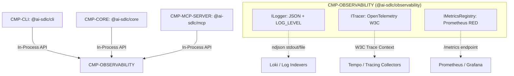

# CMP-OBSERVABILITY: Módulo de Observabilidad Runtime

## 1. Responsabilidad y Límites
Componente desacoplado de Nivel 2 responsable de la telemetría operativa en tiempo de ejecución para todos los subsistemas y servicios.
Proporciona:
1. **Motor de Logging Estructurado (`ILogger`)**: Emisión de eventos en formato JSON determinista con niveles de severidad configurables dinámicamente (`LOG_LEVEL`) y enmascaramiento automático de datos sensibles o PII.
2. **Propagación de Trazas Distribuidas (`ITracer`)**: Inyección y extracción de contexto W3C Trace Context (`traceparent`) conforme al estándar OpenTelemetry.
3. **Registro y Exposición de Métricas (`IMetricsRegistry`)**: Contadores, medidores e histogramas según el modelo RED (*Rate, Errors, Duration*) exportables en formato texto OpenMetrics/Prometheus para su raspado y visualización en Grafana.

---

## 2. Diagrama de Conectividad Estructural (arc42 Sec. 5 / NAF v4)

---

## 3. Contratos de Interfaz y Políticas de Ejecución
- **Mecanismo de Ejecución**: Biblioteca en proceso (`implementation-type: dll`) consumida de forma unidireccional por todos los componentes del sistema.
- **Tolerancia a Fallos**: Operaciones de telemetría no bloqueantes. En caso de error interno en el formateador o en la exportación de métricas, el componente aísla la falla y evita la degradación de los flujos de negocio.
- **Cumplimiento de Privacidad y Licencias**: Enclave Zero Trust perimetral `SEC-ENC-DMZ` bajo `SEC-POL-ZERO-LEAK`, con dependencias 100% compatibles con `license-policy.yaml`.

---

## 4. Historial de Revisiones

| Versión | Fecha | Autor / Agente | Descripción del Cambio | Referencia de Cambio (Change/PR) |
| :--- | :--- | :--- | :--- | :--- |
| **1.0.0** | 2026-10-18 | agent-system-architect | Creación del componente formal de observabilidad runtime | CHG-009-RUNTIME-OBSERVABILITY |
