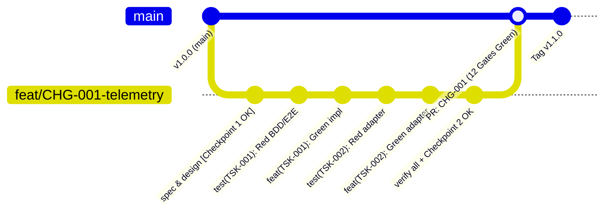
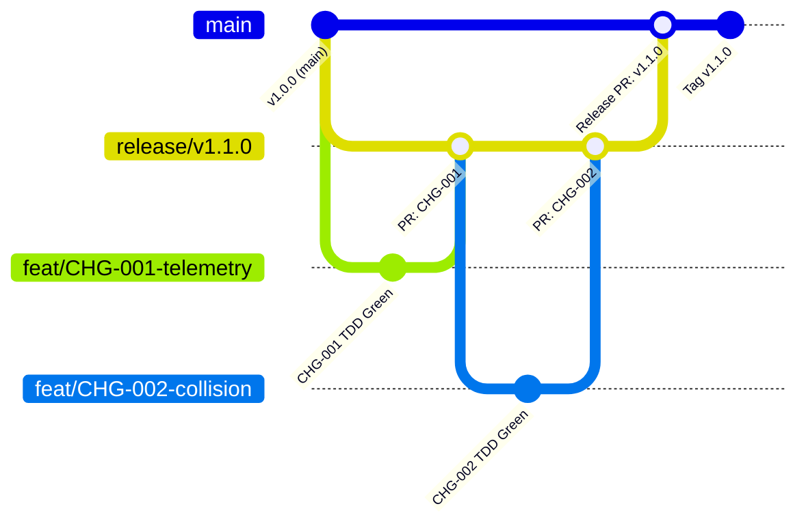

# 11. Git Branching Model & Lifecycle (Streamlined 2-Tier & Hierarchical Extensions)

## 1. Principles of the Branching Model

To govern collaborative development between humans and AI agents with maximum stability, traceability, and minimal friction, the AI-SDLC framework implements a **Streamlined 2-Tier Git branching model by default**, with optional extensions for release milestones and parallel worktrees:

```
┌────────────────────────────────────────────────────────────────────────┐
│               GIT BRANCH HIERARCHY IN AI-SDLC                          │
└────────────────────────────────────────────────────────────────────────┘

 [DEFAULT STREAMLINED 2-TIER MODEL]
  TIER 1: main (Latest stable production release — Protected)
    │
    └── TIER 2: feat/<CHG-ID>-<slug> | fix/<CHG-ID>-<slug> (Working branch)
          ├── commit: test(TSK-001): red test suites [Task-ID: TSK-001]
          ├── commit: feat(TSK-001): green implementation [Task-ID: TSK-001]
          └── commit: fix(TSK-001): rework remediation [Task-ID: TSK-001]

 [OPTIONAL ADVANCED EXTENSIONS]
  • Release Milestone Tier: release/vX.Y.Z (when batching multiple CHG-* into a release candidate)
  • Parallel Task Worktrees: task/<PARENT-ID>/<TSK-ID>-<slug> (when running concurrent agents in worktrees)
```

---

## 2. Anatomy of the Branch Tiers

### Tier 1: `main` Branch (Stable Baseline)
- **Purpose**: Exclusively contains code in its latest stable release deployed or ready for production.
- **Access Rules**:
  - **Protected Branch**: Direct `push` or agent commits are strictly forbidden (`pre-commit` hook enforced).
  - Accepts code solely via **Pull Request** merged from a verified working branch (`feat/<CHG-ID>-*` or `release/vX.Y.Z`).
  - Every merge into `main` is tagged with an immutable semantic version Git tag (e.g. `v1.0.0`, `v1.1.0`, `v1.1.1`) conforming to SemVer.

---

### Tier 2 (Default): Working Feature / Fix Branch (`feat/...`, `fix/...`, `bug/...`)
- **Purpose**: Develops a bounded SDD change (`1 UC-* = 1 CHG-*`), bug fix, or patch.
- **Origin**: Forked directly from `main` (or from an active `release/vX.Y.Z` if a milestone batch is open).
- **Standard Naming**:
  - Features: `feat/<CHG-ID>-<slug>` (e.g. `feat/CHG-001-telemetry-ingestion`)
  - Fixes / Bugs: `fix/<CHG-ID>-<slug>` or `bug/<BUG-ID>-<slug>` (e.g. `fix/CHG-003-clock-sync`)
- **Task Traceability without Branch Explosion**:
  - In the streamlined model, `agent-qa-engineer` and `agent-developer` operate directly on the `feat/<CHG-ID>-*` branch.
  - Granular traceability across tasks (`TSK-*`) declared in `tasks.md` is preserved at the **commit level** via Git trailers (`Task-ID: TSK-YYY`, `Parent-Ref: CHG-XXX`) and conventional commit scopes (`feat(TSK-001): ...`).
  - This eliminates intermediate task-level merges, reduces PR friction, and powers deterministic per-task rework KPIs.

---

### Optional Milestone Tier: Open Version Branch (`release/vX.Y.Z`)
- **Purpose**: Aggregates multiple feature increments scheduled for a single major/minor milestone before promotion to `main`.
- **Usage**: Recommended for regulated environments or scheduled release cycles. In continuous delivery environments, features merge directly into `main` via PR and trigger automated SemVer tag bumps.

---

### Optional Concurrency Tier: Atomic Task Worktrees (`task/...`)
- **Purpose**: Isolated worktree for concurrent multi-agent execution (`--parallel`).
- **Standard Naming**: `task/<PARENT-ID>/<TSK-ID>-<slug>`
- **Usage**: Created automatically only when intra-feature parallelism is active (e.g., simultaneous Frontend and Backend tasks running concurrently via `git worktree`).

---

## 3. Branch and Merge Flow Diagrams

### Streamlined Flow (Default — 1 Feature PR with SemVer Bump)


### Milestone Flow (Optional — Batched Release)


---

## 4. Quality Gates and Merge Criteria by Tier (PR Gates)

| Merge Level | Source ➔ Destination | Mandatory Merge Authorization Requirements |
| :--- | :--- | :--- |
| **Streamlined PR (Default)** | `feat/*` / `fix/*` ➔ `main` | 1. Verification of all 12 Quality Gates (`npx aisdlc verify all`).<br>2. Transversal Checkpoints 1 & 2 passed with 0 blocking defects.<br>3. Plan Execution Matrix (`[X]` vs `[O]`) completed in PR body.<br>4. Unit, BDD, and E2E test suites 100% green.<br>5. License and privacy policies compliant (`verify:licenses`, `verify:privacy`).<br>6. Mandatory human Tech Lead sign-off (no auto-merge).<br>7. SemVer tag bump (`patch` for fixes, `minor` for new features, `major` for breaking changes). |
| **Milestone PR (Optional)** | `release/*` ➔ `main` | 1. 360° Traceability matrix at 100% across all batched increments.<br>2. Consolidated release quality report (`report:quality`).<br>3. CycloneDX/SPDX SBOM generated and cryptographically signed.<br>4. Release KPI report generated (`kpi:release`).<br>5. Formal approval from Product Owner and Release Manager. |

---

## 5. Guardrails and Rules for AI Agents

1. **Strict Branch Isolation**:
   - Direct commits to `main`, `master`, and `release/*` are strictly forbidden for AI agents across all IDEs and tools.
   - Agents operate directly on `feat/<CHG-ID>-*` / `fix/<CHG-ID>-*` working branches.
   - Task-level branches (`task/*`) are utilized only when concurrent `--parallel` subagent execution is explicitly configured.
2. **Commit Trailer & Scope Discipline**:
   - Every commit produced by an agent must include the `Task-ID: TSK-YYY` trailer (or declare it in the commit subject `feat(TSK-YYY): ...`).
   - The git hook `prepare-commit-msg` automatically parses the task ID and injects author metadata and token telemetry.
3. **Mandatory Checkpoint Completion**:
   - An agent cannot open or present a PR until Checkpoint 1 (Design), TDD Red-Green implementation, and Checkpoint 2 (Pre-PR Quality & Mutation) are completed.

---

## 6. Branch Automation with the CLI (`aisdlc git checkout`)

To eliminate operational friction and navigate directly to the appropriate working branch, the framework provides automatic navigation:

```bash
npx aisdlc git checkout <task-id>
```

### Deterministic Behavior and Guarantees:
1. **Task Resolution**: Scans active changes in `specs/changes/active/*/tasks.md` identifying the active change (`CHG-*`) containing the specified task.
2. **Default Streamlined Mode**: Switches developer or AI agent directly to the working branch `feat/<CHG-ID>-<slug>` (created from `main` if it does not yet exist).
3. **Parallel Concurrency Mode (`--parallel`)**: If `--parallel` is specified, creates the dedicated atomic worktree `task/<PARENT-ID>/<TSK-ID>-<slug>` for multi-agent concurrency.
4. **Error Handling**: If task is not found in active changes, outputs clear diagnosis listing available tasks with active change IDs.

---

## 7. Multi-Platform Continuous Integration (Multi-CI Ecosystem)

The AI-SDLC framework is CI/CD provider-agnostic, guaranteeing strict parity for Quality Gate execution and automated post-merge promotion across corporate environments:

### Supported Providers and Canonical Environment Variables

| CI/CD Provider | Branch / Head Ref Variables | Pull / Merge Request Variables | Output Mechanism | Canonical Template |
| :--- | :--- | :--- | :--- | :--- |
| **GitHub Actions** | `PR_HEAD_REF`, `GITHUB_HEAD_REF`, `GITHUB_REF_NAME` | `PR_TITLE`, `PR_BODY`, `PR_NUMBER` | `$GITHUB_OUTPUT` | `templates/ci/github-workflows/` |
| **GitLab CI/CD** | `CI_MERGE_REQUEST_SOURCE_BRANCH_NAME`, `CI_COMMIT_REF_NAME`, `CI_COMMIT_BRANCH` | `CI_MERGE_REQUEST_TITLE`, `CI_MERGE_REQUEST_DESCRIPTION`, `CI_MERGE_REQUEST_IID` | `sdd-integrate.env` / `$GITLAB_ENV` | `templates/ci/.gitlab-ci.yml` |
| **Azure DevOps Pipelines** | `SYSTEM_PULLREQUEST_SOURCEBRANCH`, `BUILD_SOURCEBRANCH`, `BUILD_SOURCEBRANCHNAME` | `SYSTEM_PULLREQUEST_PULLREQUESTTITLE`, `SYSTEM_PULLREQUEST_PULLREQUESTID` | `##vso[task.setvariable]` | `templates/ci/azure-pipelines.yml` |
| **Bitbucket Pipelines** | `BITBUCKET_BRANCH`, `BITBUCKET_PR_DESTINATION_BRANCH` | `BITBUCKET_PR_ID` | `sdd-integrate.env` / `$CI_OUTPUT_FILE` | `templates/ci/bitbucket-pipelines.yml` |

### Pipeline Execution Flow

1. **Pre-Flight & Quality Gates (PR / MR / Branch)**:
   - Every change proposal runs `npx aisdlc check` and `npx aisdlc verify all`.
   - Deterministic blocking on cyclomatic complexity, orphan traceability, detected secrets, or prohibited licenses.
2. **Post-Merge Canonical Promotion & Integration (`sdd integrate --auto`)**:
   - Upon consolidating a Pull Request or Merge Request into `main` or `release/vX.Y.Z` branches, the runner invokes `npx @aisdlc/cli sdd integrate --auto`.
   - The command detects active SDD changes from provider environment variables, validates all tasks in `tasks.md` are `COMPLETED`, consolidates canonical requirements and components, and archives the change to `specs/changes/completed/`.
3. **Quick Scaffolding via CLI**:
   ```bash
   # Interactive guided prompt (GitHub Actions [recommended], GitLab, Azure, Bitbucket, or None):
   npx aisdlc init

   # Or explicit provider flag:
   npx aisdlc init --ci github      # Includes CI, SDD auto-integrate, PR KPI aggregator, and Dashboard deployment
   npx aisdlc init --ci gitlab      # .gitlab-ci.yml
   npx aisdlc init --ci azure       # azure-pipelines.yml
   npx aisdlc init --ci bitbucket   # bitbucket-pipelines.yml
   npx aisdlc init --ci none        # Reference templates in templates/ci/ only
   ```
   *In addition, `aisdlc init` automatically scaffolds `.github/PULL_REQUEST_TEMPLATE.md` with non-negotiable Plan Execution matrices (`[X]` vs `[O]`) and Weak Points hotspots.*
