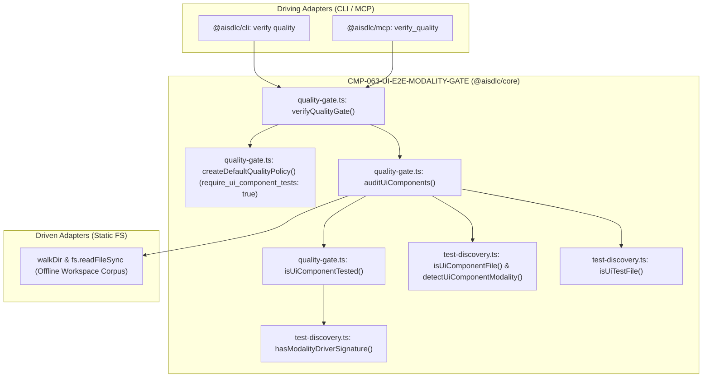
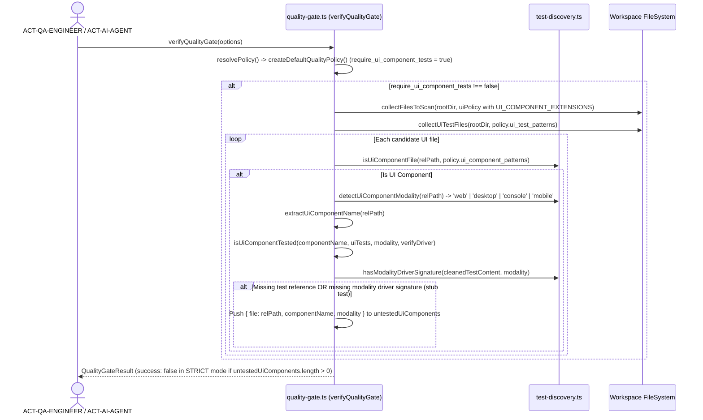

# CMP-063-UI-E2E-MODALITY-GATE: Deterministic Polyglot UI and E2E Modality Test Gate

## 1. Responsabilidad y Arquitectura Hexagonal (Ports & Adapters)
Subcomponente determinista dentro de `CMP-CORE` (`@aisdlc/core`, bajo `packages/core/src/verifiers/`) responsable de garantizar por defecto (`require_ui_component_tests: true` en `createDefaultQualityPolicy()`) que todo componente de interfaz de usuario o comando interactivo descubierto en las 4 modalidades canónicas (**Web**, **Desktop**, **Consola CLI/TUI** y **Mobile**) cuente con al menos un archivo de prueba UI/E2E real que referencie el componente y contenga la firma determinista del driver o arnés de automatización E2E correspondiente a su modalidad.

Siguiendo **Modular & Hexagonal Architecture (Ports & Adapters)** y **Simplicity First (YAGNI)**:
- **Driving Adapters (Adaptadores Primarios / Entrada)**:
  - `aisdlc verify quality` / `aisdlc verify all` (`@aisdlc/cli`) y herramienta MCP `verify_quality` (`@aisdlc/mcp`), que invocan `verifyQualityGate(options)`.
- **Application Core & Domain Ports (Núcleo de Dominio en `@aisdlc/core`)**:
  - **Motor de Políticas (`quality-gate.ts`)**: `createDefaultQualityPolicy()` inicializa `require_ui_component_tests: true` por defecto en memoria, permitiendo sobreescritura explícita mediante `quality-policy.yaml` (`test_enforcement.require_ui_component_tests: false`, `verify_ui_driver_signatures: false`) o `QualityGateOptions` (`requireUiComponentTests: false`, `verifyUiDriverSignatures: false`).
  - **Clasificador y Verificador de Modalidades UI/E2E (`test-discovery.ts`)**:
    - `UiModality = 'web' | 'desktop' | 'console' | 'mobile'`.
    - `DEFAULT_UI_COMPONENT_PATTERNS`, `DEFAULT_UI_TEST_PATTERNS` y `UI_COMPONENT_EXTENSIONS` cubriendo las 4 modalidades.
    - `detectUiComponentModality(filePath: string): UiModality | null`: infiere determinísticamente la modalidad del componente a partir de su ruta y extensión.
    - `hasModalityDriverSignature(content: string, modality: UiModality): boolean`: verifica sobre el corpus de prueba (con comentarios eliminados) la presencia de firmas reales del driver/arnés E2E de la modalidad (`Playwright`/`Cypress`/DOM para `web`, `FlaUI`/`WinAppDriver`/`Avalonia` para `desktop`, `spawn`/`execFile`/`Spectre.Console`/`CliRunner`/`pty` para `console`, `WidgetTester`/`XCUIApplication`/`Espresso`/`Compose`/`Appium`/`Maestro`/`Detox` para `mobile`).
  - **Auditor de Componentes UI (`quality-gate.ts`)**:
    - `extractUiComponentName(relPath)` normaliza sufijos compuestos (`.xaml.cs`, `.axaml.cs`, `.component.ts`, `.razor`, `.cshtml`, `.xaml`, `.axaml`, `.vue`, `.svelte`, `.tsx`, `.ts`, `.jsx`, `.js`, `.py`, `.cs`, `.java`, `.kt`, `.swift`, `.dart`).
    - `isUiComponentTested(componentName, uiTests, modality?, verifyDriverSignatures?)` y `auditUiComponents(rootDir, policy, options?)` verifican tanto la referencia al nombre del componente (fuera de comentarios) como la firma del driver E2E de su modalidad, reportando componentes sin prueba válida o con tests stub en `untestedUiComponents`.
- **Driven Adapters (Adaptadores Secundarios / Salida)**:
  - Lector determinista de sistema de archivos local (`walkDir`, `fs.readFileSync`) 100% offline y estático, sin ejecutar navegadores ni procesos externos durante la verificación del gate.

## 2. Diagrama de Componentes (Mermaid)

## 3. Diagrama de Secuencia en Tiempo de Ejecución (Mermaid)

## 4. Límites YAGNI y Restricciones de Calidad
- **Cero dependencias externas nuevas**: Implementado íntegramente con expresiones regulares deterministas y módulos nativos de Node.js (`fs`, `path`).
- **Umbrales AST (`quality-policy.yaml`)**: Todas las funciones nuevas o modificadas cumplen `Cyclomatic Complexity <= 10`, `Cognitive Complexity <= 15`, `Maintainability Index >= 50` y `Lines <= 40`.
- **Cero regresiones en proyectos sin componentes UI**: Si los directorios objetivo (`target_directories`) o archivos fuera de `exclude_patterns` no contienen componentes UI, `untestedUiComponents` retorna `[]`.

## Historial de Revisiones

| Versión | Fecha | Autor / Agente | Descripción del Cambio | Referencia de Cambio (Change/PR) |
| :--- | :--- | :--- | :--- | :--- |
| **1.0.0** | 2026-11-18 | agent-system-architect | Definición arquitectónica inicial del gate determinista de pruebas UI y E2E por modalidad (`web`, `desktop`, `console`, `mobile`) | CHG-063-UI-E2E-MODALITY-GATE |
