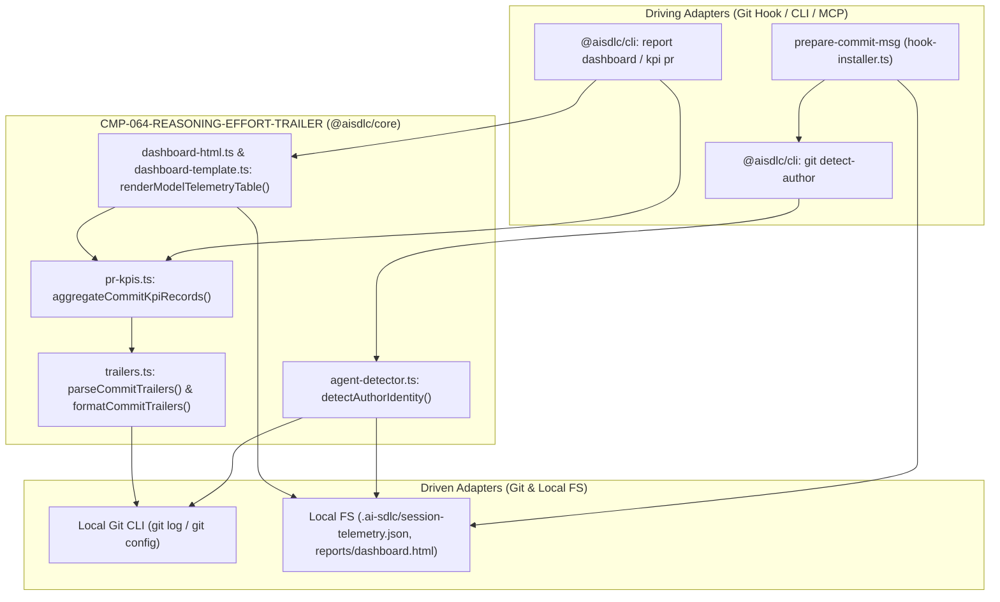
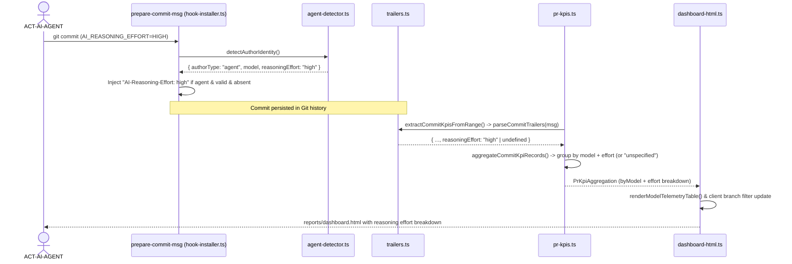

# CMP-064-REASONING-EFFORT-TRAILER: AI Reasoning Effort Git Trailer and Dashboard Telemetry Breakdown

## 1. Responsabilidad y Arquitectura Hexagonal (Ports & Adapters)
Subcomponente determinista dentro de `CMP-CORE` (`@aisdlc/core`) responsable de capturar, normalizar, inyectar, agregar y visualizar el parámetro de esfuerzo de razonamiento (`AI-Reasoning-Effort`: `low | medium | high | max`) de los commits generados por agentes IA de forma agnóstica al IDE, manteniendo compatibilidad retroactiva con commits históricos o humanos sin dicho trailer (`unspecified` / `—`) y sin alterar `schemas/`.

Siguiendo **Modular & Hexagonal Architecture (Ports & Adapters)** y **Simplicity First (YAGNI)**:
- **Driving Adapters (Adaptadores Primarios / Entrada)**:
  - Hook Git `prepare-commit-msg` (`packages/core/src/git/hook-installer.ts`) y comando CLI `aisdlc git detect-author` (`packages/cli/src/commands/git.ts`), que detectan la identidad del autor y el esfuerzo de razonamiento en tiempo de commit.
  - Generadores de reportes `aisdlc report dashboard` / `aisdlc kpi pr` (`@aisdlc/cli`) y herramientas MCP (`@aisdlc/mcp`).
- **Application Core & Domain Ports (Núcleo de Dominio en `@aisdlc/core`)**:
  - **Parser y Formateador de Trailers (`packages/core/src/git/trailers.ts`)**:
    - Define `ReasoningEffort = 'low' | 'medium' | 'high' | 'max'` y `CommitTrailers.reasoningEffort?: ReasoningEffort`.
    - `normalizeReasoningEffort(raw?: string): ReasoningEffort | undefined`: recorta espacios y normaliza a minúsculas; retorna el valor si pertenece a `{low, medium, high, max}` o `undefined` en caso contrario.
    - `parseCommitTrailers(rawMessage)` extrae `AI-Reasoning-Effort: <valor>` de forma insensible a mayúsculas/minúsculas.
    - `formatCommitTrailers(trailers)` emite `AI-Reasoning-Effort: <reasoningEffort>` solo cuando `trailers.reasoningEffort` es válido, omitiéndolo si es `undefined`.
  - **Detector Universal de Autoría (`packages/core/src/git/agent-detector.ts`)**:
    - Extiende `AuthorIdentity` con `reasoningEffort?: ReasoningEffort`.
    - `detectAuthorIdentity()` resuelve y normaliza `reasoningEffort` desde `AI_REASONING_EFFORT` (entorno), `ai.reasoningEffort` (Git config) o `reasoningEffort` en `.ai-sdlc/session-telemetry.json`.
  - **Agregador de KPIs (`packages/core/src/reporters/pr-kpis.ts`)**:
    - Extiende `PrKpiAggregation` / `AuthorKpiSummary` con el desglose por modelo y nivel de esfuerzo (`ModelEffortKpiRow` / `byModelEffort` / `byEffort`), agrupando commits sin trailer válido bajo `unspecified`.
  - **Renderizador de Dashboard (`packages/core/src/reporters/dashboard-html.ts` y `dashboard-template.ts`)**:
    - `renderModelTelemetryTable()` y el script cliente de filtrado por rama (`dashboard-template.ts`) renderizan el desglose por modelo y nivel de esfuerzo en `Telemetry Breakdown by Author and Model` y en los detalles KPI/commit de `reports/dashboard.html`, mostrando `unspecified` o `—` cuando no existe trailer.
- **Driven Adapters (Adaptadores Secundarios / Salida)**:
  - Git CLI local (`execFileSync('git', ...)`), sistema de archivos local (`.ai-sdlc/session-telemetry.json`, `.git/hooks/`) y generación estática offline de `reports/dashboard.html`.

## 2. Diagrama de Componentes (Mermaid)

## 3. Diagrama de Secuencia en Tiempo de Ejecución (Mermaid)

## 4. Límites YAGNI y Restricciones de Calidad
- **Cero dependencias externas nuevas**: Implementado íntegramente con TypeScript/Node.js nativo y Bash POSIX estándar en `PREPARE_COMMIT_MSG_SCRIPT`.
- **Inmutabilidad de `schemas/`**: Ningún esquema JSON/YAML bajo `schemas/` es modificado.
- **Umbrales AST (`quality-policy.yaml`)**: Todas las funciones nuevas o modificadas cumplen `Cyclomatic Complexity <= 10`, `Cognitive Complexity <= 15`, `Maintainability Index >= 50` y `Lines <= 40`.
- **Compatibilidad retroactiva**: Commits históricos o humanos sin `AI-Reasoning-Effort` retornan `reasoningEffort: undefined` y se muestran como `unspecified` o `—` en `reports/dashboard.html`.

## Historial de Revisiones

| Versión | Fecha | Autor / Agente | Descripción del Cambio | Referencia de Cambio (Change/PR) |
| :--- | :--- | :--- | :--- | :--- |
| **1.0.0** | 2026-11-19 | agent-system-architect | Definición arquitectónica inicial del soporte de `AI-Reasoning-Effort` en trailers Git, hooks, agregador KPI y Dashboard | CHG-064-REASONING-EFFORT-TRAILER |
