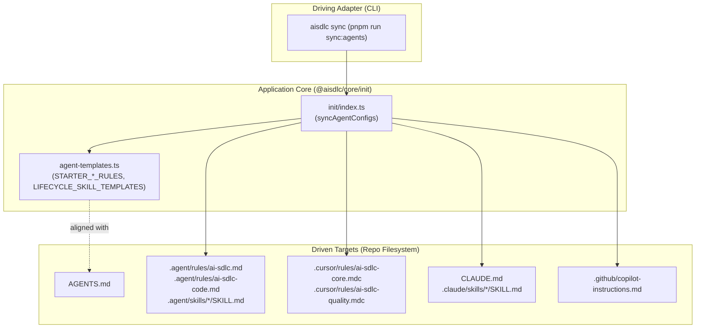

# CMP-066-CONTEXT-BUDGET-AND-RULES-CONSISTENCY: Cross-IDE Context Budget Rule and Rules/Skills Consistency Governance

## 1. Responsabilidad y Arquitectura Hexagonal (Ports & Adapters)
Subcomponente dentro de `CMP-CORE` (`@aisdlc/core`) responsable de definir, renderizar y sincronizar de forma consistente las directivas operativas cross-IDE (incluyendo la Regla de Presupuesto de Contexto, los 6 Mandamientos Inquebrantables de los Agentes y el Orden de Implementación de 5 pasos) y los enlaces relativos válidos entre skills (`.agent/skills/*/SKILL.md`, `.claude/skills/*/SKILL.md`) y definiciones de agentes (`.agent/agents/agent-*.md`, `.claude/agents/agent-*.md`).

Siguiendo **Modular & Hexagonal Architecture (Ports & Adapters)** y **Simplicity First (YAGNI)**:
- **Driving Adapters (Adaptadores Primarios / Entrada)**:
  - Comando CLI `aisdlc sync` (`pnpm run sync:agents`, `packages/cli/src/index.ts`), que invoca el generador de plantillas en `@aisdlc/core` para regenerar `.agent/`, `.cursor/`, `.claude/`, `.github/` y `CLAUDE.md`.
- **Application Core & Templates (`packages/core/src/init/agent-templates.ts`, `packages/core/src/init/index.ts`)**:
  - **Plantillas de Rulesets IDE (`STARTER_ANTIGRAVITY_RULES`, `STARTER_CURSOR_CORE_RULES`, `STARTER_CLAUDE_RULES`, `STARTER_COPILOT_RULES`)**: Incluyen la Regla de Presupuesto de Contexto (`get_task_context` / `aisdlc context pack`, `query_code_graph`, `search_specs` primero; `process/*.md` solo bajo demanda) y el encabezado reconciliado `"The 6 Unbreakable Commandments of Agents"` con los 6 ítems reales (incluyendo `#6 MANDATORY CLEAN CONTEXT WINDOW ISOLATION PER SPECIALIST AGENT`).
  - **Plantillas de Calidad/Código (`STARTER_ANTIGRAVITY_CODE_RULES`, `STARTER_CURSOR_QUALITY_RULES`) y Playbook de Skills (`LIFECYCLE_SKILL_TEMPLATES`)**: Estandarizan el **5-Step Implementation Order** en `.agent/rules/ai-sdlc-code.md`, `.cursor/rules/ai-sdlc-quality.mdc` y `.agent/skills/aisdlc-increment/SKILL.md`.
  - **Referencias Relativas de Skills (`LIFECYCLE_SKILL_TEMPLATES`)**: Reemplazan `../agent-*/SKILL.md` por `../../agents/agent-*.md` para `.agent/skills/*/SKILL.md` y `.claude/skills/*/SKILL.md`.
- **Driven Adapters (Adaptadores Secundarios / Salida)**:
  - Sistema de archivos local (`AGENTS.md`, `.agent/rules/ai-sdlc.md`, `.agent/rules/ai-sdlc-code.md`, `.agent/skills/*/SKILL.md`, `.cursor/rules/*.mdc`, `.claude/skills/*/SKILL.md`, `CLAUDE.md`, `.github/copilot-instructions.md`).

## 2. Diagrama de Componentes (Mermaid)

## 3. Historial de Revisiones

| Versión | Fecha | Autor / Agente | Descripción del Cambio | Referencia |
| :--- | :--- | :--- | :--- | :--- |
| **1.0.0** | 2026-11-25 | agent-system-architect | Definición inicial del componente para Regla de Presupuesto de Contexto y consistencia de reglas/skills | CHG-066 |
