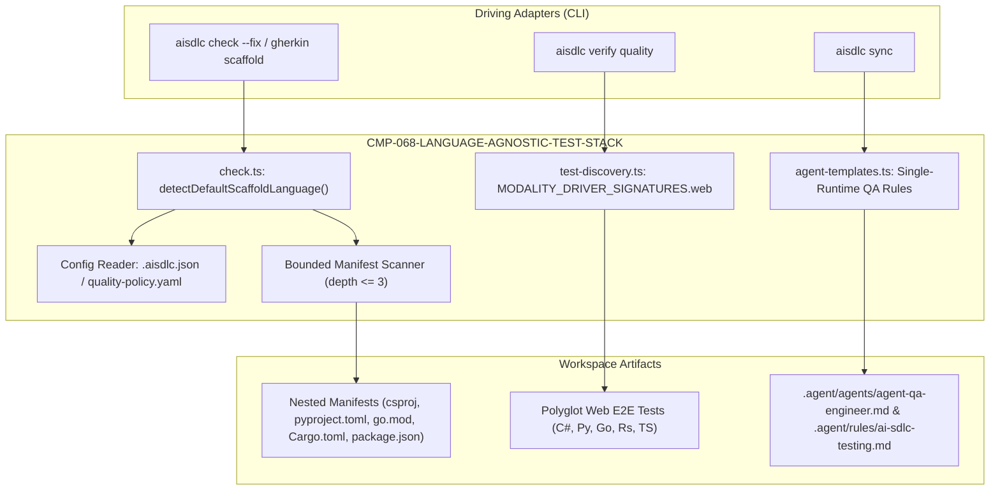
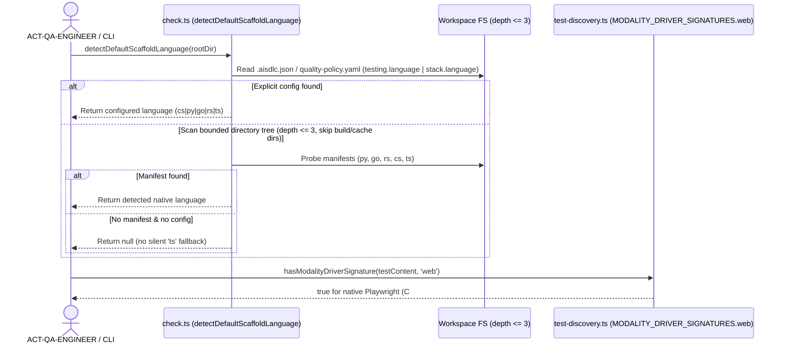

# CMP-068-LANGUAGE-AGNOSTIC-TEST-STACK: Language-Agnostic Test Stack Alignment

## 1. Responsabilidad y Arquitectura Hexagonal (Ports & Adapters)
Subcomponente determinista transversal entre `@aisdlc/cli` (`packages/cli/src/commands/check.ts`) y `@aisdlc/core` (`packages/core/src/verifiers/test-discovery.ts`, `packages/core/src/init/agent-templates.ts`) encargado de garantizar que AI-SDLC opere de forma estrictamente agnóstica al lenguaje (`ts`, `py`, `go`, `rs`, `cs`) sin sesgo hacia Node.js/TypeScript:

- **Driving Adapters (Adaptadores Primarios / Entrada)**:
  - `aisdlc check --fix`, `aisdlc gherkin scaffold`, `aisdlc verify quality`, y `aisdlc sync` (`@aisdlc/cli`).
- **Application Core & Domain Ports**:
  1. **Detector Acotado y Agnóstico de Stack (`detectDefaultScaffoldLanguage(rootDir)` en `packages/cli/src/commands/check.ts`)**:
     - Consulta primero configuración explícita de Fase 0 (`testing.language` o `stack.language` en `.aisdlc.json` o `quality-policy.yaml`).
     - Ejecuta un recorrido acotado (`maxDepth = 3`, omitiendo `node_modules`, `.git`, `bin`, `obj`, `dist`, `build`, `target`, `.venv`, `__pycache__`, `.pytest_cache`) detectando manifiestos nativos: Python (`pyproject.toml`, `requirements.txt`, `setup.py`), Go (`go.mod`), Rust (`Cargo.toml`), C#/.NET (`*.csproj`, `*.sln`, `*.slnx`), y JS/TS (`package.json`, `tsconfig.json`).
     - Retorna `GherkinScaffoldLanguage | null`: **sin fallback silencioso a `'ts'`** cuando no existe ningún manifiesto ni configuración explícita. Si retorna `null`, `autoScaffoldMissingSteps(rootDir)` omite el scaffolding automático y reporta diagnóstico accionable sin contaminar repositorios no-Node con archivos `.ts`.
  2. **Firmas Políglotas de Drivers Web E2E (`MODALITY_DRIVER_SIGNATURES.web` en `packages/core/src/verifiers/test-discovery.ts`)**:
     - Reconoce uniformemente bindings oficiales de Playwright y automatización Web E2E en C# (`Microsoft.Playwright`, `PageTest`, `IPage`, `GotoAsync`, `GetByRole`, `GetByText`, `GetByTestId`, `GetByLabel`, `ClickAsync`, `FillAsync`, `WaitForSelectorAsync`, `Expect(Page`, `Expect(Locator`), Python (`playwright.sync_api`, `playwright.async_api`, `sync_playwright`, `async_playwright`, `page.get_by_role`, `page.get_by_text`, `page.get_by_test_id`, `page.get_by_label`, `page.wait_for_selector`), Go (`playwright-go`, `pw.Chromium`, `page.Goto`, `page.Locator`, `page.GetByRole`, `page.GetByText`, `page.GetByTestId`, `page.GetByLabel`), y Rust (`playwright::Playwright`, `goto_builder`, `wait_for_selector`), manteniendo compatibilidad con JS/TS Playwright, Cypress, Testing Library, Angular `TestBed` y `bUnit`/`RenderComponent`.
     - Los tests stub sin firma válida de driver continúan siendo rechazados en `untestedUiComponents`.
  3. **Disciplina QA de Runtime Único (`.agent/agents/agent-qa-engineer.md`, `.agent/rules/ai-sdlc-testing.md`, `packages/core/src/init/agent-templates.ts`)**:
     - Prohíbe explícitamente a los agentes QA introducir un runtime o lenguaje de pruebas secundario (p. ej. `package.json`, `playwright.config.ts`, `@cucumber/cucumber`) fuera del stack acordado, salvo que un ADR explícito apruebe una arquitectura políglota.
     - Sincronizado hacia los espejos IDE mediante `aisdlc sync`.
- **Driven Adapters (Adaptadores Secundarios / Salida)**:
  - Sistema de archivos local (`fs.existsSync`, `fs.readdirSync`, `fs.readFileSync`) 100% offline y determinista.

## 2. Diagrama de Componentes (Mermaid)

## 3. Diagrama de Secuencia (Mermaid)

## 4. Límites YAGNI y Restricciones de Calidad
- **Cero dependencias externas nuevas**: Solo `fs`, `path`, `js-yaml` (ya existente en el workspace) y expresiones regulares deterministas.
- **Umbrales AST (`quality-policy.yaml`)**: Todas las funciones nuevas o modificadas mantienen `Cyclomatic Complexity <= 10`, `Cognitive Complexity <= 15`, `Maintainability Index >= 50` y `Lines <= 40`.
