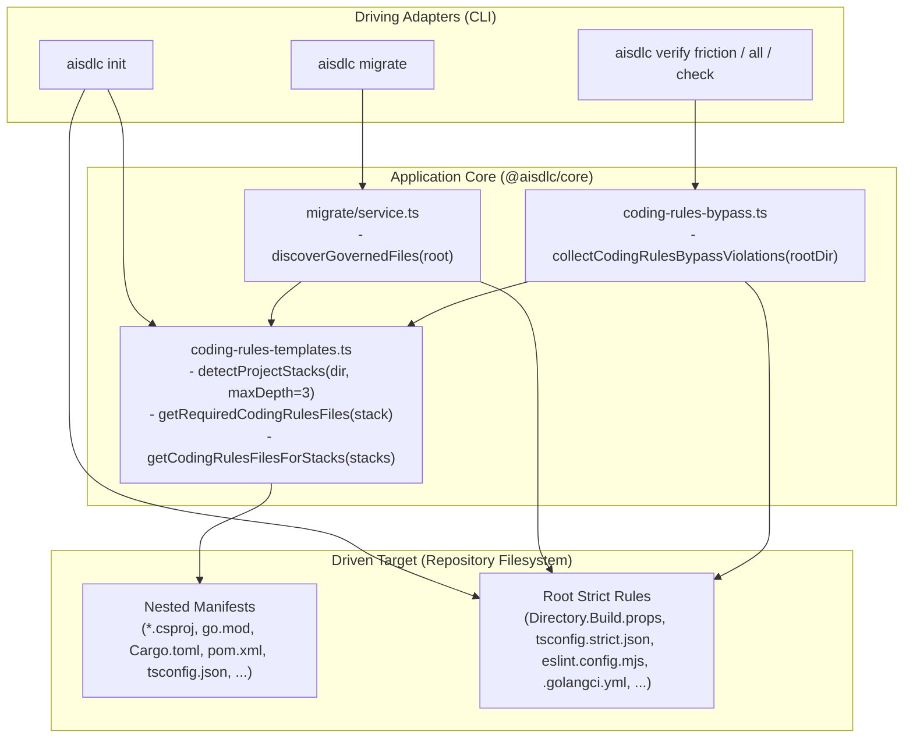

# CMP-069-LANGUAGE-AGNOSTIC-CODING-RULES: Language-Agnostic Recursive Coding Rules Detection and Verification

## 1. Responsabilidad y Arquitectura Hexagonal (Ports & Adapters)
Subcomponente dentro de `CMP-CORE` (`@aisdlc/core`) responsable de:
1. Detectar de forma recursiva y acotada (`maxDepth = 3`) los stacks tecnológicos presentes en un repositorio (incluyendo estructuras anidadas como `src/App/App.csproj`, `services/api/go.mod`, `crates/core/Cargo.toml`, `backend/pom.xml`, `frontend/tsconfig.json`), omitiendo enlaces simbólicos y directorios de artefactos/dependencias/plantillas.
2. Exponer de forma uniforme el catálogo `STACK_FILE_MAP` mediante `getRequiredCodingRulesFiles(stack)` y `getCodingRulesFilesForStacks(stacks)` para los 10 `CodingRuleStack` soportados (`dotnet`, `typescript`, `javascript`, `angular`, `java`, `kotlin`, `rust`, `go`, `c`, `cpp`), asegurando que tanto `aisdlc init` como `aisdlc migrate` desplieguen los archivos faltantes.
3. Verificar de forma agnóstica al lenguaje en `collectCodingRulesBypassViolations(rootDir)` que todo stack detectado por `detectProjectStacks(rootDir)` tenga sus archivos de reglas estrictas presentes en `rootDir` (emitiendo `[CODING-RULES-MISSING]` en caso contrario), además de mantener las comprobaciones de debilitamiento (`[CODING-RULES-BYPASS]`).

Siguiendo **Modular & Hexagonal Architecture (Ports & Adapters)** y **Simplicity First (YAGNI)**:
- **Driving Adapters (Adaptadores Primarios / Entrada)**:
  - Comandos CLI `aisdlc init`, `aisdlc migrate`, `aisdlc verify friction`, `aisdlc verify all` y `aisdlc check`.
- **Application Core (`packages/core/src/init/coding-rules-templates.ts`, `packages/core/src/verifiers/coding-rules-bypass.ts`, `packages/core/src/migrate/service.ts`)**:
  - `detectProjectStacks(targetDir, maxDepth = 3)` y `getRequiredCodingRulesFiles(stack)` en `coding-rules-templates.ts`.
  - `MigrationService.discoverGovernedFiles(root)` en `migrate/service.ts` para desplegar reglas estrictas faltantes de stacks detectados sin sobrescribir personalizaciones humanas.
  - `collectCodingRulesBypassViolations(rootDir)` en `coding-rules-bypass.ts` integrando detección de ausencia (`[CODING-RULES-MISSING]`) y detección de debilitamiento (`[CODING-RULES-BYPASS]`).
- **Driven Adapters (Adaptadores Secundarios / Salida)**:
  - Sistema de archivos local (`fs` síncrono sobre `rootDir` con exclusión de symlinks y directorios ignorados).

## 2. Diagrama de Componentes y Flujo (Mermaid)

## 3. Historial de Revisiones

| Versión | Fecha | Autor / Agente | Descripción del Cambio | Referencia |
| :--- | :--- | :--- | :--- | :--- |
| **1.0.0** | 2026-11-26 | agent-system-architect | Definición inicial del componente para detección recursiva y cumplimiento agnóstico al lenguaje de reglas de codificación | CHG-069-LANGUAGE-AGNOSTIC-CODING-RULES |
