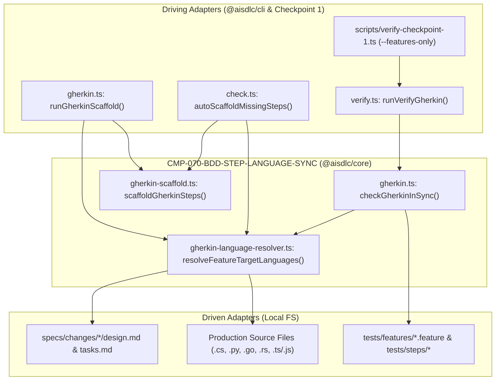
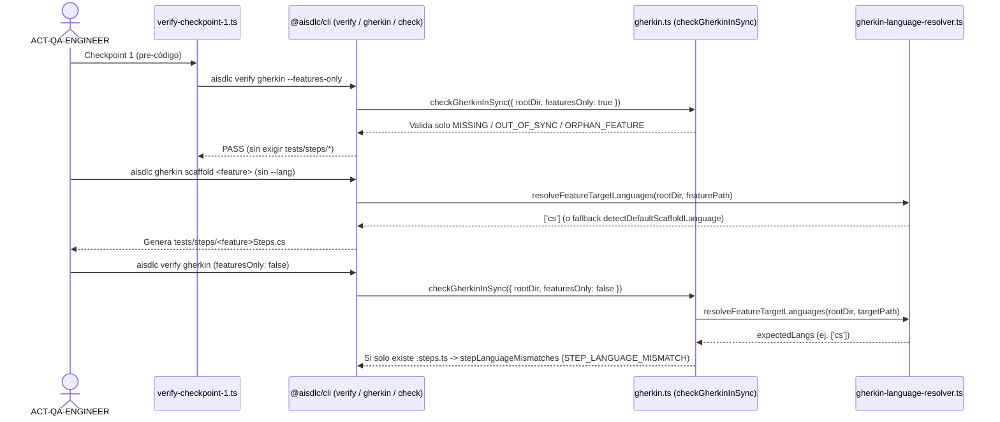

# CMP-070-BDD-STEP-LANGUAGE-SYNC: Declarative vs Executable BDD Separation and Per-Feature Step Language Resolver

## 1. Responsabilidad y Arquitectura Hexagonal (Ports & Adapters)
Subcomponente determinista dentro de `CMP-CORE` (`@aisdlc/core`) y su adaptador CLI (`@aisdlc/cli`) responsable de desacoplar la validación declarativa `Markdown <-> .feature` (Checkpoint 1, `--features-only`) de la validación ejecutable de definiciones de pasos (`tests/steps/*`), inferir deterministamente los lenguajes de implementación de producción asociados a cada archivo `.feature` (`cs`, `py`, `go`, `rs`, `ts`) y exigir paridad estricta de lenguaje (`STEP_LANGUAGE_MISMATCH`) durante la verificación completa sin alterar `schemas/`.

Siguiendo **Modular & Hexagonal Architecture (Ports & Adapters)** y **Simplicity First (YAGNI)**:
- **Driving Adapters (Adaptadores Primarios / Entrada)**:
  - `packages/cli/src/index.ts` & `packages/cli/src/commands/verify.ts`: exponen `--features-only` en `aisdlc verify gherkin` y emiten violaciones `STEP_LANGUAGE_MISMATCH` en salida JSON y consola.
  - `scripts/verify-checkpoint-1.ts`: invoca Gate 4 (`verify gherkin`) con `'--features-only'` en Checkpoint 1.
  - `packages/cli/src/commands/gherkin.ts`: hace opcional `--lang` en `aisdlc gherkin scaffold <feature-file>`, resolviendo automáticamente los lenguajes objetivo mediante `resolveFeatureTargetLanguages` con fallback a `detectDefaultScaffoldLanguage(rootDir)`.
  - `packages/cli/src/commands/check.ts`: actualiza `autoScaffoldMissingSteps(rootDir)` para inferir lenguajes por feature vía `resolveFeatureTargetLanguages(rootDir, fp)` antes de recurrir a `detectDefaultScaffoldLanguage(rootDir)`.
- **Application Core & Domain Ports (Núcleo de Dominio en `@aisdlc/core`)**:
  - **Resolver de Lenguajes por Feature (`packages/core/src/verifiers/gherkin-language-resolver.ts`)**:
    - Expone `resolveFeatureTargetLanguages(rootDir: string, featurePath: string): GherkinScaffoldLanguage[]` (re-exportado en `gherkin.ts` e `index.ts`).
    - Extrae `# ID Requerimiento:` y `@tags` del `.feature`, descubre cambios `CHG-*` / tareas `TSK-*` y símbolos declarados en `contracts` de `design.md`, escanea archivos fuente de producción citando esos IDs o definiendo esos símbolos y mapea extensiones (`.cs` -> `cs`, `.py` -> `py`, `.go` -> `go`, `.rs` -> `rs`, `.ts/.tsx/.js/.jsx/.mjs/.cjs` -> `ts`) en orden determinista.
  - **Verificador de Sincronización Gherkin (`packages/core/src/verifiers/gherkin.ts` + `packages/core/src/types/index.ts`)**:
    - Extiende `GherkinExtractionOptions` con `featuresOnly?: boolean` y `GherkinSyncCheckResult` con `stepLanguageMismatches?: GherkinStepLanguageMismatch[]`.
    - Cuando `featuresOnly: true`, omite la validación de `tests/steps/` y discrepancias de lenguaje.
    - Cuando `featuresOnly: false`, si `resolveFeatureTargetLanguages` devuelve `expectedLangs` no vacío, exige step files para cada `expectedLang` en `tests/steps/`; si faltan y existen step files de otros lenguajes, registra `stepLanguageMismatches` (`STEP_LANGUAGE_MISMATCH`) y marca `inSync = false`.
- **Driven Adapters (Adaptadores Secundarios / Salida)**:
  - Sistema de archivos local (`fs`) con recorrido determinista que excluye `tests/`, `node_modules/`, `.git/`, `bin/`, `obj/`, `dist/`, `build/`, `target/`, `.venv/`, `venv/`, `templates/`, `reports/` y enlaces simbólicos (symlinks).

## 2. Diagrama de Componentes (Mermaid)

## 3. Diagrama de Secuencia en Tiempo de Ejecución (Mermaid)

## 4. Límites YAGNI y Restricciones de Calidad
- **Cero dependencias externas nuevas**: Implementado íntegramente con TypeScript/Node.js estándar (`fs`, `path`).
- **Inmutabilidad de `schemas/`**: Ningún esquema JSON/YAML bajo `schemas/` es modificado.
- **Umbrales AST (`quality-policy.yaml`)**: Todas las funciones nuevas o modificadas cumplen `Cyclomatic Complexity <= 10`, `Cognitive Complexity <= 15`, `Maintainability Index >= 50` y `Lines <= 40`.
- **Seguridad FS**: Excluye symlinks y directorios de build/dependencias/reportes al escanear archivos fuente de producción.

## Historial de Revisiones

| Versión | Fecha | Autor / Agente | Descripción del Cambio | Referencia de Cambio (Change/PR) |
| :--- | :--- | :--- | :--- | :--- |
| **1.0.0** | 2026-11-28 | AI-SDLC Integration Engine | Integración de incremento de entrega chg-070-bdd-step-language-sync | chg-070-bdd-step-language-sync |
| **1.0.0** | 2026-11-26 | agent-system-architect | Definición arquitectónica inicial para separación BDD declarativo/ejecutable (`--features-only`), inferencia de lenguaje por feature (`resolveFeatureTargetLanguages`) y paridad `STEP_LANGUAGE_MISMATCH` | CHG-070-BDD-STEP-LANGUAGE-SYNC |
