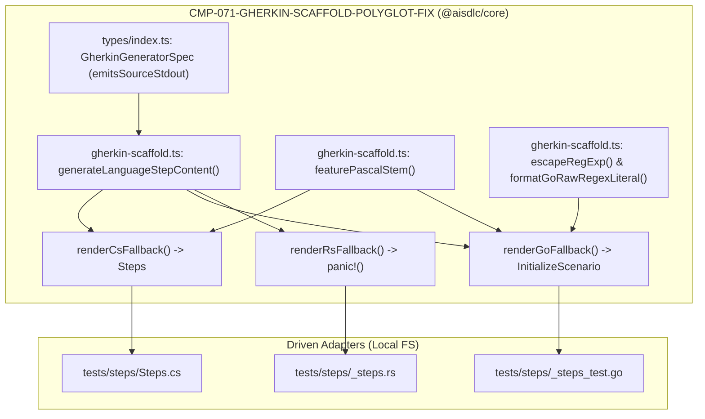

# CMP-071-GHERKIN-SCAFFOLD-POLYGLOT-FIX: Polyglot Gherkin Scaffold Deterministic Templates, Unique Symbols, Go Regex, and Rust Clippy Compliance

## 1. Responsabilidad y Arquitectura Hexagonal (Ports & Adapters)
Subcomponente determinista dentro de `CMP-CORE` (`@aisdlc/core`) responsable de garantizar que el motor de scaffolding políglota (`packages/core/src/verifiers/gherkin-scaffold.ts`) emita definiciones de pasos `RED` sintácticamente válidas, compilables y libres de colisiones de símbolos para C# (`cs`), Go (`go`) y Rust (`rs`) sin alterar `schemas/` ni añadir dependencias externas.

Siguiendo **Modular & Hexagonal Architecture (Ports & Adapters)** y **Simplicity First (YAGNI)**:
- **Application Core & Domain Contracts (`@aisdlc/core`)**:
  - `packages/core/src/types/index.ts`: extiende `GherkinGeneratorSpec` con la propiedad opcional `emitsSourceStdout?: boolean` (por defecto `true` cuando se omite; `false` para comandos de compilación/test-runner como `cs` `dotnet build` y `rs` `cargo test --test cucumber` que no emiten código fuente de pasos por `stdout`).
  - `packages/core/src/verifiers/gherkin-scaffold.ts`:
    - `GHERKIN_GENERATOR_SPECS` y `generateLanguageStepContent`: cuando `spec.emitsSourceStdout === false` (o `!binaryReady`), descarta el `stdout` del compilador/runner y retorna la plantilla determinista tipada `RED`.
    - `featurePascalStem(featurePath: string): string`: convierte el stem del archivo `.feature` a identificador PascalCase seguro (prefijando `_` si comienza por dígito o `'Generated'` si queda vacío).
    - `renderCsFallback`: parametriza la clase de Reqnroll como `public class <FeaturePascalStem>Steps` para evitar `CS0101` en proyectos multi-feature.
    - `renderGoFallback`: parametriza la función godog como `func Initialize<FeaturePascalStem>Scenario(ctx *godog.ScenarioContext)` para evitar redeclaraciones en paquetes Go multi-feature, y utiliza `escapeRegExp(st.text)` + `formatGoRawRegexLiteral(pattern)` para escapar metacaracteres regex y manejar backticks (`` ` ``) de forma segura sin inyectar `\"`.
    - `renderRsFallback`: sustituye `todo!("RED: Step not implemented: ...")` por `panic!("RED: Step not implemented: ...")` para cumplir con `-D clippy::todo` y `-D clippy::assertions_on_constants` de `RUST_CARGO_CONFIG_TOML` (CHG-069).
- **Driven Adapters (Local FS & Test Suites)**:
  - `packages/core/tests/gherkin-scaffold.spec.ts` y pruebas BDD bajo `tests/steps/`: verifican generación multi-feature sin colisiones, escape regex/backtick en Go, rechazo de `stdout` en `cs`/`rs` y ausencia de `todo!()` en Rust.

## 2. Diagrama de Componentes (Mermaid)

## 3. Límites YAGNI y Restricciones de Calidad
- **Cero dependencias externas nuevas**: Implementado íntegramente con TypeScript/Node.js estándar.
- **Inmutabilidad de `schemas/`**: Ningún esquema bajo `schemas/` es modificado.
- **Umbrales AST (`quality-policy.yaml`)**: Todas las funciones nuevas o modificadas cumplen `Cyclomatic Complexity <= 10`, `Cognitive Complexity <= 15`, `Maintainability Index >= 50` y `Lines <= 40`.

## Historial de Revisiones

| Versión | Fecha | Autor / Agente | Descripción del Cambio | Referencia de Cambio (Change/PR) |
| :--- | :--- | :--- | :--- | :--- |
| **1.0.0** | 2026-11-26 | agent-system-architect | Definición arquitectónica inicial para corrección determinista de `stdout` en `cs`/`rs`, unicidad de símbolos PascalCase en C#/Go, escape regex/backtick en Go y `panic!()` en Rust | CHG-071-GHERKIN-SCAFFOLD-POLYGLOT-FIX |
