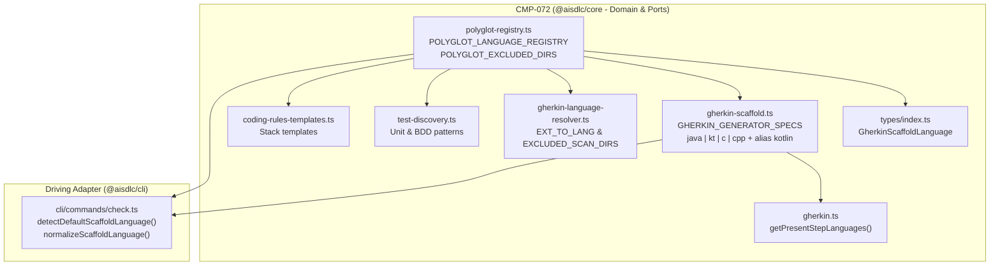

# CMP-072-POLYGLOT-REGISTRY-BDD-JVM-CPP: Unified Polyglot Language Registry and BDD Support for Java, Kotlin, C, and C++

## 1. Responsabilidad y Arquitectura Hexagonal (Ports & Adapters)
Subcomponente determinista dentro de `CMP-CORE` (`@aisdlc/core`) y su adaptador de conducción en `@aisdlc/cli` (`packages/cli/src/commands/check.ts`) responsable de centralizar todos los metadatos de lenguajes soportados y directorios excluidos en una única fuente de verdad (`POLYGLOT_LANGUAGE_REGISTRY` y `POLYGLOT_EXCLUDED_DIRS`), extender el soporte BDD de scaffolding y verificación a `java`, `kt` (alias `kotlin`), `c` y `cpp`, y garantizar detección determinista de stack sin eclipsamiento por archivos auxiliares en raíz.

Siguiendo **Modular & Hexagonal Architecture (Ports & Adapters)** y **Simplicity First (YAGNI)**:
- **Application Core & Domain Contracts (`@aisdlc/core`)**:
  - `packages/core/src/verifiers/polyglot-registry.ts` (reexportado desde `packages/core/src/index.ts`):
    - `POLYGLOT_LANGUAGE_REGISTRY`: registro único tipado por lenguaje (`ts`, `py`, `go`, `rs`, `cs`, `java`, `kt`, `c`, `cpp`) que centraliza: identificador canónico, alias (`kotlin` → `kt`), extensiones de código fuente, manifiestos de proyecto (`pom.xml`, `build.gradle`, `build.gradle.kts`, `CMakeLists.txt`, `Cargo.toml`, `go.mod`, `.csproj`/`.sln`/`.slnx`, `pyproject.toml`/`requirements.txt`/`setup.py`, `package.json`/`tsconfig.json`), nivel de precedencia de manifiesto (primario compilado/tipado vs auxiliar), stacks de reglas de codificación (`coding-rules-templates.ts`) y metadatos BDD.
    - `POLYGLOT_EXCLUDED_DIRS`: conjunto unificado de directorios excluidos (`node_modules`, `.git`, `bin`, `obj`, `dist`, `build`, `target`, `.venv`, `venv`, `__pycache__`, `.pytest_cache`, `reports`, `templates`, `examples`, `coverage`).
  - `packages/core/src/types/index.ts`: extiende `GherkinScaffoldLanguage` a `'ts' | 'py' | 'go' | 'rs' | 'cs' | 'java' | 'kt' | 'c' | 'cpp'`.
  - `packages/core/src/verifiers/gherkin-scaffold.ts`:
    - Extiende `GHERKIN_GENERATOR_SPECS` para `java` (Cucumber-JVM `*Steps.java`, `io.cucumber:cucumber-java`, `MIT`), `kt` (Cucumber-JVM/Kotlin `*Steps.kt`, `MIT`), `c` (`*_steps.c`) y `cpp` (Catch2 BDD `*_steps.cpp`, `BSL-1.0`), todos con `emitsSourceStdout: false` para garantizar emisión determinista de plantillas `RED` con símbolos únicos por `.feature`.
    - Normaliza el alias `'kotlin'` a `'kt'` en `normalizeScaffoldLanguages` (y `normalizeScaffoldLanguage` compartido).
  - `packages/core/src/verifiers/gherkin-language-resolver.ts`: deriva `EXT_TO_LANG` y `EXCLUDED_SCAN_DIRS` desde `POLYGLOT_LANGUAGE_REGISTRY` y `POLYGLOT_EXCLUDED_DIRS` (soportando `.java`, `.kt`, `.kts`, `.c`, `.h`, `.cpp`, `.cc`, `.cxx`, `.hpp`).
  - `packages/core/src/verifiers/gherkin.ts`: `getPresentStepLanguages` inspecciona todos los lenguajes en `GHERKIN_GENERATOR_SPECS` incluyendo `java`, `kt`, `c`, `cpp`.
  - `packages/core/src/verifiers/test-discovery.ts`: consume `POLYGLOT_EXCLUDED_DIRS` y patrones de pruebas unitarias políglotas incluyendo C/C++ y JVM.
  - `packages/core/src/init/coding-rules-templates.ts`: consume `POLYGLOT_LANGUAGE_REGISTRY` para mantener paridad de stacks sin duplicación.
- **Driving Adapter (CLI)**:
  - `packages/cli/src/commands/check.ts`: `normalizeScaffoldLanguage` y `detectDefaultScaffoldLanguage` consumen `POLYGLOT_LANGUAGE_REGISTRY` y `POLYGLOT_EXCLUDED_DIRS` desde `@aisdlc/core`, reconocen `pom.xml`, `build.gradle`, `build.gradle.kts` y `CMakeLists.txt`, y priorizan manifiestos primarios de proyecto (incluidos los ubicados en `src/` como `src/App/App.csproj`) frente a archivos auxiliares en la raíz (como `requirements.txt`).

## 2. Diagrama de Componentes (Mermaid)

## 3. Conformidad de Licencias y Restricciones de Calidad
- **Licencias BDD (`license-policy.yaml` y `packages/core/src/verifiers/licenses.ts`)**:
  - `io.cucumber:cucumber-java` (`MIT`) — permitida explícitamente en `permissive_free`.
  - `Catch2` (`BSL-1.0`, Boost Software License 1.0) — licencia permisiva libre, distinta de `BSL-1.1` (Business Source License 1.1 en `commercial_acquisition_required`). Como parte de este incremento, `BSL-1.0` se añade a `permissive_free.spdx_identifiers` en `license-policy.yaml` y a `DEFAULT_PERMITTED` en `packages/core/src/verifiers/licenses.ts`.
- **Sin cambios de esquema**: Ningún archivo bajo `schemas/` es modificado.
- **Umbrales AST (`quality-policy.yaml`)**: Todas las funciones nuevas o modificadas mantienen `Cyclomatic Complexity <= 10`, `Cognitive Complexity <= 15`, `Maintainability Index >= 50` y `Lines <= 40`.

## Historial de Revisiones

| Versión | Fecha | Autor / Agente | Descripción del Cambio | Referencia de Cambio (Change/PR) |
| :--- | :--- | :--- | :--- | :--- |
| **1.0.0** | 2026-11-26 | agent-system-architect | Definición arquitectónica inicial para `POLYGLOT_LANGUAGE_REGISTRY`, `POLYGLOT_EXCLUDED_DIRS`, soporte BDD `java`/`kt`/`c`/`cpp`, alias `kotlin` y precedencia de manifiestos en `detectDefaultScaffoldLanguage` | CHG-072-POLYGLOT-REGISTRY-BDD-JVM-CPP |
