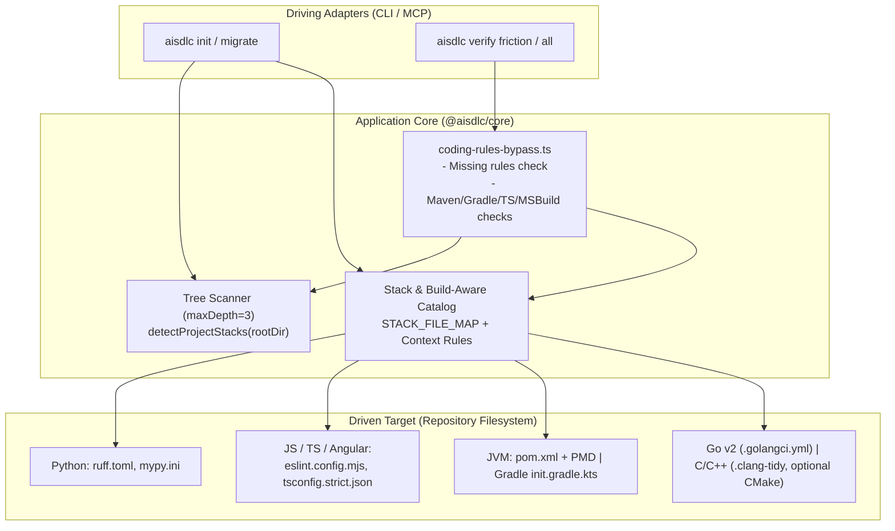

# CMP-073-EXECUTABLE-STRICT-CODING-RULES: Executable and Stack-Decoupled Strict Coding Rules Engine

## 1. Responsabilidad y Arquitectura Hexagonal (Ports & Adapters)
Subcomponente dentro de `CMP-CORE` (`@aisdlc/core`) que evoluciona el catálogo de plantillas (`packages/core/src/init/coding-rules-templates.ts`) y el verificador anti-bypass (`packages/core/src/verifiers/coding-rules-bypass.ts`) siguiendo **Modular & Hexagonal Architecture (Ports & Adapters)** y **Simplicity First (YAGNI)**:

1. **Soporte completo del stack Python (`python`, alias `py`)**:
   - Incorporar `'python'` en `VALID_CODING_RULE_STACKS`, `STACK_FILE_MAP`, `PROTECTED_CODING_RULES_FILES` (`ruff.toml`, `mypy.ini`), `getReferenceCodingRulesTemplates()` y alias `'py'` en `STACK_ALIASES`.
   - Detectar proyectos Python en `detectProjectStacks()` mediante `pyproject.toml`, `requirements.txt`, `setup.py` o archivos `*.py`.
   - Generar `ruff.toml` y `mypy.ini` autónomos con tipado estricto (`strict = true`, prohibición de `Any` explícito/implícito y sin exclusión de pruebas).
2. **Desacoplamiento estricto de `javascript`, `typescript` y `angular` + conexión del monorepo `AI-SDLC`**:
   - `javascript`: genera únicamente una configuración plana nativa de ESLint 9 (`eslint.config.mjs` con `@eslint/js` / reglas core) sin importar `typescript-eslint` y sin desplegar ni exigir `tsconfig.strict.json`.
   - `typescript`: genera `tsconfig.strict.json` sin `angularCompilerOptions` junto con `eslint.config.mjs`.
   - `angular`: genera `tsconfig.strict.json` con `angularCompilerOptions` estrictas junto con `eslint.config.mjs`.
   - Monorepo `AI-SDLC`: declara/instala `typescript-eslint` (licencia MIT) en `package.json` y conecta `tsconfig.base.json`/`tsconfig.json` extendiendo `tsconfig.strict.json` para que `eslint` y `tsc` ejecuten y pasen sin errores.
3. **Diferenciación JVM Maven vs Gradle y esquema `golangci-lint` v2**:
   - Distinguir proyectos JVM con Maven (`pom.xml` sin `build.gradle`/`build.gradle.kts`) de proyectos Gradle: para Maven, `getRequiredCodingRulesFilesForProject(rootDir, stack)` / `collectMissingCodingRuleViolations(rootDir)` exige `config/pmd/aisdlc-ruleset.xml` y valida en `coding-rules-bypass.ts` la configuración estricta de compilador Maven (`-Werror`, `-Xlint:all`) y PMD en `pom.xml`, sin exigir `gradle/init.d/aisdlc-strict.init.gradle.kts`.
   - Actualizar `GO_GOLANGCI_YML` al esquema de `golangci-lint` v2 (`version: "2"`).
4. **Detección a nivel de árbol completo `c` vs `cpp` y requisito condicional de CMake**:
   - `detectProjectStacks(targetDir, maxDepth = 3)` recopila los nombres/rutas de archivos a nivel de todo el árbol escaneado antes de resolver `c` vs `cpp`, evitando que un directorio padre con `CMakeLists.txt` y fuentes `src/*.c` (sin `.cpp`/`.cc`/`.cxx`/`.hpp`) sea clasificado erróneamente como `cpp`.
   - `cmake/AisdlcStrictCompiler.cmake` solo se exige y verifica cuando existe al menos un `CMakeLists.txt` en el árbol del proyecto.

### Capas Hexagonales
- **Driving Adapters (Adaptadores Primarios / Entrada)**:
  - CLI (`aisdlc init`, `aisdlc migrate`, `aisdlc verify friction`, `aisdlc verify all`, `aisdlc check`) y herramientas MCP (`verify_friction`).
- **Application Core (`packages/core/src/init/coding-rules-templates.ts`, `packages/core/src/verifiers/coding-rules-bypass.ts`)**:
  - Puertos puros de detección de árbol, resolución de plantillas por stack/gestor de build y validación de integridad sin efectos secundarios de red.
- **Driven Adapters (Adaptadores Secundarios / Salida)**:
  - Sistema de archivos local (`fs` síncrono sobre `rootDir`) y herramientas nativas de build/linting (`tsc`, `eslint`, `ruff`, `mypy`, `golangci-lint`, `mvn`/PMD, `clang-tidy`).

## 2. Diagrama de Componentes y Flujo (Mermaid)

## 3. Historial de Revisiones

| Versión | Fecha | Autor / Agente | Descripción del Cambio | Referencia |
| :--- | :--- | :--- | :--- | :--- |
| **1.0.0** | 2026-11-26 | agent-system-architect | Definición del componente para reglas estrictas ejecutables y desacopladas por stack (Issue #230) | CHG-073-EXECUTABLE-STRICT-CODING-RULES |
