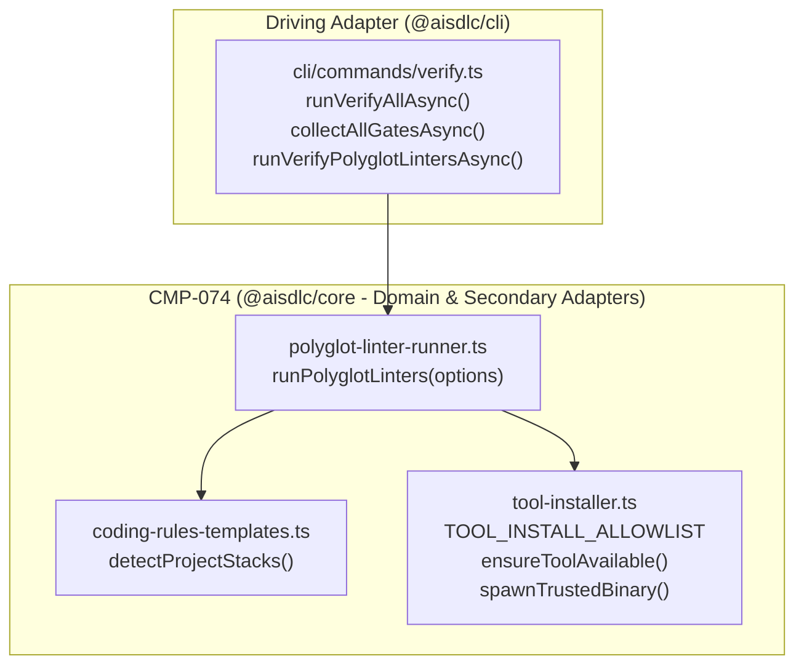

# CMP-074-POLYGLOT-LINTER-VERIFY-ALL: Polyglot Native Linter and Compiler Runner for `aisdlc verify all`

## 1. Responsabilidad y Arquitectura Hexagonal (Ports & Adapters)
Subcomponente determinista dentro de `CMP-CORE` (`@aisdlc/core`) y su adaptador de conducción en `@aisdlc/cli` (`packages/cli/src/commands/verify.ts`) responsable de detectar automáticamente los stacks tecnológicos presentes en el repositorio (`typescript`, `javascript`, `angular`, `python`, `dotnet`, `java`, `kotlin`, `rust`, `go`, `c`, `cpp`), resolver de forma segura sus linters/compiladores nativos mediante `tool-installer.ts` (CWE-426), y ejecutarlos sin shell (`shell: false`) durante `aisdlc verify all`.

Siguiendo **Modular & Hexagonal Architecture (Ports & Adapters)** y **Simplicity First (YAGNI)**:
- **Core Domain & Secondary Adapter (`@aisdlc/core`)**:
  - `packages/core/src/verifiers/tool-installer.ts`:
    - Extiende `InstallableTool` y `TOOL_INSTALL_ALLOWLIST` (congelado profundamente) con `tsc`, `mypy`, `golangci-lint`, `clippy`, `pmd`, `detekt`, `mvn`, `gradle` y `clang-tidy`, reutilizando los existentes `eslint`, `ruff` y `dotnet`.
    - Mantiene resolución segura de binarios en `PATH` (CWE-426, omitiendo `.` y `rootDir`), `spawnTrustedBinary` (`shell: false`) y `redactSensitiveDiagnostics`.
  - `packages/core/src/verifiers/polyglot-linter-runner.ts` (reexportado desde `packages/core/src/index.ts`):
    - `runPolyglotLinters(options)`: detecta stacks soportados (`detectProjectStacks` + detección Python), mapea cada stack a sus comandos nativos concretos, verifica disponibilidad mediante `ensureToolAvailable` (prompt interactivo local; omisión con warning no bloqueante en CI / non-TTY o rechazo del usuario), y ejecuta las herramientas instaladas de forma segura con diagnóstico redactado.
    - Para `c`/`cpp`, omite `clang-tidy` con un warning si `compile_commands.json` no está presente en el repositorio.
- **Driving Adapter (`@aisdlc/cli`)**:
  - `packages/cli/src/commands/verify.ts`:
    - `runVerifyPolyglotLintersAsync` integrado en `collectAllGatesAsync`, `runVerifyAllAsync` y `VERIFY_ALL_GATES_LIST` (y opciones del subcomando `verify`), respetando `options.skipExternalLinters` y guardas contra recursión infinita cuando se ejecuta dentro de suites unitarias (`VITEST`) salvo prueba explícita.

## 2. Diagrama de Componentes (Mermaid)

## 3. Restricciones de Seguridad, Licencias y Calidad
- **Seguridad (CWE-426 & CWE-78)**: Toda resolución de binarios pasa por `resolveTrustedBinaryPath` y toda ejecución por `spawnTrustedBinary` (`shell: false`), con salida redactada mediante `redactSensitiveDiagnostics`.
- **Sin dependencias externas nuevas**: No se añaden paquetes npm nuevos (`license-policy.yaml` sin impacto).
- **Umbrales AST (`quality-policy.yaml`)**: Todas las funciones nuevas o modificadas mantienen `Cyclomatic Complexity <= 10`, `Cognitive Complexity <= 15`, `Maintainability Index >= 50` y `Lines <= 40`.

## Historial de Revisiones

| Versión | Fecha | Autor / Agente | Descripción del Cambio | Referencia de Cambio (Change/PR) |
| :--- | :--- | :--- | :--- | :--- |
| **1.0.0** | 2026-11-27 | AI-SDLC Integration Engine | Integración de incremento de entrega chg-074-polyglot-linter-verify-all | chg-074-polyglot-linter-verify-all |
| **1.0.0** | 2026-11-26 | agent-system-architect | Definición arquitectónica inicial para ejecución de linters y compiladores políglotas en `aisdlc verify all` | CHG-074-POLYGLOT-LINTER-VERIFY-ALL |
