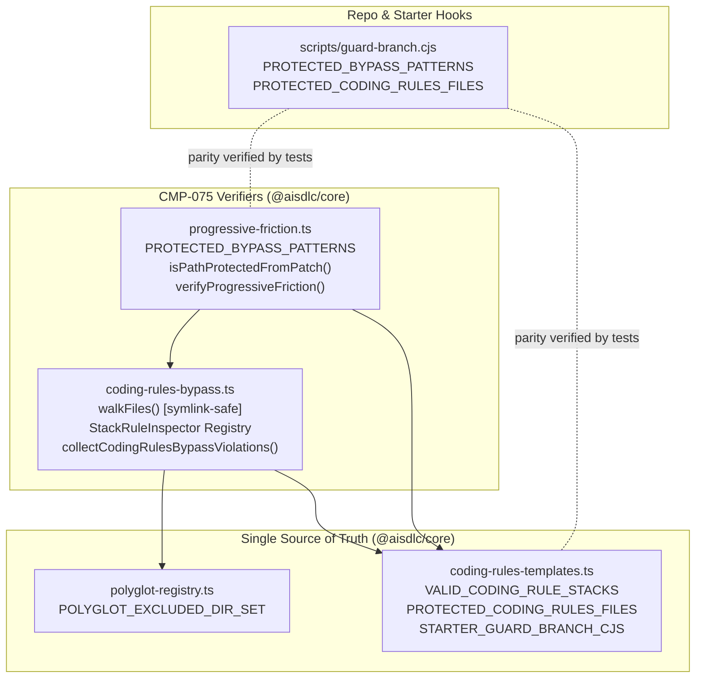

# CMP-075-POLYGLOT-CODING-RULES-ANTIBYPASS: Polyglot Coding Rules Anti-Bypass Scanner and Protected Friction Path Alignment

> **Upstream Citation**: `FR-075-POLYGLOT-CODING-RULES-ANTIBYPASS-001` (`specs/product/FR-075-POLYGLOT-CODING-RULES-ANTIBYPASS-001.md`, Unix LF SHA-256: `a795ccea8a45db8e2a40b6e23a9f405e149b93e2fe08c31e58f4478de2294dff`)

## 1. Responsabilidad y Arquitectura Hexagonal (Ports & Adapters)
Subcomponente determinista dentro de `CMP-CORE` (`@aisdlc/core`) responsable de:
1. Detectar debilitamientos o bypasses de reglas estrictas de compilación y linting (`[CODING-RULES-BYPASS]`) en todos los stacks declarados en `VALID_CODING_RULE_STACKS` (`dotnet`, `typescript`, `javascript`, `angular`, `python`, `java`, `kotlin`, `rust`, `go`, `c`, `cpp`).
2. Recorrer el árbol del repositorio de forma segura evitando bucles o lecturas fuera de raíz mediante omisión explícita de enlaces simbólicos (`entry.isSymbolicLink()`) y reutilizando `POLYGLOT_EXCLUDED_DIR_SET` como única fuente de verdad para directorios excluidos.
3. Alinear los patrones de rutas protegidas en `aisdlc verify friction` (`PROTECTED_BYPASS_PATTERNS` + `PROTECTED_CODING_RULES_FILES`) con `scripts/guard-branch.cjs` y `STARTER_GUARD_BRANCH_CJS` para bloquear modificaciones con perfil `patch` (`[ANTI-PATCH-BYPASS]`).

Siguiendo **Modular & Hexagonal Architecture (Ports & Adapters)** y **Simplicity First (YAGNI)**:
- **Core Domain & Secondary Verifier (`packages/core/src/verifiers/coding-rules-bypass.ts`)**:
  - `walkFiles(dir, rootDir, out)`: omite `entry.isSymbolicLink()` antes de descender o recolectar archivos, y filtra directorios contra `POLYGLOT_EXCLUDED_DIR_SET` importado desde `./polyglot-registry.js` (eliminando el conjunto local divergente `IGNORED_DIRS`).
  - **Verificación de Symlinks en Reglas Requeridas (`collectCodingRulesBypassViolations`)**: verifica explícitamente `fs.lstatSync` sobre cada ruta de `PROTECTED_CODING_RULES_FILES` y emite `[CODING-RULES-BYPASS]` si alguna es un enlace simbólico (`isSymbolicLink()`).
  - **Registro Uniforme de Inspectores por Stack (`StackRuleInspector[]`)**: en lugar de cadenas `if/else` crecientes y banderas sueltas, cada stack o familia de reglas se declara mediante un descriptor uniforme (`isActive(rootDir)`, `matchesFile(rel)`, `inspect(rel, content, rootDir)`) que emite diagnósticos deterministas `[CODING-RULES-BYPASS]`:
    - **`.NET` (`dotnet`)**: activo con `Directory.Build.props`; inspecciona `\.(csproj|props|targets)$` (`MSBUILD_WEAKENING` y `Directory.Build.props` anidado sin `GetPathOfFileAbove`).
    - **`TypeScript / Angular` (`typescript`, `angular`)**: activo con `tsconfig.strict.json`; inspecciona `tsconfig*.json` (excepto `tsconfig.strict.json`) eliminando comentarios JSONC (`//`, `/* ... */`) y resolviendo la cadena `extends` (string o array `extends`, rutas relativas con protección contra ciclos) hasta `tsconfig.strict.json` (de modo que monorepos como `packages/core/tsconfig.json -> ../../tsconfig.base.json -> ./tsconfig.strict.json` pasan sin falsos positivos), además de detectar `TSCONFIG_WEAKENING` (`"strict": false`, `"noImplicitAny": false`, `"strictNullChecks": false`).
    - **`JavaScript / ESLint` (`javascript`, `typescript`, `angular`)**: activo con `eslint.config.mjs`; inspecciona `eslint.config.*`, `.eslintrc*` y `.eslintignore` para detectar configuraciones vaciadas (`export default []`, `export default [{}]`, `export default tseslint.config()`), `ignores: ["**/*"]` / `["**"]`, `.eslintignore` con `*`, o `"off"` / `0` en reglas críticas.
    - **`Python` (`python`)**: activo con `mypy.ini`, `ruff.toml` o `.ruff.toml`; inspecciona `pyproject.toml`, `mypy.ini`, `ruff.toml` y `.ruff.toml` (`PYTHON_WEAKENING`, `ignore = ["ALL"]`, `select = []`, `ignore_errors = true`).
    - **`Java` (`java`)**: activo con `config/pmd/aisdlc-ruleset.xml`; inspecciona `pom.xml` (`MAVEN_WEAKENING`, `<skip>true</skip>`, `<maven.pmd.skip>true</maven.pmd.skip>`), `build.gradle(.kts)` (`ignoreFailures = true`) y `config/pmd/aisdlc-ruleset.xml` (sin `<rule` o con `<exclude-pattern>.*</exclude-pattern>`).
    - **`Kotlin` (`kotlin`)**: activo con `config/detekt/detekt.yml` o `gradle/init.d/aisdlc-strict.init.gradle.kts`; inspecciona `detekt.yml` (`maxIssues: -1` o `> 0`, `active: false`) y `build.gradle(.kts)` (`allWarningsAsErrors = false`, `allWarningsAsErrors.set(false)`, `ignoreFailures = true`, `-Werror` deshabilitado).
    - **`Rust` (`rust`)**: activo con `.cargo/config.toml`, `.cargo/config` o `.clippy.toml`; inspecciona `Cargo.toml` (`[lints.rust]` y `[workspace.lints.rust]` con `warnings = "allow"`, `[lints.clippy]` y `[workspace.lints.clippy]` permisivos), `.cargo/config.toml` y `.cargo/config` (`rustflags` / `[target.*]` sobrescritos sin flags estrictos o con `--cap-lints allow`), y archivos `.rs` con `#![allow(warnings)]` o `#![allow(clippy::all)]` (tolerante a espacios en blanco).
    - **`Go` (`go`)**: activo con `.golangci.yml`, `.golangci.yaml` o `.golangci.toml`; inspecciona `.golangci.yml`, `.golangci.yaml` y `.golangci.toml` buscando `disable: all`, `disable-all: true`, `default: none` sin `enable`, o ausencia de linters obligatorios.
    - **`C / C++` (`c`, `cpp`)**: activo con `.clang-tidy` o `cmake/AisdlcStrictCompiler.cmake`; inspecciona `.clang-tidy` (`WarningsAsErrors: ''` / `""` o `Checks: '-*'`) y exige `include(...cmake/AisdlcStrictCompiler.cmake)` únicamente en el `CMakeLists.txt` raíz o en `CMakeLists.txt` que declaren `project(...)`, evitando falsos positivos en subdirectorios `add_subdirectory` (p. ej. `src/CMakeLists.txt`).
- **Friction Guardrail & Protected Path Registry (`packages/core/src/verifiers/progressive-friction.ts` & `packages/core/src/init/coding-rules-templates.ts`)**:
  - `progressive-friction.ts` importa `PROTECTED_CODING_RULES_FILES` desde `../init/coding-rules-templates.js` y sincroniza `PROTECTED_BYPASS_PATTERNS` con `scripts/guard-branch.cjs` y `STARTER_GUARD_BRANCH_CJS` (incluyendo `^specs[\\/]privacy[\\/]`, `^packages[\\/]security[\\/]`, `/privacy-policy\.ya?ml$/i`, y `/^\.github\/CODEOWNERS$/i`).
  - `isPathProtectedFromPatch(filePath)` normaliza la ruta (`path.posix.normalize`, eliminando `./` y `/` iniciales) y evalúa `PROTECTED_BYPASS_PATTERNS`, coincidencias insensibles a mayúsculas/minúsculas contra `PROTECTED_CODING_RULES_FILES` (coincidencia exacta o sufijo `/<ruleFile>`) y prefijo `templates/coding-rules/`. `scripts/guard-branch.cjs` y `STARTER_GUARD_BRANCH_CJS` aplican la misma normalización y coincidencia insensible a mayúsculas/minúsculas.

## 2. Diagrama de Componentes (Mermaid)

## 3. Restricciones de Seguridad, Licencias y Calidad
- **Seguridad (CWE-59 / Traversal Safety)**: `walkFiles` nunca sigue enlaces simbólicos (`entry.isSymbolicLink()`) y restringe el recorrido a directorios reales fuera de `POLYGLOT_EXCLUDED_DIR_SET`.
- **Anti-Bypass Parity**: Ninguna ruta protegida en `scripts/guard-branch.cjs` o `PROTECTED_CODING_RULES_FILES` queda expuesta bajo perfil `patch` en `aisdlc verify friction`.
- **Sin dependencias externas nuevas**: No se añaden paquetes npm nuevos (`license-policy.yaml` sin impacto).
- **Umbrales AST (`quality-policy.yaml`)**: Todas las funciones nuevas o refactorizadas mantienen `Cyclomatic Complexity <= 10`, `Cognitive Complexity <= 15`, `Maintainability Index >= 50` y `Lines <= 40`.

## Historial de Revisiones

| Versión | Fecha | Autor / Agente | Descripción del Cambio | Referencia de Cambio (Change/PR) |
| :--- | :--- | :--- | :--- | :--- |
| **1.0.0** | 2026-11-27 | agent-system-architect | Definición arquitectónica inicial para detección anti-bypass políglota y alineación de rutas protegidas en `verify friction` | CHG-075-POLYGLOT-CODING-RULES-ANTIBYPASS |
