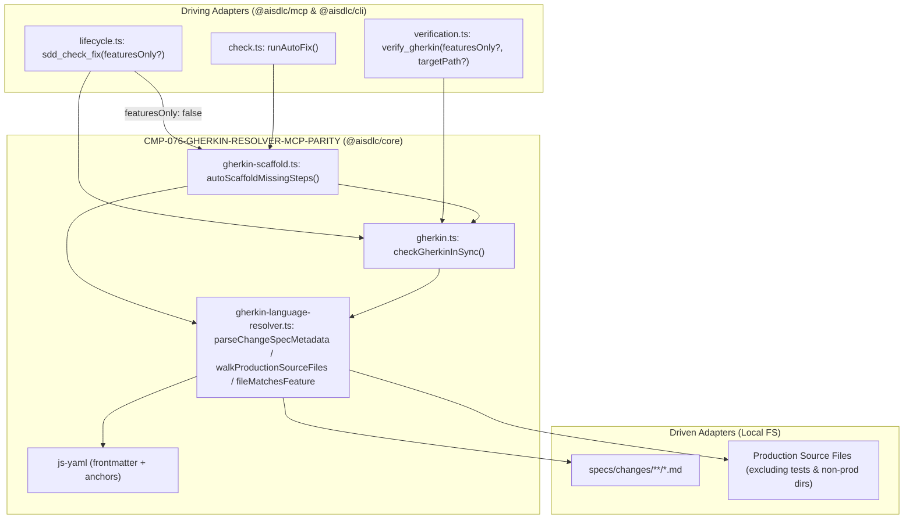
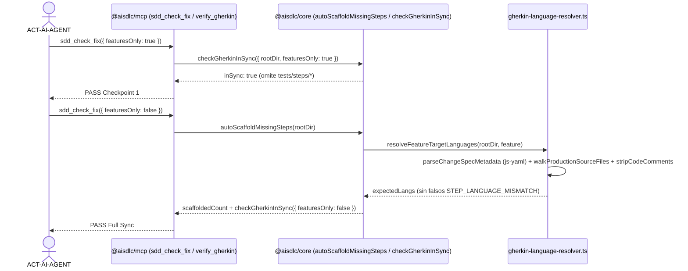

# CMP-076-GHERKIN-RESOLVER-MCP-PARITY: Gherkin Resolver Precision and MCP Check-Fix / Verify Parity

## 1. Responsabilidad y Arquitectura Hexagonal (Ports & Adapters)
Subcomponente determinista dentro de `CMP-CORE` (`@aisdlc/core`) y sus adaptadores primarios CLI (`@aisdlc/cli`) y MCP (`@aisdlc/mcp`) que endurece el resolver de lenguajes BDD (`gherkin-language-resolver.ts`) y establece paridad 100% entre CLI (`aisdlc check --fix`, `aisdlc verify gherkin`) y los tools MCP (`sdd_check_fix`, `verify_gherkin`) sin modificar `schemas/` ni añadir dependencias externas.

Siguiendo **Modular & Hexagonal Architecture (Ports & Adapters)** y **Simplicity First (YAGNI)**:
- **Driving Adapters (Adaptadores Primarios / Entrada)**:
  - `packages/mcp/src/tools/lifecycle.ts` (`registerSddCheckFixTool`): extiende `sdd_check_fix` con `featuresOnly?: boolean` (default `false`). Cuando `featuresOnly: false`, invoca `autoScaffoldMissingSteps(root)` exportado desde `@aisdlc/core` antes de `checkGherkinInSync`; cuando `featuresOnly: true`, omite el scaffolding de pasos y ejecuta `checkGherkinInSync({ rootDir: root, featuresOnly: true })` para Checkpoint 1.
  - `packages/mcp/src/tools/verification.ts` (`registerVerifyGherkinTool`): expone el nuevo tool MCP read-only `verify_gherkin` con `{ root?: string, featuresOnly?: boolean, targetPath?: string }` delegando en `checkGherkinInSync` y retornando `inSync`, `missingFiles`, `outOfSyncFiles`, `orphanFeatureFiles`, `missingStepFiles`, `stepLanguageMismatches` y `totalFeatures`.
  - `packages/cli/src/commands/check.ts`: reutiliza `autoScaffoldMissingSteps` desde `@aisdlc/core` eliminando lógica duplicada.
- **Application Core & Domain Ports (Núcleo de Dominio en `@aisdlc/core`)**:
  - **Shared Auto-Scaffold Helper (`packages/core/src/verifiers/gherkin-scaffold.ts` + `packages/core/src/index.ts`)**: exporta `autoScaffoldMissingSteps(rootDir: string): number` como puerto único compartido entre CLI y MCP.
  - **Hardened Language Resolver (`packages/core/src/verifiers/gherkin-language-resolver.ts`)**:
    - `parseChangeSpecMetadata`: reemplaza el parser YAML manual línea-a-línea por `js-yaml`, soportando anclas/alias (`&ref_0` / `*ref_0`), `citations`, `satisfies-requirements`, `tasks[*].satisfies-requirements`, `contracts` y `tasks[*].implements-contracts` con expansión `DesignContractDeclaration` (`string` y `{ interface, methods }`, longitud >= 4).
    - `EXCLUDED_SCAN_DIRS` & `walkProductionSourceFiles`: amplía exclusiones con `coverage`, `htmlcov`, `TestResults`, `out`, `examples`, `fixtures`, `scratch`, `.pytest_cache`, `scripts`, `.agent`, `.claude`, `.cursor` y filtra archivos que coincidan con `isPolyglotUnitTestFile` o `isUiTestFile`.
    - `stripCodeComments` & `fileMatchesFeature`: mantiene `idPatterns` (`FR-*`, `CHG-*`, `TSK-*`) sobre contenido crudo (incluyendo comentarios `// Cites: ...`), mientras evalúa `symbolPatterns` (`contracts`) únicamente sobre código sin comentarios (`//`, `/* */` en lenguajes C-like y `#` en Python, preservando literales de cadena).
- **Driven Adapters (Local FS)**:
  - Lectura determinista de `specs/changes/**/*.md` y archivos fuente de producción bajo `rootDir` excluyendo symlinks, directorios no productivos y archivos de test co-ubicados.

## 2. Diagrama de Componentes (Mermaid)

## 3. Diagrama de Secuencia en Tiempo de Ejecución (Mermaid)

## 4. Límites YAGNI y Restricciones de Calidad
- **Cero dependencias externas nuevas**: reutiliza `js-yaml` ya presente en `packages/core/package.json` (`^4.1.0`).
- **Inmutabilidad de `schemas/`**: sin cambios en esquemas JSON/YAML bajo `schemas/`.
- **Umbrales AST (`quality-policy.yaml`)**: funciones nuevas/modificadas cumplen `Cyclomatic <= 10`, `Cognitive <= 15`, `MI >= 50` y `Lines <= 40`.

## Historial de Revisiones

| Versión | Fecha | Autor / Agente | Descripción del Cambio | Referencia de Cambio (Change/PR) |
| :--- | :--- | :--- | :--- | :--- |
| **1.0.0** | 2026-11-27 | agent-system-architect | Definición arquitectónica inicial para Issue #232: paridad MCP `sdd_check_fix`/`verify_gherkin`, `js-yaml` frontmatter, exclusiones de escaneo/tests y matching comment-aware | CHG-076-GHERKIN-RESOLVER-MCP-PARITY |
