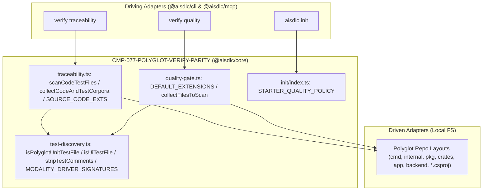
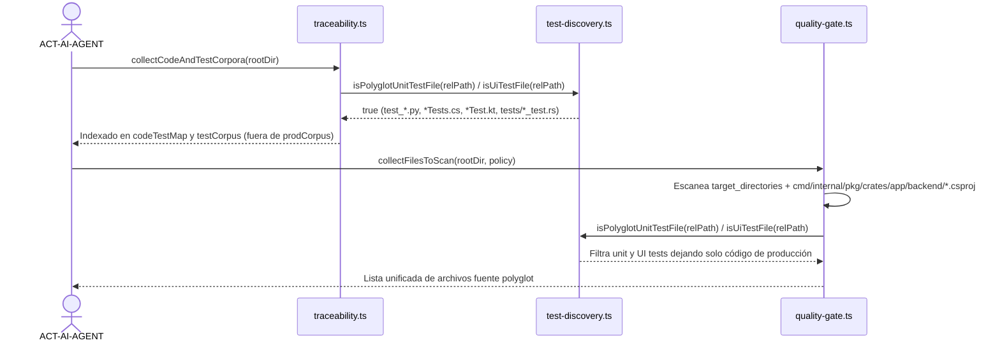

# CMP-077-POLYGLOT-VERIFY-PARITY: Polyglot Parity for Traceability, Quality Gate, and Test Discovery Verifiers

## 1. Responsabilidad y Arquitectura Hexagonal (Ports & Adapters)
Subcomponente determinista dentro de `CMP-CORE` (`@aisdlc/core`) que unifica la clasificación de archivos de prueba, extensiones de código fuente, escaneo de layouts idiomáticos multi-lenguaje, firmas de drivers UI/CLI y sanitización de comentarios consciente de literales de cadena, sin modificar `schemas/` ni añadir dependencias externas.

Siguiendo **Modular & Hexagonal Architecture (Ports & Adapters)** y **Simplicity First (YAGNI)**:
- **Application Core & Domain Ports (Núcleo de Dominio en `@aisdlc/core`)**:
  - **Canonical Polyglot Test Discovery (`packages/core/src/verifiers/test-discovery.ts`)**:
    - `MODALITY_DRIVER_SIGNATURES.web`: soporta `Expect(page|locator)` de forma case-insensitive (C#) y firmas oficiales de Playwright Java/Kotlin (`com.microsoft.playwright`, `Playwright.create`, `assertThat(page`).
    - `MODALITY_DRIVER_SIGNATURES.console`: incorpora drivers CLI de Go (`exec.Command`, `cobra`) y Rust (`assert_cmd`, `Command::cargo_bin`).
    - `DEFAULT_UI_TEST_PATTERNS`: añade `**/*_e2e_test.go`, `**/*_ui_test.go`, `**/*_e2e_test.rs`, `**/*_ui_test.rs`.
    - `stripTestComments`: preserva literales de cadena (`"..."`, `'...'`, `` `...` ``) al eliminar comentarios `//` para no truncar selectores XPath como `page.locator("//button[@type='submit']")`.
  - **Traceability Verifier (`packages/core/src/verifiers/traceability.ts`)**:
    - Reemplaza `isCodeTestFile(name)` por `isPolyglotUnitTestFile(relPath)` e `isUiTestFile(relPath)` (condicionado a que `path.extname(relPath).toLowerCase()` pertenezca a `SOURCE_CODE_EXTS` para evitar que binarios/fixtures como `.png` o `.json` bajo `tests/e2e/**` contaminen `testCorpus`) importados desde `./test-discovery.js` tanto en `scanCodeTestFiles` como en `collectCodeAndTestCorpora`.
    - Alinea `SOURCE_CODE_EXTS` con `.ts`, `.tsx`, `.js`, `.jsx`, `.mjs`, `.cjs`, `.py`, `.go`, `.java`, `.kt`, `.cs`, `.fs`, `.rs`, `.c`, `.cpp`, `.cc`, `.cxx`, `.hpp`, e incorpora `.venv`, `venv`, `__pycache__` y `.pytest_cache` a `SKIPPED_DIR_NAMES`.
  - **Quality Gate & Init Policy (`packages/core/src/verifiers/quality-gate.ts` y `packages/core/src/init/index.ts`)**:
    - Añade `.kt`, `.mjs`, `.cjs`, `.cc`, `.cxx`, `.hpp` a `DEFAULT_EXTENSIONS` y `STARTER_QUALITY_POLICY` (difiriendo `.fs` del escaneo AST).
    - Extiende `collectFilesToScan` para descubrir layouts idiomáticos: Go (`cmd`, `internal`, `pkg`), Rust workspace (`crates`), Python (`app`, `backend`) y subdirectorios .NET de nivel 1 con archivos `.csproj`, aplicando exclusión de tests unitarios (`!isPolyglotUnitTestFile`) y UI (`!isUiTestFile`), así como contención de enlaces simbólicos (`lstatSync` / `realpathSync` dentro de `rootDir`) en `walkDir` y los escáneres de nivel 1 (`crates`/`.csproj`).
- **Driven Adapters (Local FS)**:
  - Lectura determinista del árbol de archivos del repositorio con contención estricta de enlaces simbólicos (`lstatSync` / `realpathSync` dentro de `rootDir`), excluyendo artefactos generados, `.d.ts` y archivos de prueba en el escaneo de producción.

## 2. Diagrama de Componentes (Mermaid)

## 3. Diagrama de Secuencia en Tiempo de Ejecución (Mermaid)

## 4. Límites YAGNI y Restricciones de Calidad
- **Cero dependencias externas nuevas**: implementación 100% TypeScript sobre APIs estándar de Node.js (`fs`, `path`).
- **Inmutabilidad de `schemas/`**: sin cambios en esquemas JSON/YAML bajo `schemas/`.
- **Umbrales AST (`quality-policy.yaml`)**: funciones nuevas/modificadas cumplen `Cyclomatic <= 10`, `Cognitive <= 15`, `MI >= 50` y `Lines <= 40`.

## Historial de Revisiones

| Versión | Fecha | Autor / Agente | Descripción del Cambio | Referencia de Cambio (Change/PR) |
| :--- | :--- | :--- | :--- | :--- |
| **1.0.0** | 2026-11-27 | AI-SDLC Integration Engine | Integración de incremento de entrega chg-077-polyglot-verify-parity | chg-077-polyglot-verify-parity |
| **1.0.0** | 2026-11-27 | agent-system-architect | Definición arquitectónica inicial para Issue #233: paridad polyglot en `traceability.ts`, `quality-gate.ts`, `init/index.ts` y `test-discovery.ts` | CHG-077-POLYGLOT-VERIFY-PARITY |
