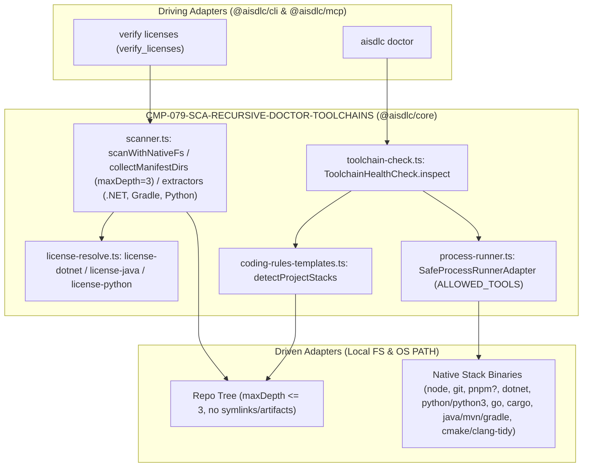
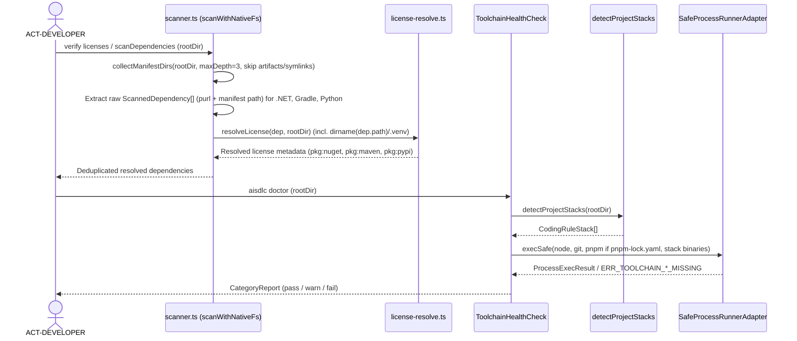

# CMP-079-SCA-RECURSIVE-DOCTOR-TOOLCHAINS: Recursive Multi-Ecosystem SCA Scanning and Stack-Aware Doctor Toolchains

## 1. Responsabilidad y Arquitectura Hexagonal (Ports & Adapters)
Subcomponente determinista dentro de `CMP-CORE` (`@aisdlc/core`) que habilita el descubrimiento recursivo acotado de manifiestos y lockfiles multi-ecosistema en `scanWithNativeFs` y el diagnóstico de toolchains nativos consciente del stack en `ToolchainHealthCheck`, sin modificar `schemas/` ni añadir dependencias externas.

Siguiendo **Modular & Hexagonal Architecture (Ports & Adapters)** y **Simplicity First (YAGNI)**:
- **Application Core & Domain Ports (Núcleo de Dominio en `@aisdlc/core`)**:
  - **Bounded Recursive SCA Discovery & Native Extractors (`packages/core/src/verifiers/sca/scanner.ts`, `license-resolve.ts`)**:
    - Recorrido recursivo acotado (`maxDepth = 3`, alineado con `detectProjectStacks`) mediante helpers pequeños y de responsabilidad única (`collectManifestDirs`, `walkManifestTree`), omitiendo enlaces simbólicos (`isSymbolicLink()`) y directorios de artefactos/caché (`node_modules`, `.git`, `dist`, `target`, `bin`, `obj`, `.venv`, `venv`).
    - Extractores nativos sin red ni binarios externos (`scanWithNativeFs` extrae `ScannedDependency` crudos con `purl` y `path` apuntando al manifiesto/lockfile descubierto, y `scanDependencies` / `verify licenses` invoca `resolveLicense(dep, rootDir)`):
      - **.NET**: `<PackageReference>` y `<PackageVersion>` en `*.csproj` y `Directory.Packages.props`, más paquetes resueltos en `packages.lock.json` -> `pkg:nuget/<name>@<version>` (resuelto vía `license-dotnet.ts`).
      - **Gradle**: dependencias en `build.gradle`, `build.gradle.kts` y `gradle.lockfile` -> `pkg:maven/<group>/<artifact>@<version>` (resuelto vía `license-java.ts`).
      - **Python**: `requirements.txt` (en adición a `pyproject.toml`, `poetry.lock`, `uv.lock`, `Pipfile.lock`) -> `pkg:pypi/<name>@<version>`; `resolvePythonLicenseDetailed` (`license-python.ts`) inspecciona `path.dirname(dep.path)` (si está dentro de `rootDir`) además de `rootDir` para `.venv`/`venv` `site-packages`, permitiendo resolver metadatos locales offline en subproyectos Python anidados.
    - Degradación elegante ante manifiestos vacíos o malformados sin lanzar excepciones, y deduplicación en `ScannedDependency[]`.
  - **Stack-Aware Toolchain Health Check (`packages/core/src/doctor/toolchain-check.ts`, `process-runner.ts`, `types/doctor.ts`)**:
    - Consulta `detectProjectStacks(rootDir)` (`packages/core/src/init/coding-rules-templates.ts`) para determinar los stacks activos del repositorio, y busca `pom.xml`, `build.gradle`/`build.gradle.kts`, `CMakeLists.txt` y `.clang-tidy` en todo el árbol acotado (`maxDepth = 3`, consistente con `detectProjectStacks`) y no solo en `rootDir`.
    - Sondea siempre `node` y `git`, exige `pnpm` únicamente cuando `pnpm-lock.yaml` existe en `rootDir`, y sondea los binarios nativos correspondientes a cada stack detectado (`dotnet`, `python`/`python3`, `go`, `cargo`, `java`/`mvn`/`gradle`, `cmake`/`clang-tidy`) mediante una tabla declarativa de mapeo.
    - En `probeTool`, considera saludable una sonda cuando `res.exitCode === 0 && Boolean(res.stdout.trim() || res.stderr.trim())` para que `java -version` (que imprime en `stderr`) tenga éxito sin falsas advertencias.
    - Para `python`, sondea primero `python --version` y solo hace fallback secuencial a `python3 --version` si `python` falta o falla (emitiendo `ERR_TOOLCHAIN_PYTHON_MISSING` únicamente si ambos fallan).
    - Extiende `SafeProbeExecutable` (`types/doctor.ts`) y `ALLOWED_TOOLS` (`process-runner.ts`) para autorizar de forma segura (Zero Trust, `shell: false`) las sondas de versión de cada binario nativo.
- **Driven Adapters (Local FS & Safe Process Runner)**:
  - Lectura determinista del árbol de archivos local (`fs.readdirSync` con `withFileTypes: true` y exclusión de symlinks) y ejecución confinada de sondas `--version`/`version` vía `IProcessRunner` (`SafeProcessRunnerAdapter`).

## 2. Diagrama de Componentes (Mermaid)

## 3. Diagrama de Secuencia en Tiempo de Ejecución (Mermaid)

## 4. Límites YAGNI y Restricciones de Calidad
- **Cero dependencias externas nuevas**: implementación 100% TypeScript sobre APIs estándar de Node.js (`fs`, `path`, `node:child_process`).
- **Inmutabilidad de `schemas/`**: sin cambios en esquemas JSON/YAML bajo `schemas/`.
- **Umbrales AST (`quality-policy.yaml`)**: funciones nuevas/modificadas cumplen `Cyclomatic <= 10`, `Cognitive <= 15`, `MI >= 50` y `Lines <= 40`.

## Historial de Revisiones

| Versión | Fecha | Autor / Agente | Descripción del Cambio | Referencia de Cambio (Change/PR) |
| :--- | :--- | :--- | :--- | :--- |
| **1.0.0** | 2026-11-27 | agent-system-architect | Definición arquitectónica inicial para Issue #234: escaneo SCA recursivo multi-ecosistema y `ToolchainHealthCheck` consciente del stack | CHG-079-SCA-RECURSIVE-DOCTOR-TOOLCHAINS |
