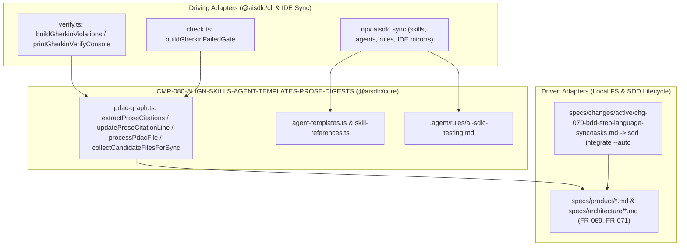
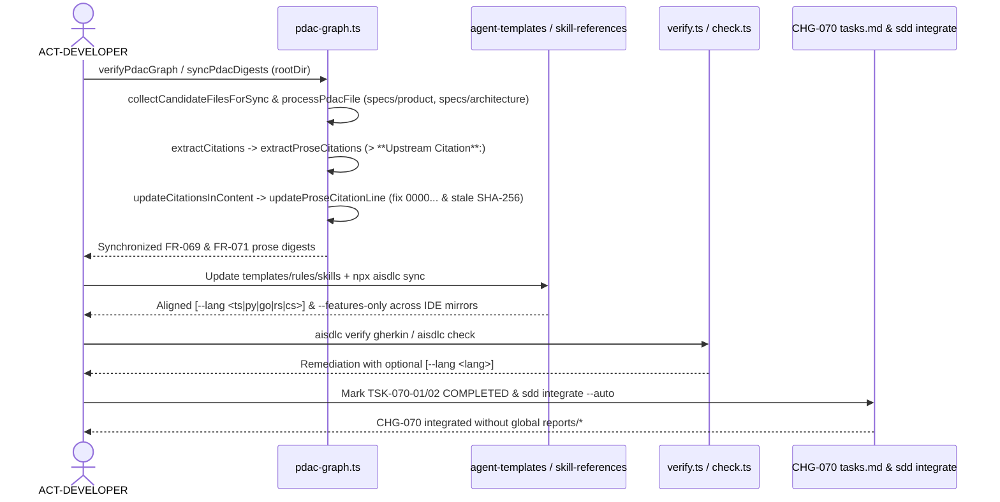

# CMP-080-ALIGN-SKILLS-AGENT-TEMPLATES-PROSE-DIGESTS: Align Skills, Agent Templates, CLI Remediation, Prose Citation Digests, and CHG-070 Integration

## 1. Responsabilidad y Arquitectura Hexagonal (Ports & Adapters)
Subcomponente determinista dentro de `CMP-CORE` (`@aisdlc/core`) y su adaptador de entrada `@aisdlc/cli` que alinea las plantillas/reglas/skills/mirrors IDE con el flujo políglota opcional `[--lang <ts|py|go|rs|cs>]` y `--features-only`, extiende el grafo PDaC (`pdac-graph.ts`) para detectar, verificar y sincronizar citaciones en prosa Markdown (`> **Upstream Citation**:`), corrige los mensajes de remediación CLI en `verify.ts` y `check.ts`, y completa la integración canónica de `CHG-070` sin modificar `schemas/`.

Siguiendo **Modular & Hexagonal Architecture (Ports & Adapters)** y **Simplicity First (YAGNI)**:
- **Application Core & Domain Ports (`@aisdlc/core`)**:
  - **PDaC Prose Citation Detection & Sync (`packages/core/src/verifiers/pdac-graph.ts`)**:
    - Define el contrato `ProseCitationMatch` (`{ targetId: string; expectedDigest: string }`) y los helpers cohesivos `extractProseCitations(line: string): ProseCitationMatch | null` y `updateProseCitationLine(rawLine: string, baselineMap: Map<string, PdacNode>, sourceFile: string, details: PdacSyncDetail[]): { line: string; changed: boolean }`.
    - `extractProseCitations` usa la expresión regular lineal `/^>\s*\*\*Upstream Citation\*\*:\s*\`([^`\n]+)\`[^\n]*?SHA-256:\s*\`([^`\n]+)\`/i` para cruzar rutas de archivo envueltas en backticks y capturar cualquier token de digest no vacío (tanto `<64-hex>` válido como digests malformados, de modo que `checkDigest` reporte deriva PDaC en casos `@invalid`).
    - `extractCitations(content, sourceFile)` invoca `extractProseCitations` sobre líneas de cuerpo Markdown fuera de bloques YAML `citations:` y fuera de bloques de código delimitados (` ``` ` o `~~~` al inicio de línea tras `trim()`), evitando falsos positivos en ejemplos de documentación.
    - `updateCitationsInContent(content, baselineMap, sourceFile, details)` también rastrea bloques de código delimitados (` ``` ` o `~~~` al inicio de línea tras `trim()`) y omite la mutación dentro de ellos; fuera de bloques de código y de `citations:`, invoca `updateProseCitationLine` cuando la línea coincide con `> **Upstream Citation**:`, reemplazando el token de digest capturado por `targetNode.digest` cuando `expectedDigest !== targetNode.digest && expectedDigest !== targetNode.rawDigest` y registrando el detalle en `PdacSyncDetail[]`.
    - `collectCandidateFilesForSync` y `processPdacFile` cubren explícitamente archivos Markdown bajo `specs/product/` y `specs/architecture/` (vía `isPdacDeliveryDoc(relFile)`), permitiendo verificar y sincronizar digests en prosa de especificaciones como `FR-069-LANGUAGE-AGNOSTIC-CODING-RULES-001.md` y `FR-071-GHERKIN-SCAFFOLD-POLYGLOT-FIX-001.md`.
  - **Templates, Rules & Skill References (`packages/core/src/init/agent-templates.ts`, `packages/core/src/init/skill-references.ts`, `.agent/rules/ai-sdlc-testing.md`)**:
    - Actualiza `agent-qa-engineer`, `aisdlc-increment`, `aisdlc-bdd-gherkin`, `STARTER_ANTIGRAVITY_TESTING_RULES`, `STARTER_CURSOR_TESTING_RULES`, `STARTER_TESTS_AGENTS_MD`, `gherkin-polyglot-matrix.md` y `.agent/rules/ai-sdlc-testing.md` para documentar la inferencia automática de lenguaje con `--lang` opcional (`aisdlc gherkin scaffold <feature-file> [--lang <ts|py|go|rs|cs>] [--fallback]`) y el modo declarativo pre-código (`aisdlc verify gherkin --features-only` en Checkpoint 1).
    - Propaga determinísticamente las actualizaciones a todos los mirrors IDE mediante `npx aisdlc sync`.
- **Driving Adapters (`@aisdlc/cli`)**:
  - **CLI Remediation Builders (`packages/cli/src/commands/verify.ts`, `packages/cli/src/commands/check.ts`)**:
    - `buildGherkinViolations` y `printGherkinVerifyConsole` (`verify.ts`) y `buildGherkinFailedGate` (`check.ts`) muestran `[--lang <lang>]` (opcional) en lugar de `--lang <lang>` obligatorio en los mensajes de remediación de `MISSING_STEP_FILE` y `STEP_LANGUAGE_MISMATCH`.
- **Driven Adapters & Lifecycle Integration (`specs/changes/active/chg-070-bdd-step-language-sync/`)**:
  - Marca `TSK-070-01` y `TSK-070-02` como `COMPLETED` en `specs/changes/active/chg-070-bdd-step-language-sync/tasks.md` y ejecuta `sdd integrate --auto` para promover `CHG-070` sin incluir archivos globales `reports/*`.

## 2. Diagrama de Componentes (Mermaid)



## 3. Diagrama de Secuencia en Tiempo de Ejecución (Mermaid)



## 4. Límites YAGNI y Restricciones de Calidad
- **Cero dependencias externas nuevas**: implementación 100% TypeScript sobre APIs estándar de Node.js (`fs`, `path`, `crypto`).
- **Inmutabilidad de `schemas/`**: sin cambios en esquemas JSON/YAML bajo `schemas/`.
- **Umbrales AST (`quality-policy.yaml`)**: funciones nuevas/modificadas cumplen `Cyclomatic <= 10`, `Cognitive <= 15`, `MI >= 50` y `Lines <= 40`.

## Historial de Revisiones

| Versión | Fecha | Autor / Agent | Descripción del Cambio | Referencia de Cambio (Change/PR) |
| :--- | :--- | :--- | :--- | :--- |
| **1.0.0** | 2026-11-28 | AI-SDLC Integration Engine | Integración de incremento de entrega chg-080-align-skills-agent-templates-prose-digests | chg-080-align-skills-agent-templates-prose-digests |
| **1.0.0** | 2026-11-28 | agent-system-architect | Definición arquitectónica inicial para CHG-080 (Issue #235): citas en prosa PDaC, alineación de plantillas/skills/remediación CLI y cierre de CHG-070 | CHG-080-ALIGN-SKILLS-AGENT-TEMPLATES-PROSE-DIGESTS |
