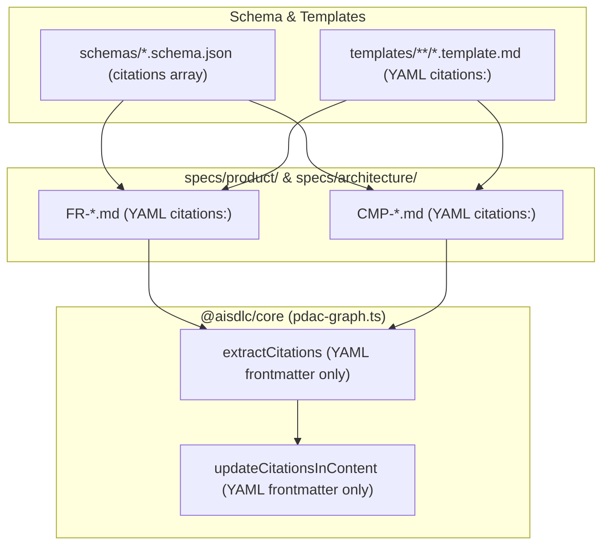

# CMP-081-UNIFY-YAML-FRONTMATTER-CITATIONS: Unify Upstream Cryptographic Citations into YAML Frontmatter

## 1. Responsabilidad y Arquitectura Hexagonal (Ports & Adapters)
Subcomponente determinista dentro de `CMP-CORE` (`@aisdlc/core`) que unifica todas las citaciones criptográficas upstream en un único formato canónico YAML frontmatter `citations:` (`- id: <UPSTREAM-ID>`, `digest: "sha256:<64-hex>"`), eliminando el parseo dual prosa/YAML.

Siguiendo **Modular & Hexagonal Architecture (Ports & Adapters)** y **Simplicity First (YAGNI)**:
- **Schema Governance (`schemas/`)**:
  - `requirement.schema.json`, `component.schema.json` y esquemas relacionados definen `citations` como propiedad opcional de frontmatter YAML: array de objetos `{ id: string, digest: string (^sha256:[0-9a-f]{64}$), comment?: string }`.
- **Template Emission (`templates/`)**:
  - `templates/product/functional-requirement.template.md`, `templates/architecture/component.template.md` y plantillas relacionadas emiten `citations:` en YAML frontmatter en lugar de blockquotes en prosa `> **Upstream Citation**:`.
- **Specification Migration (`specs/product/`, `specs/architecture/`)**:
  - Todas las especificaciones existentes con `> **Upstream Citation**:` migran sus citaciones al bloque YAML frontmatter `citations:` y eliminan el blockquote en prosa.
- **Application Core (`packages/core/src/verifiers/pdac-graph.ts`)**:
  - `extractCitations(content, sourceFile)` y `updateCitationsInContent(content, baselineMap, sourceFile, details)` parsean y sincronizan exclusivamente bloques YAML frontmatter `citations:` como única fuente de verdad, eliminando `extractProseCitations` y `updateProseCitationLine`.

## 2. Diagrama de Componentes (Mermaid)

## 3. Historial de Revisiones

| Versión | Fecha | Autor / Agent | Descripción del Cambio | Referencia |
| :--- | :--- | :--- | :--- | :--- |
| **1.0.0** | 2026-11-28 | AI-SDLC Integration Engine | Integración de incremento de entrega chg-081-unify-yaml-frontmatter-citations | chg-081-unify-yaml-frontmatter-citations |
| **1.0.0** | 2026-11-28 | agent-system-architect | Diseño arquitectónico inicial para CHG-081 | CHG-081 |
