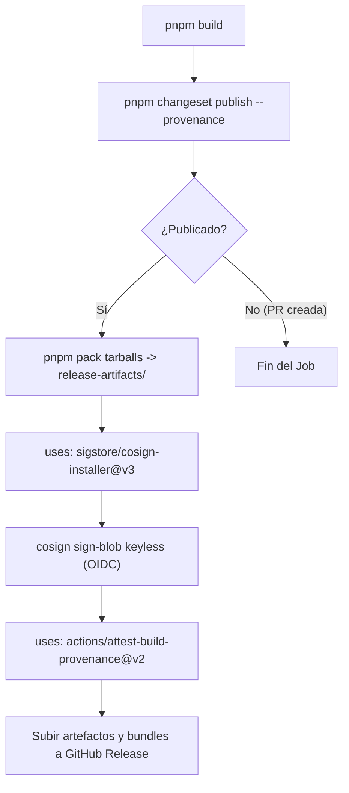

# Diseño de Implementación: CHG-040-RELEASE-SUPPLY-CHAIN-PROVENANCE

## 1. Arquitectura de Firma y Procedencia

## 2. Invariantes de Seguridad
- Cero claves criptográficas estáticas o privadas almacenadas en secretos del repositorio (modelo Keyless con Sigstore Fulcio/Rekor).
- Autenticación OIDC efímera ligada exclusivamente al repositorio `altromon/AI-SDLC` y la rama `main`.
- Verificación simétrica y reproducible documentada en manuales operativos.
