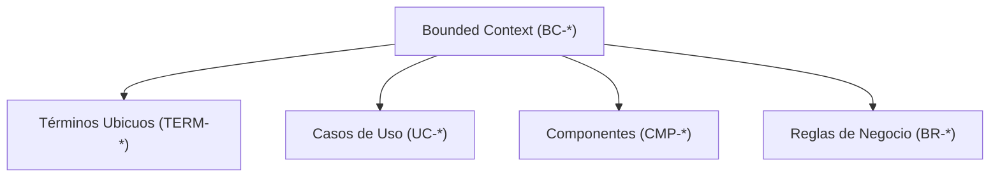

# Diseño de Implementación: CHG-041-BOUNDED-CONTEXT-TEMPLATE

## 1. Estructura de Artefactos de Producto

## 2. Alineación con el Ciclo de Scaffolding
- Durante `initProject`, la colección `STARTER_BASE_TEMPLATES` se itera y escribe deterministamente en el sistema de archivos del usuario.
- La incorporación de `bounded-context.template.md` completa la suite de modelado DDD (`product/`).
