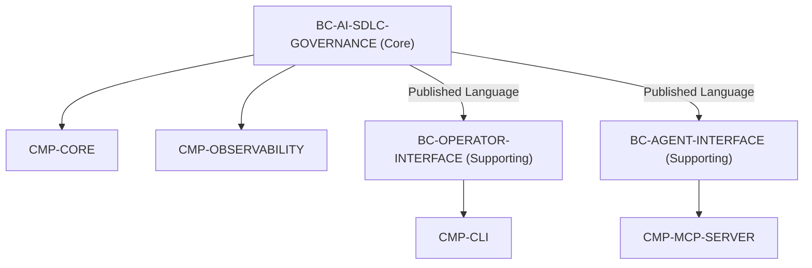

# Diseño de Implementación: CHG-042-BOUNDED-CONTEXTS-AND-DOCS

## 1. Mapeo de Subdominios y Componentes

## 2. Invariantes
- Conformidad al 100% con `bounded-context.schema.json`.
- Trazabilidad y aristas automáticas `encompasses` en Cytoscape.
- Cero desalineación entre código y documentación pública en los READMEs.
