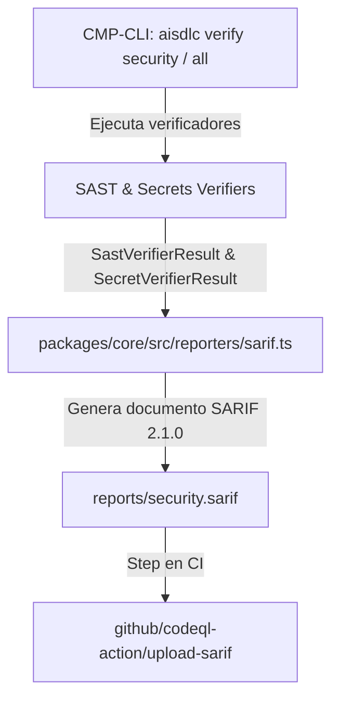

# Diseño Técnico: CHG-043-SARIF-SECURITY-REPORTING

## 1. Mapeo Arquitectónico y Enclave Zero Trust
El módulo generador de SARIF se ubica en `@aisdlc/core` dentro de `packages/core/src/reporters/sarif.ts`. Orquesta la serialización estandarizada de resultados producidos por `packages/core/src/verifiers/sast.ts` y `packages/core/src/verifiers/secrets.ts`.
La capa de CLI (`packages/cli/src/commands/verify.ts`) invoca este reporter para persistir `reports/security.sarif` y procesar el flag `--format sarif`.



## 2. Contratos de Datos e Interfaces

```typescript
export type SarifLevel = 'error' | 'warning' | 'note' | 'none';

export interface SarifRule {
  id: string;
  name: string;
  shortDescription: { text: string };
  fullDescription?: { text: string };
  defaultConfiguration?: { level: SarifLevel };
  helpUri?: string;
  properties?: {
    tags?: string[];
    cwe?: string[];
    owasp?: string[];
  };
}

export interface SarifLocation {
  physicalLocation: {
    artifactLocation: { uri: string; uriBaseId?: string };
    region?: {
      startLine: number;
      startColumn?: number;
      endLine?: number;
      endColumn?: number;
    };
  };
}

export interface SarifResult {
  ruleId: string;
  level: SarifLevel;
  message: { text: string };
  locations: SarifLocation[];
}

export interface SarifRun {
  tool: {
    driver: {
      name: string;
      version: string;
      informationUri: string;
      rules: SarifRule[];
    };
  };
  results: SarifResult[];
}

export interface SarifDocument {
  $schema: string;
  version: '2.1.0';
  runs: SarifRun[];
}
```

## 3. Mapeo de Severidades y Taxonomía CWE / OWASP

| Severidad AI-SDLC | Nivel SARIF | Mapeo CWE Típico | Mapeo OWASP |
| :--- | :--- | :--- | :--- |
| `CRITICAL` (SQLi, Command Inj, Eval, Key Leak) | `error` | CWE-89, CWE-78, CWE-95, CWE-798 | A03:2021-Injection, A07:2021-Identification |
| `HIGH` (SSRF, Path Traversal, JWT Leak) | `error` | CWE-918, CWE-22, CWE-522 | A10:2021-SSRF, A01:2021-Broken Access |
| `MEDIUM` (Weak Hashes, General Tokens) | `warning` | CWE-328, CWE-200 | A02:2021-Cryptographic Failures |
| `LOW` / `INFO` | `note` | CWE-200 | A05:2021-Security Misconfiguration |

## 4. Conformidad con la Política de Licencias (`license-policy.yaml`)
La implementación no agrega ninguna dependencia externa; modela los tipos directamente y genera JSON conforme al estándar OASIS.

## 5. Historial de Revisiones

| Versión | Fecha | Autor | Descripción del Cambio | Referencia |
| :--- | :--- | :--- | :--- | :--- |
| **1.0.0** | 2026-10-24 | agent-system-architect | Diseño técnico del reporter SARIF 2.1.0 | CHG-043-SARIF-SECURITY-REPORTING |
