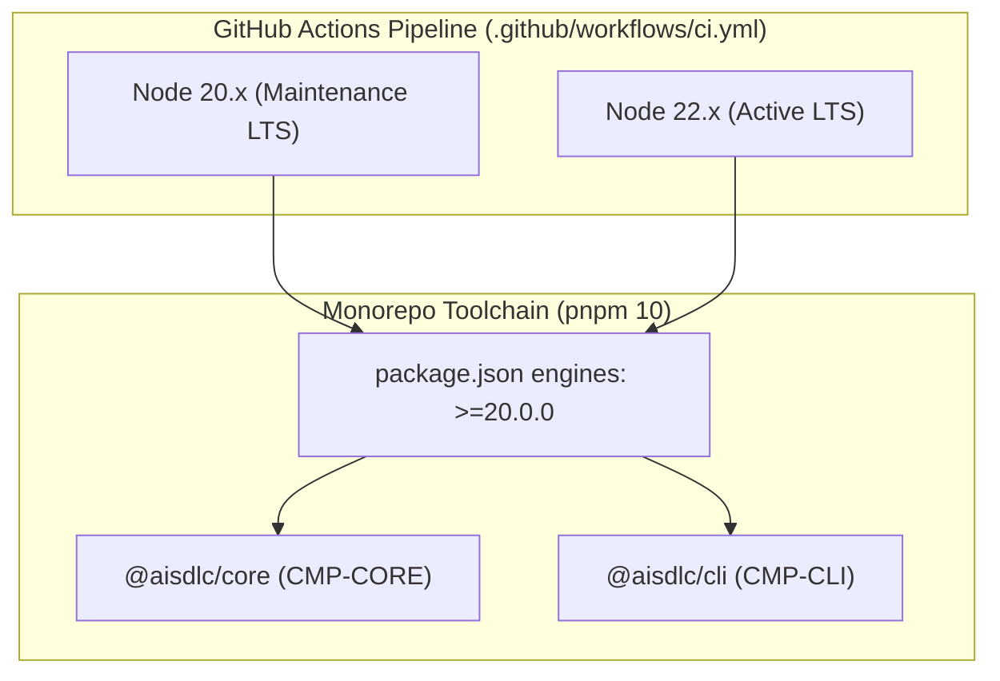

# Diseño Técnico: CHG-049-NODE-LTS-RUNTIME-AND-CI

## 1. Mapeo Arquitectónico y Enclave Zero Trust
Este cambio actualiza la configuración de runtime y toolchain en `CMP-CORE` y `CMP-CLI`, formalizando la restricción arquitectónica `CON-TECH-002` (*Execution on Node.js LTS 20+ and deterministic packaging with pnpm*) y alineando los pipelines de CI (`.github/workflows/ci.yml`) y las plantillas de andamiaje generadas por `aisdlc init`.



## 2. Contratos de Datos e Interfaces
- **Configuración de Manifiesto (`package.json`)**:
  ```json
  "engines": {
    "node": ">=20.0.0"
  }
  ```
- **Matriz de CI (`.github/workflows/ci.yml` y `templates/ci/github-workflows/ci.yml`)**:
  ```yaml
  strategy:
    matrix:
      node-version: [ 20.x, 22.x ]
  ```

## 3. Protocolos de Manejo de Errores y Mitigación
- La ejecución en entornos con Node.js < 20.0.0 emitirá las advertencias de compatibilidad `EBADENGINE` de los gestores de paquetes estándar (`pnpm`, `npm`).
- El step de subida SARIF a GitHub Code Scanning en CI permanece condicionado a la versión Active LTS (`matrix.node-version == '22.x'`).

## 4. Conformidad con la Política de Licencias (`license-policy.yaml`)
Cero dependencias adicionales añadidas o modificadas. Pleno cumplimiento de `license-policy.yaml`.

## 5. Historial de Revisiones

| Versión | Fecha | Autor | Descripción del Cambio | Referencia |
| :--- | :--- | :--- | :--- | :--- |
| **1.0.0** | 2026-11-01 | Alfonso Troyano | Diseño técnico para alineación a Node 20 y 22 LTS | CHG-049-NODE-LTS-RUNTIME-AND-CI |
