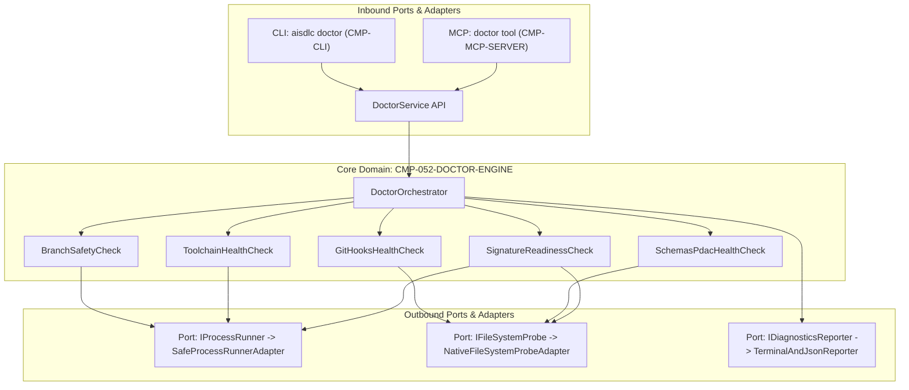

# Diseño Técnico: CHG-052-CLI-DOCTOR

## 1. Mapeo Arquitectónico y Enclave Zero Trust
El componente central `CMP-052-DOCTOR-ENGINE` se despliega en el enclave perimetral `SEC-ENC-DMZ` como biblioteca modular in-process dentro de `@ai-sdlc/core`, expuesta a través de adaptadores de entrada en `@ai-sdlc/cli` (`aisdlc doctor`) y `@ai-sdlc/mcp` (`doctor`).

### Diagrama de Arquitectura Hexagonal (Ports & Adapters)


---

## 2. Contratos de Datos, Interfaces y Tipos del Dominio

### 2.1 Modelo de Opciones y Resultados de Servicio
```typescript
export type CheckStatus = "pass" | "warn" | "fail";

export interface DiagnosticFinding {
  id: string; // e.g. 'ERR_HOOKS_NOT_INSTALLED', 'ERR_PROTECTED_BRANCH_ACTIVE'
  category: "git_hooks" | "branch_safety" | "schemas_pdac" | "toolchain" | "signing_readiness";
  status: CheckStatus;
  message: string;
  remediation?: string;
  details?: Record<string, unknown>;
}

export interface CategoryResult {
  category: "git_hooks" | "branch_safety" | "schemas_pdac" | "toolchain" | "signing_readiness";
  title: string;
  status: CheckStatus;
  findings: DiagnosticFinding[];
}

export interface DoctorOptions {
  rootDir: string;
  json?: boolean;
  fix?: boolean;
  strict?: boolean;
  offline?: boolean; // When true (or AI_SDLC_OFFLINE=1), skips remote probes without triggering failure
  timeout?: number; // ms, default: 2000ms
}

export interface DoctorReport {
  overallStatus: CheckStatus;
  exitCode: 0 | 1 | 2; // 0: healthy, 1: warnings, 2: critical failures
  timestamp: string; // ISO 8601 UTC
  categories: CategoryResult[];
  remediations: string[];
}

export interface IDoctorService {
  diagnose(options: DoctorOptions): Promise<DoctorReport>;
}
```

### 2.2 Puertos de Salida (Outbound Ports)
```typescript
export interface ProcessExecOptions {
  timeout?: number; // default 2000ms
  maxBuffer?: number; // default 1024 bytes
  cwd?: string;
}

export interface ProcessExecResult {
  stdout: string;
  stderr: string;
  exitCode: number | null;
}

export interface IProcessRunner {
  execSafe(executable: "node" | "pnpm" | "git", args: string[], options?: ProcessExecOptions): Promise<ProcessExecResult>;
}

export interface IFileSystemProbe {
  exists(filePath: string): Promise<boolean>;
  readFile(filePath: string): Promise<string>;
  getFileSize(filePath: string): Promise<number>;
  isExecutable(filePath: string): Promise<boolean>;
}

export interface IDiagnosticsReporter {
  formatTerminal(report: DoctorReport): string;
  formatJson(report: DoctorReport): string;
}
```

---

## 3. Protocolos de Manejo de Errores y Mitigación de Ciberseguridad

### 3.1 Verificación Estructural de Hooks Git y Defensa contra Symlinks (`SEC-REQ-052-TAMPER-RESISTANT-HOOK-VERIFICATION-001`)
- `GitHooksHealthCheck` verifica exhaustivamente los githooks canónicos `.git/hooks/pre-commit` y `.git/hooks/prepare-commit-msg`:
  1. **Defensa contra Symlinks**: Comprueba `fs.lstatSync(hookPath).isSymbolicLink() === false`. Los enlaces simbólicos son rechazados con `ERR_HOOKS_SYMLINK_REJECTED` para evitar ataques de redirección o clobbering de archivos del sistema.
  2. **Presencia y Permisos de Ejecución**: Existencia real en disco y comprobación de permisos de ejecución (`0o755` en POSIX o ejecutable nativo).
  3. **No Vacío**: Longitud del archivo mayor a 0 bytes (`size > 0`).
  4. **Verificación Estructural Anti-Bypass Diferenciada**:
     - Para `.git/hooks/pre-commit`: DEBE contener el encabezado identificador `# AI-SDLC: Universal Protected Branches Guard` Y la verificación lógica estructural del bloqueo de ramas protegidas (e.g. coincidencia con `main|master|release` y salida `exit 1`). Se rechaza cualquier hook falso que intente bypass mediante un simple marcador seguido de `exit 0`.
     - Para `.git/hooks/prepare-commit-msg`: DEBE contener el encabezado identificador `# AI-SDLC: Automated Commit Trailers Injection Hook` y la lógica de inyección de trailers (`Task-ID` / `Parent-Ref`).
  5. **Copia de Seguridad Timestamped en Modo `--fix`**: Antes de instalar o sobrescribir un hook existente no canónico, el sistema genera automáticamente un respaldo seguro `<hookPath>.bak.<timestamp>`. Si el hook original era un symlink, se desvincula de forma segura antes de escribir el nuevo archivo.
- Si falta el hook, es un symlink no confiable, está vacío o ha sido manipulado, emite `ERR_HOOKS_NOT_INSTALLED`, `ERR_HOOKS_SYMLINK_REJECTED` o `ERR_HOOKS_TAMPERED` con estado `fail` y código de salida `2`.

### 3.2 Invocación Segura e Higienización de Entorno en Toolchains (`SEC-REQ-052-SAFE-TOOLCHAIN-PROBE-001`)
- `SafeProcessRunnerAdapter` ejecuta llamadas mediante `execFile` o `spawn` con `{ shell: false }`.
- **Lista Blanca Inmutable de Ejecutables**: Sólo se autorizan `node`, `pnpm` y `git`. Cualquier otro nombre es rechazado con `ERR_UNAUTHORIZED_PROBE_TOOL`.
- **Higienización Forzosa de Variables de Entorno (Environment Sanitization)**:
  - Purga sistemática de variables de inyección y hijacking: `NODE_OPTIONS`, `NODE_PATH`, `LD_PRELOAD`, `DYLD_INSERT_LIBRARIES`, y `GIT_EXEC_PATH`.
  - Provisión al subproceso de un entorno restringido a la lista blanca segura del sistema: `PATH` (o `Path`), `SYSTEMROOT`, `TMP`, `TEMP`, `HOME`, `USERPROFILE`.
- **Contención de Salidas y Timeouts**: Truncamiento preventivo estricto de buffers (`maxBuffer: 1024`) y timeout máximo de 2000ms.

### 3.3 Redacción Recursiva DLP Mandatoria en Diagnósticos (`SEC-REQ-052-NO-SECRET-LEAK-DIAGNOSTICS-001`)
- Toda información emitida en hallazgos de diagnóstico, mensajes de error y stack traces (`err.message`, `err.stack`) DEBE ser procesada a través de `DlpSanitizer` (`sanitizeDlpText` / `sanitizeDlpPayload`) de forma recursiva antes de ser formateada para consola, MCP o JSON.
- `SignatureReadinessCheck` inspecciona credenciales criptográficas reportando únicamente su presencia booleana o identificadores públicos/fingerprints, reemplazando cualquier material sensible con tokens de censura deterministas (`[REDACTED:PRIVATE_KEY]`, `[REDACTED:API_TOKEN]`, `[REDACTED_SECRET]`).

### 3.4 Soporte Offline / Air-Gapped y Resiliencia Anti-DoS (`SEC-REQ-052-RESILIENT-DIAGNOSTIC-TIMEOUTS-001`)
- **Modo Offline / Air-Gapped**: Si se proporciona la bandera `--offline` o la variable de entorno `AI_SDLC_OFFLINE=1`, el motor de diagnóstico omite de forma proactiva todas las sondas de red externas (e.g. consulta de registros o endpoints de firma remotos). En este modo, si las validaciones locales resultan exitosas, el reporte final es `pass` con código de salida `0` (incluso con la bandera `--strict` habilitada).
- **Timeouts Deterministas**: Cuando las comprobaciones de red están habilitadas, se aplica un timeout determinista acotado a un máximo de 2000ms (`timeout <= 2000`). Si una sonda agota el tiempo, se aborta el proceso hijo y se reporta una advertencia no bloqueante `ERR_NETWORK_PROBE_TIMEOUT`, permitiendo que el diagnóstico culmine ordenadamente sin procesos zombi.

---

## 4. Conformidad con la Política de Licencias (`license-policy.yaml`)
Todas las librerías empleadas en la implementación (APIs nativas de Node.js `node:child_process`, `node:fs`, `node:path`, `node:crypto`) cumplen con las categorías `PERMISSIVE` (`MIT`, `Apache-2.0`, `BSD`) estipuladas en `license-policy.yaml`. No se agregan nuevas dependencias externas de licencia viral o comercial.

---

## 5. Historial de Revisiones

| Versión | Fecha | Autor | Descripción del Cambio | Referencia |
| :--- | :--- | :--- | :--- | :--- |
| **1.0.0** | 2026-11-11 | agent-system-architect | Diseño técnico formal de CMP-052-DOCTOR-ENGINE con Arquitectura Hexagonal | CHG-052-CLI-DOCTOR |
