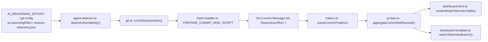
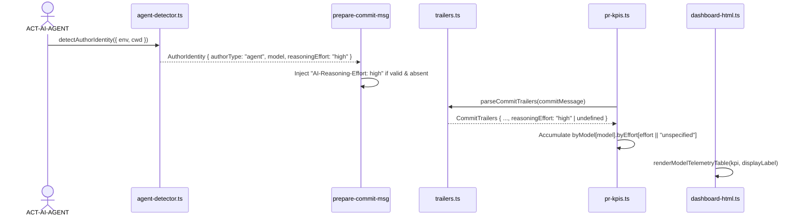

# Diseño Técnico: CHG-064-REASONING-EFFORT-TRAILER

## 1. Mapeo Arquitectónico, Diseño Modular y Enclave Zero Trust
Materializa `CMP-064-REASONING-EFFORT-TRAILER` dentro de `CMP-CORE` (`@aisdlc/core`) en el enclave `SEC-ENC-DMZ`, siguiendo **Modular & Hexagonal Architecture (Ports & Adapters)** y **Simplicity First (YAGNI)** con cero dependencias externas nuevas y sin modificar `schemas/`:

1. **Tipos y Parser/Formateador de Trailers (`packages/core/src/git/trailers.ts`)**:
   - Definir y exportar `ReasoningEffort = 'low' | 'medium' | 'high' | 'max'`.
   - Definir y exportar `normalizeReasoningEffort(raw?: string): ReasoningEffort | undefined` (recorta espacios, convierte a minúsculas y valida contra `'low' | 'medium' | 'high' | 'max'`, retornando `undefined` si no coincide).
   - Extender `CommitTrailers` con `reasoningEffort?: ReasoningEffort`.
   - Añadir `reasoningEffort: /^\s*AI-Reasoning-Effort:\s*(.+)$/im` a `TRAILER_REGEXES`.
   - En `parseCommitTrailers(rawMessage)`: extraer `AI-Reasoning-Effort` usando `normalizeReasoningEffort(...)`.
   - En `formatCommitTrailers(trailers)`: añadir `AI-Reasoning-Effort: ${normalized}` únicamente cuando `normalizeReasoningEffort(trailers.reasoningEffort)` retorne un valor válido.

2. **Detección Agnóstica al IDE (`packages/core/src/git/agent-detector.ts` y `packages/cli/src/commands/git.ts`)**:
   - Extender `AuthorIdentity` con `reasoningEffort?: ReasoningEffort`.
   - Extender `TelemetrySessionData` con `reasoningEffort?: string`.
   - En `detectAuthorIdentity()` (cubriendo `detectFromEnvOverride`, `detectFromGitConfig`, `detectFromTelemetry`, `detectFromAgentEnv` y `detectFromSignature`): resolver `reasoningEffort` en orden de precedencia (`env.AI_REASONING_EFFORT`, `telemetry.reasoningEffort`, `getGitConfigValue('ai.reasoningEffort', cwd)`), normalizado mediante `normalizeReasoningEffort()`.
   - En `packages/cli/src/commands/git.ts` (`runGitDetectAuthor`): incluir `identity.reasoningEffort || ''` como sexto campo separado por `|` en la salida de texto plano para consumo de `prepare-commit-msg`.

3. **Inyección en Hook `prepare-commit-msg` (`packages/core/src/git/hook-installer.ts`)**:
   - En `PREPARE_COMMIT_MSG_SCRIPT`:
     - Leer el sexto campo `DET_EFFORT` desde `git detect-author` (y respaldo desde `AI_REASONING_EFFORT` del entorno o `git config --get ai.reasoningEffort`).
     - Normalizar a minúsculas (`tr '[:upper:]' '[:lower:]'` y trim) y validar estrictamente contra `low|medium|high|max`.
     - Inyectar `AI-Reasoning-Effort: $REASONING_EFFORT\n` únicamente cuando `AUTHOR_TYPE="agent"`, `REASONING_EFFORT` es válido y `! grep -qiE "^AI-Reasoning-Effort:" "$COMMIT_MSG_FILE"`.

4. **Agregación KPI por Modelo y Nivel de Esfuerzo (`packages/core/src/reporters/pr-kpis.ts`)**:
   - Extender `AuthorKpiSummary` con un mapa opcional `byEffort?: Record<string, AuthorKpiSummary>` (o `ModelKpiRow[]` proyectado en el agregador/dashboard) manteniendo todos los campos agregados existentes en `byModel[modelName]` para compatibilidad 100% hacia atrás.
   - Al acumular cada `CommitKpiRecord` de agente en `accumulateAuthorSummaries()`:
     - Normalizar la clave de esfuerzo como `record.trailers.reasoningEffort || 'unspecified'`.
     - Acumular `commits`, `linesAdded`, `linesDeleted`, `activeTimeSeconds`, `promptTokens`, `completionTokens` y `estimatedCostUsd` tanto en `byModel[modelName]` como en `byModel[modelName].byEffort[effortKey]`.

5. **Renderizado en Dashboard HTML y Filtrado Dinámico en Cliente (`packages/core/src/reporters/dashboard-html.ts` y `packages/core/src/reporters/dashboard-template.ts`)**:
   - Exportar `ModelKpiRow` y `renderModelTelemetryTable(kpi: PrKpiAggregation, displayLabel: string): string` (reutilizada por `renderTelemetryTable` / `renderActiveTelemetrySection`) para que la tabla `Telemetry Breakdown by Author and Model` incluya la columna `Reasoning Effort` (mostrando badges/etiquetas para `low`, `medium`, `high`, `max`, o `unspecified` / `—` cuando no haya trailer).
   - Cuando un modelo tenga múltiples niveles de esfuerzo en `byEffort`, renderizar una fila por cada `(modelo, nivel de esfuerzo)` ordenado determinísticamente (`low`, `medium`, `high`, `max`, `unspecified`); si solo existe `unspecified` o no hay `byEffort`, mostrar `unspecified` / `—`.
   - Sincronizar la misma lógica de renderizado en `dashboard-template.ts` (`switchTelemetryBranch`) para que al cambiar el selector de rama en `reports/dashboard.html` se actualice dinámicamente la columna `Reasoning Effort`.

---

## 2. Diagrama de Componentes y Secuencia (Mermaid)





---

## 3. Contratos de Datos e Interfaces (`contracts`)

```ts
// packages/core/src/git/trailers.ts
export type ReasoningEffort = 'low' | 'medium' | 'high' | 'max';

export function normalizeReasoningEffort(raw?: string): ReasoningEffort | undefined;

export interface CommitTrailers {
  taskId?: string;
  parentRef?: string;
  authorType: 'human' | 'agent';
  aiModel?: string;
  reasoningEffort?: ReasoningEffort;
  promptTokens: number;
  completionTokens: number;
  activeTimeSeconds: number;
  isTelemetryEstimated?: boolean;
}

// packages/core/src/git/agent-detector.ts
export interface AuthorIdentity {
  authorType: 'human' | 'agent';
  model: string;
  reasoningEffort?: ReasoningEffort;
  source: string;
  confidence: 'HIGH' | 'MEDIUM' | 'LOW';
  promptTokens: number;
  completionTokens: number;
  activeTimeSeconds: number;
}

// packages/core/src/reporters/pr-kpis.ts
export interface AuthorKpiSummary {
  commits: number;
  linesAdded: number;
  linesDeleted: number;
  activeTimeSeconds: number;
  promptTokens: number;
  completionTokens: number;
  estimatedCostUsd: number;
  byEffort?: Record<string, AuthorKpiSummary>;
}

// packages/core/src/reporters/dashboard-html.ts
export interface ModelKpiRow {
  model: string;
  reasoningEffort: ReasoningEffort | 'unspecified';
  summary: AuthorKpiSummary;
}

export function renderModelTelemetryTable(kpi: PrKpiAggregation, displayLabel: string): string;
```

---

## 4. Protocolos de Manejo de Errores, Calidad AST y Licencias (`license-policy.yaml`)
- **Validación estricta sin excepciones**: Valores inválidos o desconocidos (ej. `extreme`, `ultra`, vacío) se descartan silenciosamente como `undefined` en `normalizeReasoningEffort()`, nunca lanzan excepciones ni inyectan trailers inválidos.
- **Restricciones AST (`quality-policy.yaml`)**: Todas las funciones nuevas o modificadas mantienen `Cyclomatic Complexity <= 10`, `Cognitive Complexity <= 15`, `Maintainability Index >= 50` y `Lines <= 40`.
- **Inmutabilidad de `schemas/`**: Ningún archivo bajo `schemas/` es modificado.
- **Conformidad de Licencias**: Cero dependencias externas nuevas.
