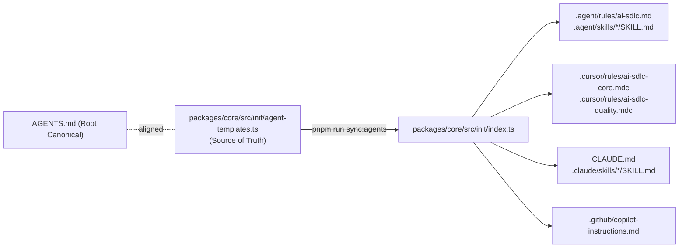

# Diseño Técnico: CHG-066-CONTEXT-BUDGET-AND-RULES-CONSISTENCY

## 1. Mapeo Arquitectónico y Enclave Zero Trust
El cambio materializa `CMP-066-CONTEXT-BUDGET-AND-RULES-CONSISTENCY` (subcomponente de `CMP-CORE` en `@aisdlc/core`) dentro del enclave `SEC-ENC-DMZ`. No introduce nuevos servicios de red ni almacenamiento de datos personales; opera exclusivamente sobre las plantillas de generación cross-IDE (`packages/core/src/init/agent-templates.ts`) y los artefactos Markdown canónicos sincronizados por `aisdlc sync` (`packages/core/src/init/index.ts`).

## 2. Contratos de Datos e Interfaces (Cambios por Archivo)

1. **Regla de Presupuesto de Contexto Cross-IDE**:
   - Se añade la sección/directiva **Context Budget Rule** en `AGENTS.md` y en las 4 plantillas de ruleset principal en `packages/core/src/init/agent-templates.ts`:
     - `STARTER_ANTIGRAVITY_RULES` (genera `.agent/rules/ai-sdlc.md`)
     - `STARTER_CURSOR_CORE_RULES` (genera `.cursor/rules/ai-sdlc-core.mdc`)
     - `STARTER_CLAUDE_RULES` (genera `CLAUDE.md`)
     - `STARTER_COPILOT_RULES` (genera `.github/copilot-instructions.md`)
   - Contenido normativo mínimo: exigir hidratar contexto mediante `get_task_context` (`npx aisdlc context pack`), `query_code_graph` (`npx aisdlc graph query`) y `search_specs` antes de leer archivos completos o directorios de código fuente, tratando `process/*.md` exclusivamente como referencia bajo demanda.

2. **Reparación de Enlaces Relativos en Skills (`LIFECYCLE_SKILL_TEMPLATES`)**:
   - En `packages/core/src/init/agent-templates.ts`, todas las 19 ocurrencias de `[`agent-<role>`](../agent-<role>/SKILL.md)` en `LIFECYCLE_SKILL_TEMPLATES` se actualizan a `[`agent-<role>`](../../agents/agent-<role>.md)`.
   - Al ejecutar `pnpm run sync:agents`, `.agent/skills/*/SKILL.md` y `.claude/skills/*/SKILL.md` quedan con enlaces válidos que resuelven a `.agent/agents/agent-*.md` y `.claude/agents/agent-*.md` respectivamente.

3. **Reconciliación de Mandamientos (6) y Numeración de Secciones**:
   - En `AGENTS.md`: actualizar `## 1. The 5 Unbreakable Commandments of Agents` a `## 1. The 6 Unbreakable Commandments of Agents` (coincidiendo con los 6 ítems ya listados).
   - En `STARTER_ANTIGRAVITY_RULES`, `STARTER_CURSOR_CORE_RULES`, `STARTER_CLAUDE_RULES`, `STARTER_COPILOT_RULES` (y `description` de `STARTER_CURSOR_CORE_RULES`): actualizar el título a `## 1. The 6 Unbreakable Commandments of Agents | Los 6 Mandamientos Inquebrantables de los Agentes` e incluir el mandamiento #6 (`**MANDATORY CLEAN CONTEXT WINDOW ISOLATION PER SPECIALIST AGENT**`).
   - En `STARTER_ANTIGRAVITY_RULES` (y `.agent/rules/ai-sdlc.md`): corregir la numeración duplicada `## 4. Workflow Handoff Protocol...` a `## 5. Workflow Handoff Protocol...` (dejando secuencia única `## 1.` .. `## 5.`).
   - Nota de compatibilidad: `process/09_agent_protocols.md` y la aserción histórica sobre `process/09_agent_protocols.md` en `packages/core/tests/agent-native-configs-drift.spec.ts` no se alteran salvo ajuste de pruebas de rulesets si verifican el nuevo encabezado `"6 Unbreakable Commandments"`.

4. **Alineación del Orden de Implementación (5 Pasos)**:
   - Unificar `LIFECYCLE_SKILL_TEMPLATES` (`aisdlc-increment`) y `STARTER_CURSOR_QUALITY_RULES` con `STARTER_ANTIGRAVITY_CODE_RULES` (`.agent/rules/ai-sdlc-code.md`) y `agent-developer.md` declarando el **Mandatory 5-Step Implementation Order** (incluyendo el paso `(5) Per-component UI/E2E tests`).

## 3. Protocolos de Manejo de Errores y Mitigación
- La validación automatizada (`tests/unit/context-budget-rules-consistency.spec.ts` y `tests/steps/*066*.steps.ts`) falla explícitamente si detecta cualquier enlace `../agent-`, un encabezado `## 4.` duplicado en `.agent/rules/ai-sdlc.md`, un desajuste entre el número de mandamientos en el título y los ítems listados, o ausencia de la regla de presupuesto de contexto en las plantillas IDE.

## 4. Conformidad con la Política de Licencias (`license-policy.yaml`)
- Sin nuevas dependencias externas; 100% conforme con `license-policy.yaml`.

## 5. Historial de Revisiones

| Versión | Fecha | Autor | Descripción del Cambio | Referencia |
| :--- | :--- | :--- | :--- | :--- |
| **1.0.0** | 2026-11-25 | agent-system-architect | Diseño técnico inicial y mapeo de plantillas IDE | CHG-066-CONTEXT-BUDGET-AND-RULES-CONSISTENCY |
