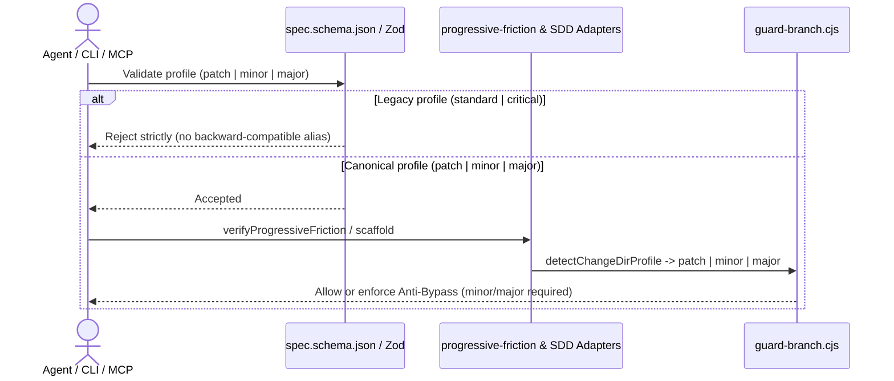

# Diseño Técnico: CHG-067-SEMVER-FRICTION-PROFILES

## 1. Mapeo Arquitectónico y Enclave Zero Trust
El cambio actualiza `CMP-CORE` en el enclave `SEC-ENC-DMZ` siguiendo **Hexagonal Architecture (Ports & Adapters)** y **Simplicity First (YAGNI)**:
- **Dominio y Tipos (`packages/core/src/types/index.ts`)**: `ChangeProfile = 'patch' | 'minor' | 'major'` y `VALID_CHANGE_PROFILES = ['patch', 'minor', 'major'] as const` (junto con alias de tipo `FrictionProfile = ChangeProfile` si aplica).
- **Esquema Canónico (`schemas/sdd/spec.schema.json`)**: `properties.profile.enum` pasa a `["patch", "minor", "major"]`.
- **Núcleo de Verificación (`packages/core/src/verifiers/progressive-friction.ts` y `manuals.ts`)**:
  - `detectProfileFromChange(changeDir)` valida estrictamente `['patch', 'minor', 'major']` con valor por defecto `'minor'`.
  - `verifyProgressiveFriction()` y `collectPatchViolations()` exigen `'minor' or 'major'` para rutas Anti-Bypass.
  - `manuals.ts` resuelve perfil por defecto `'minor'` y aplica modo estricto (`isStrictEnforcement`) cuando `profile === 'major'` o rama `release/*`.
- **Adaptadores SDD (`packages/core/src/adapters/sdd/{openspec,speckit,scaffold}.ts`)**: `parseChangeProfile` y valor por defecto `'minor'`, validando estrictamente `['patch', 'minor', 'major']`.
- **Adaptadores de Entrada (CLI y MCP)**:
  - `packages/cli/src/index.ts` y `packages/cli/src/commands/sdd.ts`: `--profile <profile>` con valores `patch | minor | major` (por defecto `'minor'`) y rechazo explícito de valores distintos (incluidos `standard` y `critical`).
  - `packages/mcp/src/tools/lifecycle.ts`: `profile: z.enum(['patch', 'minor', 'major']).optional()`.
- **Hook Guardián (`scripts/guard-branch.cjs` y `packages/core/src/init/coding-rules-templates.ts`)**:
  - `detectChangeDirProfile` usa `/^\s*profile:\s*['"]?(patch|minor|major)['"]?\s*$/m` con valor por defecto `'minor'`.
  - Mensajes de bloqueo de `validateProtectedBypassOnly` y `validateSourceOrTestEdit` referencian `'minor' or 'major'` y `minor/major`.
- **Plantillas, Documentación y Specs Existentes**:
  - Actualiza `templates/sdd/spec.template.md`, `packages/core/src/init/starter-schemas.ts`, `packages/core/src/init/starter-templates.ts`, `process/*.md`, y los campos `profile:` en `specs/changes/` (incluyendo `chg-067-semver-friction-profiles/spec.md` de `critical` a `major` en `TSK-067-02`).

## 2. Diagrama de Secuencia (Mermaid)

## 3. Contratos de Datos e Interfaces
- `ChangeProfile = 'patch' | 'minor' | 'major'`
- `VALID_CHANGE_PROFILES = ['patch', 'minor', 'major'] as const`
- `spec.schema.json`: `"enum": ["patch", "minor", "major"]`
- `MCP sdd_change_new`: `z.enum(['patch', 'minor', 'major']).optional()`

## 4. Protocolos de Manejo de Errores y Mitigación
- Rechazo fail-closed en esquema JSON, CLI, MCP, `progressive-friction` y `guard-branch.cjs` ante `standard` o `critical` sin fallback silencioso a valores legados.

## 5. Conformidad con la Política de Licencias (`license-policy.yaml`)
- Sin nuevas dependencias externas.
