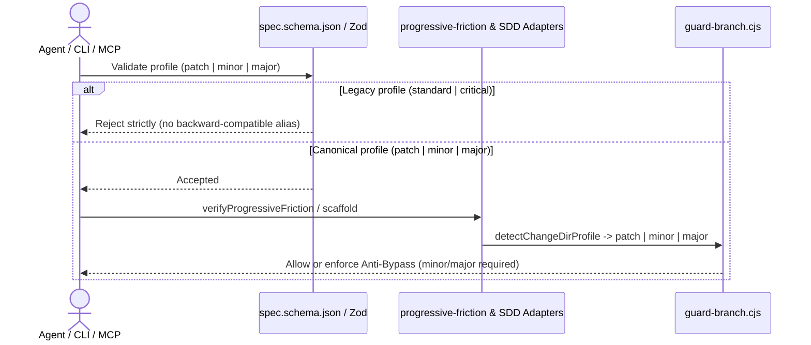

# Diseño Técnico: CHG-067-SEMVER-FRICTION-PROFILES

## 1. Mapeo Arquitectónico y Enclave Zero Trust
El cambio actualiza `CMP-CORE` en el enclave `SEC-ENC-DMZ` siguiendo **Hexagonal Architecture (Ports & Adapters)** y **Simplicity First (YAGNI)**:
- **Dominio y Tipos (`packages/core/src/types/index.ts`)**: `ChangeProfile = 'patch' | 'minor' | 'major'` y `VALID_CHANGE_PROFILES = ['patch', 'minor', 'major'] as const` (sin alias redundantes tipo `FrictionProfile` por YAGNI).
- **Esquema Canónico (`schemas/sdd/spec.schema.json`)**: `properties.profile.enum` pasa a `["patch", "minor", "major"]`.
- **Núcleo de Verificación (`packages/core/src/verifiers/progressive-friction.ts` y `manuals.ts`)**:
  - `detectProfileFromChange(changeDir)`: extrae cualquier valor `profile:` presente en el frontmatter de `spec.md` (sin ignorar valores desconocidos); si `profile` está presente y no pertenece a `['patch', 'minor', 'major']` (p. ej. `standard` o `critical`), falla de forma cerrada (**fail-closed**) reportando violación en `verifyProgressiveFriction()` / lanzando error explícito; reserva el valor por defecto `'minor'` exclusivamente cuando `profile` se omite.
  - `verifyProgressiveFriction()` y `collectPatchViolations()` exigen `'minor' or 'major'` para rutas Anti-Bypass.
  - `manuals.ts` resuelve perfil por defecto `'minor'` y aplica modo estricto (`isStrictEnforcement`) cuando `profile === 'major'` o rama `release/*`.
- **Adaptadores SDD (`packages/core/src/adapters/sdd/{openspec,speckit,scaffold}.ts`)**:
  - `parseChangeProfile` y `scaffoldSddChange` validan estrictamente `['patch', 'minor', 'major']` cuando `profile` es provisto (fallo cerrado / throw si recibe `standard` o `critical`), reservando `'minor'` como valor por defecto únicamente cuando `profile` se omite.
- **Plantillas de Skills e Inicialización (`packages/core/src/init/`)**:
  - `packages/core/src/init/agent-templates.ts` (`LIFECYCLE_SKILL_TEMPLATES`: `aisdlc-increment`, `aisdlc-release-compliance` y cualquier otra referencia a `standard`/`critical`).
  - `packages/core/src/init/starter-schemas.ts`, `packages/core/src/init/starter-templates.ts` y `packages/core/src/init/coding-rules-templates.ts` (`STARTER_GUARD_BRANCH_CJS`).
- **Adaptadores de Entrada (CLI y MCP)**:
  - `packages/cli/src/index.ts`, `packages/cli/src/commands/sdd.ts` y `packages/cli/src/commands/check.ts` (incluyendo mensajes de reclasificación a `'minor' or 'major'`): `--profile <profile>` con valores `patch | minor | major` (por defecto `'minor'`) y rechazo explícito de valores distintos (incluidos `standard` y `critical`).
  - `packages/mcp/src/tools/lifecycle.ts`: `profile: z.enum(['patch', 'minor', 'major']).optional()`.
- **Hook Guardián (`scripts/guard-branch.cjs` y `STARTER_GUARD_BRANCH_CJS`)**:
  - `detectChangeDirProfile(changeDir)` extrae cualquier token `profile:` presente mediante `/^\s*profile:\s*['"]?([A-Za-z0-9_-]+)['"]?\s*$/m` y **falla de forma cerrada (`{"decision":"deny"}`)** siempre que `profile` esté presente y no sea `'patch'`, `'minor'` o `'major'` (rechazando explícitamente `standard` y `critical`), reservando el valor por defecto `'minor'` estrictamente para cuando `profile` se omite.
  - Mensajes de bloqueo de `validateProtectedBypassOnly` y `validateSourceOrTestEdit` referencian `'minor' or 'major'` y `minor/major`.
- **Plantillas, Documentación, Specs Existentes y Pruebas**:
  - Actualiza `templates/sdd/spec.template.md`, `process/*.md`, todos los `specs/changes/active/*/spec.md` y `specs/changes/completed/*/spec.md` (~38 archivos) que declaran `profile: standard` o `profile: critical` (incluyendo `chg-067-semver-friction-profiles/spec.md` de `critical` a `major` en `TSK-067-02`), y las pruebas existentes en `packages/core/tests/`, `packages/cli/tests/`, `packages/mcp/tests/` y `tests/`.

## 2. Diagrama de Secuencia (Mermaid)

## 3. Contratos de Datos e Interfaces
- `ChangeProfile = 'patch' | 'minor' | 'major'`
- `VALID_CHANGE_PROFILES = ['patch', 'minor', 'major'] as const`
- `spec.schema.json`: `"enum": ["patch", "minor", "major"]`
- `MCP sdd_change_new`: `z.enum(['patch', 'minor', 'major']).optional()`

## 4. Protocolos de Manejo de Errores y Mitigación
- Rechazo fail-closed en esquema JSON, CLI, MCP, `progressive-friction` y `guard-branch.cjs` ante `standard` o `critical` sin fallback silencioso a valores legados.

## 5. Conformidad con la Política de Licencias (`license-policy.yaml`)
- Sin nuevas dependencias externas.
