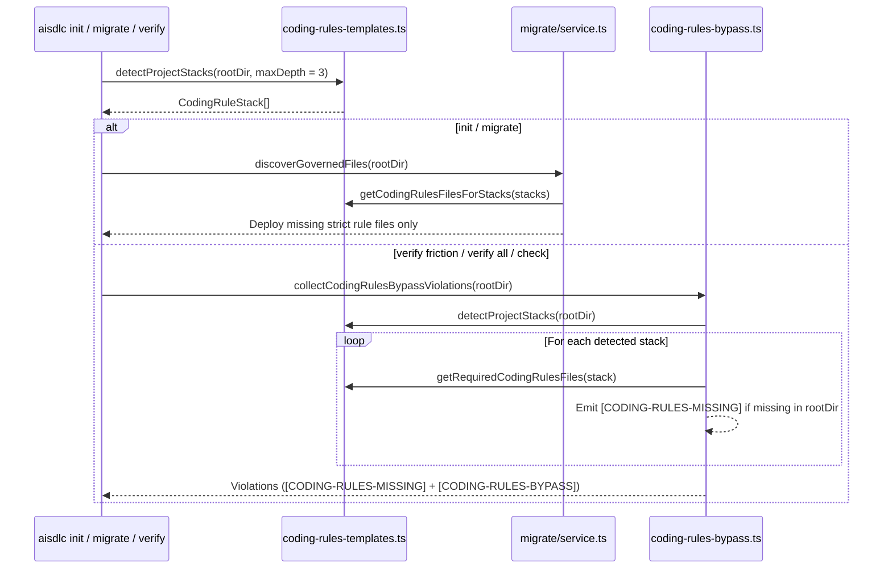

# Diseño Técnico: CHG-069-LANGUAGE-AGNOSTIC-CODING-RULES

## 1. Mapeo Arquitectónico y Enclave Zero Trust
Este cambio materializa el componente `CMP-069-LANGUAGE-AGNOSTIC-CODING-RULES` (subcomponente de `CMP-CORE` / `@aisdlc/core`) ejecutándose en el enclave local de desarrollo y CI (`SEC-ENC-DMZ`).

### Flujo de Interacción

## 2. Contratos de Datos e Interfaces

### 2.1 `packages/core/src/init/coding-rules-templates.ts` (`TSK-069-01`)
- **`IGNORED_STACK_SCAN_DIRS`**: `Set<string>` con `['node_modules', '.git', 'bin', 'obj', 'dist', 'build', 'target', '.venv', 'venv', '__pycache__', 'reports', 'templates']`.
- **`detectProjectStacks(targetDir: string, maxDepth = 3): CodingRuleStack[]`**:
  - Recorre `targetDir` de forma recursiva y acotada hasta `maxDepth` (nivel `0` = `targetDir`, hasta `depth <= maxDepth`), usando `fs.readdirSync(dir, { withFileTypes: true })`.
  - Omite explícitamente entradas donde `entry.isSymbolicLink()` sea `true` y directorios cuyo nombre pertenezca a `IGNORED_STACK_SCAN_DIRS`.
  - Recolecta los nombres de archivo encontrados y aplica las reglas de detección sobre `dotnet`, `angular`, `typescript`, `javascript`, `java`, `kotlin`, `rust`, `go`, `c` y `cpp` (asegurando que `CMakeLists.txt` / `Makefile` o archivos `.c` cubran tanto `c` como `cpp`).
- **`getRequiredCodingRulesFiles(stack: CodingRuleStack): string[]`**:
  - Expone de forma limpia las rutas relativas (`relPath`) definidas en `STACK_FILE_MAP[stack] ?? []`.
  - Reexportar `getRequiredCodingRulesFiles` desde `packages/core/src/init/index.ts` y `packages/core/src/index.ts`.
- **Integración con `aisdlc migrate` (`packages/core/src/migrate/service.ts`)**:
  - `MigrationService.discoverGovernedFiles(root)` invoca `detectProjectStacks(root)` y `getCodingRulesFilesForStacks(stacks)`.
  - Para cada archivo de reglas estrictas requerido que **no exista** en `root`, lo incorpora como `GovernedItem` con `currentContent: ''`, `baseContent: ''`, `targetContent: f.content` (clasificado como `CLEAN_UPDATE`), desplegándolo sin sobrescribir archivos de reglas ya existentes o personalizados por humanos.

### 2.2 `packages/core/src/verifiers/coding-rules-bypass.ts` (`TSK-069-02`)
- **`collectCodingRulesBypassViolations(rootDir: string): string[]`**:
  1. Invoca `detectProjectStacks(rootDir)`. Si está vacío y no hay reglas desplegadas, retorna `[]`.
  2. Para cada `stack` en `detectedStacks`, consulta `getRequiredCodingRulesFiles(stack)` y verifica con `fs.existsSync(path.join(rootDir, relPath))` que cada archivo exista en `rootDir`.
  3. Por cada archivo faltante (deduplicado por `relPath`), emite:
     `[CODING-RULES-MISSING] Stack '${stack}' detected, but required strict coding-rules file '${relPath}' is missing in '${rootDir}'. Run 'aisdlc init' or 'aisdlc migrate' to deploy it.`
  4. Mantiene la verificación existente de debilitamiento (`[CODING-RULES-BYPASS]`) para archivos MSBuild cuando `Directory.Build.props` existe y para `tsconfig*.json` cuando `tsconfig.strict.json` existe.
  5. Nota de compatibilidad de pruebas: actualizar `packages/core/tests/coding-rules-bypass.spec.ts` donde el caso `'returns nothing when no strict rules are deployed'` usaba `'a/x.csproj'` (ahora debe probar un repositorio sin manifiestos de stack para esperar `[]`, y añadir cobertura para `[CODING-RULES-MISSING]` en los 10 stacks).
- **Dogfooding en `AI-SDLC`**:
  - Al tener `tsconfig.json` / `package.json`, `AI-SDLC` detectará `typescript` durante `verify:friction` / `verify:all` / `check`. Se deben desplegar `tsconfig.strict.json` y `eslint.config.mjs` en la raíz del repositorio para que `AI-SDLC` cumpla sus propias reglas estrictas.

## 3. Protocolos de Manejo de Errores y Mitigación
- Errores de E/S (`EACCES`, `ENOENT`) en `readdirSync` durante la recursión se capturan localmente por subdirectorio para evitar abortar el escaneo del resto del árbol.
- Los enlaces simbólicos (`entry.isSymbolicLink()`) nunca se siguen para evitar bucles infinitos o escapes fuera del repositorio.

## 4. Conformidad con la Política de Licencias (`license-policy.yaml`)
- Implementación 100% sobre módulos nativos de Node.js (`fs`, `path`). Cero dependencias nuevas.

## 5. Historial de Revisiones

| Versión | Fecha | Autor | Descripción del Cambio | Referencia |
| :--- | :--- | :--- | :--- | :--- |
| **1.0.0** | 2026-11-26 | agent-system-architect | Diseño técnico formal para detección recursiva y verificación agnóstica al lenguaje | CHG-069-LANGUAGE-AGNOSTIC-CODING-RULES |
