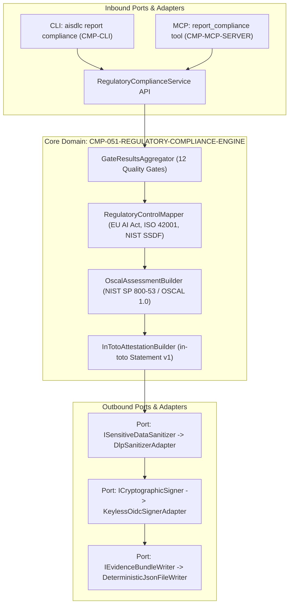

# Diseño Técnico: CHG-051-REGULATORY-COMPLIANCE-BUNDLE

## 1. Mapeo Arquitectónico y Enclave Zero Trust
El componente técnico central `CMP-051-REGULATORY-COMPLIANCE-ENGINE` se despliega en el enclave perimetral `SEC-ENC-DMZ` como una biblioteca modular in-process dentro de `@ai-sdlc/core`, expuesta a través de los adaptadores de entrada en `@ai-sdlc/cli` (`aisdlc report compliance`) y `@ai-sdlc/mcp` (`report_compliance`).

### Diagrama de Arquitectura Hexagonal (Ports & Adapters)


---

## 2. Contratos de Datos, Interfaces y Tipos del Dominio

### 2.1 Modelo de Opciones y Resultados de Servicio
```typescript
export interface ComplianceBundleOptions {
  rootDir: string;
  outputPath?: string; // default: 'reports/audit-evidence-bundle.json'
  keyless?: boolean; // Habilita atestación keyless / OIDC en CI
  strict?: boolean; // Falla si faltan reportes, gates incompletas o existen violaciones bloqueantes
  offline?: boolean; // Modo offline explícito: prohíbe llamadas a red externa OIDC/Rekor
  dryRun?: boolean; // Omite escritura a disco y retorna payload
}

export interface ComplianceBundleResult {
  success: boolean;
  outputPath: string;
  bundleDigest: string; // SHA-256 canónico del bundle generado
  findingsCount: number;
  coveredGatesCount: number; // 12 Quality Gates
  regulatoryCoverage: {
    euAiActArticles: string[]; // ["Art. 9", "Art. 10", ..., "Art. 15"]
    iso42001Clauses: string[];
    nistSsdfPractices: string[];
  };
  diagnostics: string[];
}
```

### 2.2 Estructura del Bundle Consolidado (`reports/audit-evidence-bundle.json`)
```typescript
export interface ComplianceBundlePayload {
  schemaVersion: "1.0.0";
  generatedAt: string; // ISO 8601 UTC
  generator: {
    name: "AI-SDLC Regulatory Compliance Engine";
    component: "CMP-051-REGULATORY-COMPLIANCE-ENGINE";
    version: string;
  };
  oscalAssessmentResults: OscalAssessmentResultsDocument;
  inTotoAttestation: InTotoStatementV1;
  regulatoryMatrix: RegulatoryMatrixSection;
}
```

### 2.3 Mapeo Normativo de las 12 Quality Gates
| AI-SDLC Quality Gate | EU AI Act (2024/1689) | ISO/IEC 42001:2023 | NIST SSDF (SP 800-218) |
| :--- | :--- | :--- | :--- |
| **1. Quality (Complexity/Maintainability)** | Art. 15 (Precisión y robustez) | A.8.2 (Diseño y desarrollo) | PW.6 (Calidad y mantenibilidad) |
| **2. Traceability (Reverse RTM)** | Art. 11 (Documentación técnica) | A.6.2 (Trazabilidad de requisitos) | PO.3 (Trazabilidad integral) |
| **3. Governance (Autonomy Modes)** | Art. 14 (Supervisión humana) | A.5.4 (Roles y responsabilidades) | PO.1 (Políticas de gobernanza) |
| **4. Testing (Coverage/BDD)** | Art. 15 (Pruebas y validación) | A.8.4 (Evaluación del sistema) | PW.7 (Pruebas automatizadas) |
| **5. Gherkin (Spec-First)** | Art. 11 (Especificaciones técnicas) | A.6.1 (Definición de objetivos) | PW.1 (Requisitos verificables) |
| **6. Licenses (OSS Compliance)** | Art. 10 (Cadena de suministro) | A.9.1 (Gestión de terceros) | PS.1 (Seguridad en dependencias) |
| **7. PDaC (Integrity/Drift)** | Art. 12 (Registro y auditoría) | A.7.2 (Control de cambios) | PO.3.2 (Integridad criptográfica) |
| **8. Schemas (Schema Validation)** | Art. 11 (Estructura formal) | A.8.3 (Estándares de artefactos) | PW.4 (Validación de esquemas) |
| **9. Duplicates (DRY/Collisions)** | Art. 15 (Robustez y consistencia) | A.6.2 (Consistencia de requisitos) | PW.5 (Calidad de especificaciones) |
| **10. Security (Secrets & SAST)** | Art. 15 (Ciberseguridad) | A.9.3 (Ciberseguridad de IA) | PW.8, RV.1 (Análisis estático y secretos) |
| **11. Privacy (GDPR/PII)** | Art. 10 (Gobernanza de datos) | A.7.4 (Protección de datos y PII) | PS.3 (Protección de privacidad) |
| **12. Friction (Anti-Bypass)** | Art. 14 (Supervisión y control) | A.5.2 (Controles de proceso) | PO.2 (Cumplimiento de políticas) |

---

## 3. Protocolos de Manejo de Errores y Mitigación Ciberseguridad

### 3.1 Mitigación de Manipulación y Determinismo Criptográfico (`SEC-REQ-051-TAMPER-RESISTANT-ATTESTATION-001`)
- **Canonicidad JSON (RFC 8785)**: Todo objeto del bundle es serializado aplicando el estándar RFC 8785 (JSON Canonicalization Scheme - JCS) con claves ordenadas lexicográficamente.
- **Ordenamiento Secundario Determinista de Colecciones**: Todos los arrays (`findings`, `diagnostics`, `rules`, `subjects`) se ordenan deterministamente por clave primaria/secundaria (`id`, `ruleId`, `path` o comparación léxica) previo al hashing.
- **Normalización de Formato**: Se impone terminación de línea Unix LF (`\n`) y codificación estricta UTF-8.
- **Completitud y Frescura de 12 Quality Gates (Anti-Gate Poisoning)**:
  - En pipelines CI (`CI=true`) o con flags `--strict` o `--keyless`, la presencia y veredicto de las 12 Quality Gates es obligatoria. No se permite omitir ninguna gate.
  - Se verifica la frescura de procedencia: cada reporte de gate debe corresponder exactamente al commit actual del repositorio (`git rev-parse HEAD`). Discrepancias o reportes obsoletos abortan con error `ERR_EVIDENCE_PROVENANCE_STALE`.
- Se genera un hash SHA-256 Unix LF-normalizado para cada evidencia y para el bundle completo.
- El bundle se envuelve en un Statement in-toto v1 cuyos subjects enlazan los digests de los reportes fuente.

### 3.2 Sanitización DLP Ampliada y Anti-Fuga (`SEC-REQ-051-SENSITIVE-DATA-FILTER-001`)
- Las salidas de diagnósticos crudos y metadatos Git pasan por `DlpSanitizer` antes de serializarse.
- **Expresiones Regulares y Detección Ampliada**:
  - Detección y redacción de credenciales en URIs: `://[^:/@\s]+:[^/@\s]+@` -> `://[REDACTED_SECRET]@`.
  - Detección y redacción de tokens Bearer: `Bearer [A-Za-z0-9\-._~+/]+=*` -> `Bearer [REDACTED_SECRET]`.
  - Detección y redacción de cabeceras de claves privadas PEM: `-----BEGIN (RSA|EC|OPENSSH|DSA|PGP)?\s?PRIVATE KEY-----` -> `[REDACTED_SECRET_KEY]`.
  - Nombres de correo electrónico de autores en metadatos Git se anonimizan (`[REDACTED_PII]`).
- **Envoltura Completa**: La sanitización envuelve recursivamente `diagnostics[]`, `rawOutput`, `error.message` y `stackTrace` de cualquier gate o fallo.

### 3.3 Validación de Identidad OIDC, Resiliencia Air-Gapped y Firmas Keyless (`SEC-REQ-051-KEYLESS-IDENTITY-VERIFICATION-001`)
- En modo keyless (`--keyless` o CI desatendido):
  - **Lista Blanca Estricta HTTPS**: Solo se permiten endpoints OIDC explícitamente autorizados en lista blanca (e.g. `https://token.actions.githubusercontent.com`).
  - **Timeout y Fail-Closed**: Toda llamada a proveedores de tokens OIDC o registros de transparencia (Rekor) aplica un timeout estricto de red de 5 segundos. En caso de timeout, desconexión o fallo de red en CI air-gapped, falla cerrado inmediatamente emitiendo `ERR_OIDC_NETWORK_UNREACHABLE` en lugar de quedar bloqueado indefinidamente.
  - **Modo Offline Explícito**: Soporte del flag `--offline`. En presencia de `--offline`, se desactiva cualquier intento de acceso a red externa, forzando atestación criptográfica local SHA-256 determinista.
- Si se encuentra en entorno CI con emisor no confiable, aborta inmediatamente con código 1 (`ERR_UNTRUSTED_OIDC_ISSUER`).
- Si faltan evidencias obligatorias y se invoca en `--strict`, aborta con código 1 (`ERR_MISSING_REQUIRED_EVIDENCE`).

---

## 4. Conformidad con la Política de Licencias (`license-policy.yaml`)
Todas las librerías empleadas en la implementación (crypto nativo de Node.js, `js-yaml`, validadores JSON) cumplen con las categorías `PERMISSIVE` (`MIT`, `Apache-2.0`, `BSD`) estipuladas en `license-policy.yaml`. No se agregan nuevas dependencias externas de licencia viral o comercial.

---

## 5. Historial de Revisiones

| Versión | Fecha | Autor | Descripción del Cambio | Referencia |
| :--- | :--- | :--- | :--- | :--- |
| **1.0.0** | 2026-11-10 | agent-system-architect | Diseño técnico completo con Arquitectura Hexagonal y Mapeo Regulatorio | CHG-051-REGULATORY-COMPLIANCE-BUNDLE |
| **1.1.0** | 2026-11-10 | agent-system-architect | Mitigación de 4 vectores de agente adversario (12 gates/HEAD, RFC 8785/arrays, OIDC whitelist/timeout/offline, DLP ampliado) | CHG-051-REGULATORY-COMPLIANCE-BUNDLE |
