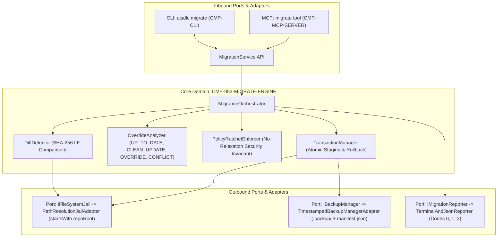

# Diseño Técnico: CHG-053-CLI-MIGRATE

## 1. Mapeo Arquitectónico y Enclave Zero Trust
El componente central `CMP-053-MIGRATE-ENGINE` se despliega en el enclave perimetral `SEC-ENC-DMZ` como biblioteca modular in-process dentro de `@ai-sdlc/core`, expuesta a través de adaptadores de entrada en `@ai-sdlc/cli` (`aisdlc migrate`) y `@ai-sdlc/mcp` (`migrate`).

### Diagrama de Arquitectura Hexagonal (Ports & Adapters)


---

## 2. Contratos de Datos, Interfaces y Tipos del Dominio

### 2.1 Modelo de Opciones, Estados y Resultados de Migración
```typescript
export type MigrationFileStatus = 
  | 'UP_TO_DATE' 
  | 'CLEAN_UPDATE' 
  | 'LOCAL_OVERRIDE_PRESERVED' 
  | 'CONFLICT';

export interface MigrationOptions {
  root?: string;
  dryRun?: boolean;
  backup?: boolean;
  force?: boolean;
  allowPolicyDowngrade?: boolean;
  json?: boolean;
  verbose?: boolean;
}

export interface MigrationItemReport {
  file: string;
  category: 'schema' | 'template' | 'policy';
  status: MigrationFileStatus;
  currentDigest?: string;
  targetDigest?: string;
  message?: string;
}

export interface MigrationSummary {
  upToDate: number;
  cleanUpdated: number;
  overridesPreserved: number;
  conflicts: number;
}

export interface MigrationResult {
  success: boolean;
  exitCode: 0 | 1 | 2;
  summary: MigrationSummary;
  backupPath?: string;
  details: MigrationItemReport[];
}

export interface IMigrationService {
  migrate(options: MigrationOptions): Promise<MigrationResult>;
  preview(options: MigrationOptions): Promise<MigrationResult>;
}
```

### 2.2 Puertos de Salida (Outbound Ports)
```typescript
export interface IFileSystemJail {
  resolveSafe(repoRoot: string, relativePath: string): string;
  readFileSafe(repoRoot: string, relativePath: string): Promise<string>;
  writeFileSafe(repoRoot: string, relativePath: string, content: string): Promise<void>;
  existsSafe(repoRoot: string, relativePath: string): Promise<boolean>;
  ensureDirectorySafe(repoRoot: string, relativeDir: string): Promise<void>;
  isSymlinkSafe(repoRoot: string, relativePath: string): Promise<boolean>;
}

export interface BackupManifestEntry {
  path: string;
  sha256: string;
  bytes: number;
}

export interface BackupManifest {
  timestamp: string;
  changeId?: string;
  files: BackupManifestEntry[];
}

export interface IBackupManager {
  createBackup(repoRoot: string, filesToBackup: string[]): Promise<string>;
  restoreBackup(repoRoot: string, backupPath: string): Promise<void>;
}

export interface IMigrationReporter {
  formatTerminal(result: MigrationResult): string;
  formatJson(result: MigrationResult): string;
}
```

---

## 3. Protocolos de Manejo de Errores y Mitigación de Ciberseguridad

### 3.1 Confinamiento Estricto en Raíz y Prevención de Path Traversal (`SEC-REQ-053-PATH-TRAVERSAL-DEFENSE-001`)
- El adaptador `PathResolutionJailAdapter` (implementando `IFileSystemJail`) procesa cada ruta mediante:
  1. Resolución canónica ineludible con `path.resolve(repoRoot, relativePath)`.
  2. Verificación estricta contra escapes y prefijos hermanos (sibling prefix bypass): se comprueba que `resolvedPath === repoRoot || resolvedPath.startsWith(repoRoot + path.sep)`, complementado con `!path.relative(repoRoot, resolvedPath).startsWith('..') && !path.isAbsolute(path.relative(repoRoot, resolvedPath))`.
  3. Soporte multiplataforma: normalización canónica de letra de unidad de disco en Windows (casing uniforme) y manejo de prefijos de ruta extendida (`\\?\`).
  4. Rechazo expreso de secuencias traversal (`../`, `..\`) y caracteres nulos (`\0`). Cualquier infracción genera `ERR_PATH_TRAVERSAL_DETECTED`.
  5. Inspección profunda de enlaces simbólicos y junctions: se verifica mediante `fs.realpathSync` que la ruta real del archivo o directorio padre resuelto resida estrictamente dentro de `fs.realpathSync(repoRoot)`. Enlaces o uniones que apunten al exterior generan de inmediato `ERR_SYMLINK_ESCAPE_DETECTED`.
  6. Contención por lista blanca de subdirectorios gobernados: solo se permiten operaciones de escritura sobre `schemas/`, `templates/`, `.backup/` y archivos de políticas directos en la raíz (`quality-policy.yaml`, `license-policy.yaml`, `privacy-policy.yaml`, `dlp-policy.yaml`).

### 3.2 Respaldo Preventivo Criptográficamente Verificado (`SEC-REQ-053-NON-DESTRUCTIVE-BACKUP-001`)
- Antes de mutar cualquier archivo en el workspace:
  1. **Orden de operaciones Gitignore**: El sistema verifica o inyecta la directiva `.backup/` en `.gitignore` ANTES de que el directorio `.backup/` sea creado físicamente en el disco, eliminando cualquier ventana temporal de filtración remota accidental.
  2. **Identificador con Sufijo Anti-Colisión**: Se genera un directorio timestamped con milisegundos y un sufijo aleatorio de al menos 6 caracteres alfanuméricos `.backup/migration-<timestamp>-<random6>/` (ej. `migration-1731325600123-a1b2c3`), garantizando atomicidad y unicidad ante ejecuciones concurrentes o instantáneas.
  3. Cada archivo a modificar se copia íntegramente al respaldo y se calcula su hash SHA-256 (normalizado en Unix LF `\n`), registrándose en `manifest.json`.
  4. El directorio `.backup/` se crea con permisos POSIX restringidos (`0700` / exclusivo del usuario actual).
  5. Ante detección de personalizaciones locales (`LOCAL_OVERRIDE_PRESERVED`) sin el flag explícito `--force`, el sistema omite la modificación y retorna código `1`.

### 3.3 Atomicidad Transaccional y Rollback Automático (`SEC-REQ-053-ATOMIC-ROLLBACK-001`)
- El componente `TransactionManager`:
  1. Escribe los archivos modificados en un área de staging unívocamente identificada (`.backup/.staging-<uuid>/` o staging in-memory) para prevenir colisiones entre procesos.
  2. Registra manejadores de señales del sistema operativo (`SIGINT`, `SIGTERM`) para invocar `rollbackSync()` inmediatamente ante cancelaciones o interrupciones forzadas, limpiando el directorio de staging y saliendo con código `2`.
  3. Ejecuta un **Fail-Safe Integrity Check** (validación pre-commit de esquemas JSON contra Draft 2020-12 y YAML parser para políticas, validando tamaño mayor a 0 bytes).
  4. Si la validación sintáctica falla o si ocurre cualquier error de I/O, interrupción o señal, se activa el mecanismo de rollback automático: se eliminan los temporales de staging y se restauran los archivos modificados a su estado original a partir de `.backup/`.
  5. Ante fallo con rollback, el proceso emite diagnóstico del error y finaliza limpiamente con código de salida `2`.

### 3.4 Invariante Ratchet de No Degradación de Políticas (`SEC-REQ-053-POLICY-RATCHET-PRESERVATION-001`)
- El componente `PolicyRatchetEnforcer`:
  1. Compara las políticas locales existentes contra las versiones canónicas entrantes.
  2. **Validación Estricta de Tipos y Fail-Closed**: Antes de cualquier evaluación relacional de umbrales numéricos (cobertura mínima, complejidad ciclomática máxima), valida que los valores sean números válidos (`typeof val === 'number' && !Number.isNaN(val)`). Si un valor es `NaN`, string o estructura malformada, falla cerrado con `ERR_INVALID_POLICY_FORMAT` impidiendo que evaluaciones caigan a estados permisivos por defecto.
  3. **Normalización SPDX de Licencias**: Normaliza todos los identificadores de licencia a mayúsculas antes de comparar listas permitidas o bloqueadas.
  4. Aplica la regla ratchet: si el usuario ha configurado un umbral más exigente (mayor cobertura mínima, menor complejidad ciclomática máxima, o lista de licencias bloqueadas más amplia), el sistema retiene el umbral local más estricto y no lo relaja jamás silenciosamente.
  5. Aplica combinación aditiva (union merge) sobre reglas de DLP, PII y activos de datos (`DATA-ASSET-*`).
  6. Si una sincronización pretende deliberadamente relajar protecciones, la CLI exige el flag inequívoco `--allow-policy-downgrade`; en caso contrario aborta con código de salida `1`.

### 3.5 Salvaguarda de Ramas Protegidas y Gestión de Detached HEAD (`AGENTS.md`)
- En cumplimiento de la Directiva 1 de `AGENTS.md`, `MigrationOrchestrator` verifica la rama Git activa.
- Para evitar bypasses en estados de Detached HEAD:
  1. Se consulta `git symbolic-ref --short HEAD`.
  2. Si retorna error o se detecta HEAD desasociado, se consulta `git rev-parse --abbrev-ref HEAD` y se examinan las variables de entorno canónicas de integración continua (`GITHUB_REF_NAME`, `CI_COMMIT_REF_NAME`).
  3. Si la rama resultante es `main`, `master` o `release/*`, se bloquea cualquier operación mutante.
  4. Si no es posible determinar la rama de forma fehaciente en una operación de escritura (no `--dry-run`), el sistema aplica el principio de fail-closed y aborta de inmediato con `ERR_PROTECTED_BRANCH_MIGRATION` y código de salida `2`.

---

## 4. Conformidad con la Política de Licencias (`license-policy.yaml`)
Todas las librerías empleadas en la implementación (APIs nativas de Node.js `node:fs`, `node:path`, `node:crypto`, `node:child_process`, y las dependencias ya aprobadas en el monorepo como `js-yaml`) cumplen con la categoría `PERMISSIVE` (`MIT`, `Apache-2.0`, `BSD`) conforme a `license-policy.yaml`. No se introducen nuevas dependencias externas.

---

## 5. Historial de Revisiones

| Versión | Fecha | Autor | Descripción del Cambio | Referencia |
| :--- | :--- | :--- | :--- | :--- |
| **1.0.0** | 2026-11-11 | agent-system-architect | Diseño técnico formal de CMP-053-MIGRATE-ENGINE con Arquitectura Hexagonal | CHG-053-CLI-MIGRATE |
