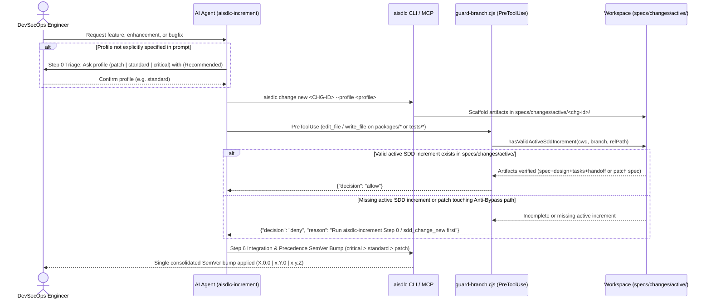

# Diseño Técnico: CHG-061-INCREMENT-PROFILE-AND-SEMVER-GUARD

## 1. Mapeo Arquitectónico, Diseño Modular y Enclave Zero Trust

Materializa `FR-061-INCREMENT-PROFILE-AND-SEMVER-GUARD-001` y `UC-061-INCREMENT-PROFILE-AND-SEMVER-GUARD` dentro de `CMP-CORE` en el enclave `SEC-ENC-DMZ`, siguiendo **Modular & Hexagonal Architecture (Ports & Adapters)** y el principio **Simplicity First (YAGNI)** sin añadir dependencias externas:

1. **Núcleo de Plantillas de Ciclo de Vida (`packages/core/src/init/agent-templates.ts`) y Skills Desplegados Multi-IDE**:
   - Actualiza la entrada `id: 'aisdlc-increment'` en `LIFECYCLE_SKILL_TEMPLATES` y sincroniza los cuatro artefactos desplegados en el repositorio:
     - `.agent/skills/aisdlc-increment/SKILL.md`
     - `.claude/skills/aisdlc-increment/SKILL.md`
     - `.github/skills/aisdlc-increment/SKILL.md`
     - `.cursor/rules/skill-aisdlc-increment.mdc`
   - **Step 0: Friction Profile Selection & Scope Triage (`patch | standard | critical`)**:
     - Se ejecuta obligatoriamente antes del Step 1 / creación de ramas o scaffolding SDD.
     - Si el usuario no especificó explícitamente el perfil (`patch`, `standard` o `critical`) en su prompt inicial, el agente DEBE preguntar interactivamente al usuario (usando `ask_question` o equivalente del IDE) qué perfil aplicar, colocando primero la opción recomendada con el prefijo `(Recommended)` inferida del alcance y de las rutas protegidas Anti-Bypass (`specs/security/`, `specs/privacy/`, `schemas/`, `packages/security/`, `SEC-ENC-*`, `09_decisions/`, `migrations/`, `*-policy.yaml`).
     - Define el enrutamiento explícito por perfil:
       - **`patch` (Fast-Track Bugfix, $\le 2$ ficheros fuente, cero rutas Anti-Bypass)**: `npx aisdlc change new "<Title>" --id <chg-id> --profile patch` genera únicamente `spec.md` con bloque `verification` (omitiendo `design.md`, `tasks.md` y `handoff.yaml`) y requiere 1 único checkpoint de auditoría antes de integrar.
       - **`standard` (Feature / Enhancement estándar)**: requiere los 4 artefactos SDD (`proposal.md`, `spec.md`, `design.md`, `tasks.md`) + `handoff.yaml` y los 2 checkpoints transversales (`agent-auditor` $\parallel$ `agent-adversary`).
       - **`critical` (Seguridad, Privacidad, Esquemas Troncales o Breaking Changes)**: obligatorio cuando se tocan rutas Anti-Bypass o contratos incompatibles; exige el paquete SDD completo más modelado `agent-threat-modeler` $\rightarrow$ `agent-privacy-officer` y los 2 checkpoints completos.
   - **Step 6: Profile-Driven Semantic Versioning & Highest-Precedence Consolidation**:
     - Especifica la correspondencia determinista entre el perfil del incremento y el dígito SemVer (`MAJOR.MINOR.PATCH`) a incrementar en el software bajo desarrollo:
       - `patch` $\rightarrow$ incrementa el tercer dígito **Patch** (`x.y.Z`, p. ej. `1.2.3` $\rightarrow$ `1.2.4`).
       - `standard` $\rightarrow$ incrementa el segundo dígito **Minor** y reinicia patch a `0` (`x.Y.0`, p. ej. `1.2.3` $\rightarrow$ `1.3.0`).
       - `critical` $\rightarrow$ incrementa el primer dígito **Major** y reinicia minor y patch a `0` (`X.0.0`, p. ej. `1.2.3` $\rightarrow$ `2.0.0`).
     - **Regla de Consolidación por Máxima Precedencia**: Cuando existan múltiples incrementos pendientes siendo integrados en la rama actual o en el lote de release (sin considerar directorios históricos no relacionados que permanezcan en `specs/changes/active/`), el agente aplica **un único incremento SemVer** determinado exclusivamente por el perfil de mayor rango (`critical` / Major $>$ `standard` / Minor $>$ `patch` / Patch), prohibiendo sumar incrementos sucesivos del mismo o menor rango.

2. **Adaptador Guardián PreToolUse (`packages/core/src/init/coding-rules-templates.ts` — `STARTER_GUARD_BRANCH_CJS` y `scripts/guard-branch.cjs`)**:
   - Incorpora validación síncrona y determinista (usando únicamente `fs` y `path` de Node.js) en `evaluateGuardDecision(payload)`, que invoca `hasValidActiveSddIncrement(cwd, branch, relPath)` siempre que `isSourceOrTestTarget(relPath) || isProtectedBypassPath(relPath)` sea `true`, mediante las funciones auxiliares:
     - `isSourceOrTestTarget(relPath)`: detecta si la ruta relativa normalizada (`/` separator) apunta a directorios de código o pruebas (`^(src|lib|packages|tests)\/`).
     - `isProtectedBypassPath(relPath)`: evalúa si la ruta coincide con `PROTECTED_BYPASS_PATTERNS` (`^schemas\/`, `^examples\/security\/`, `^specs\/security\/`, `enclaves?\/`, `SEC-ENC-`, `quality-policy\.ya?ml$`, `license-policy\.ya?ml$`, `privacy-policy\.ya?ml$`, `08_security_concept\.md$`, `09_decisions\/`, `migrations?\/`, `^\.github\/CODEOWNERS$`).
     - `detectChangeDirProfile(changeDir)`: inspecciona `spec.md`, `proposal.md` y `handoff.yaml` en `changeDir` extrayendo el perfil con una expresión regular tolerante a comillas `/^\s*profile:\s*['"]?(patch|standard|critical)['"]?\s*$/m` sin dependencias externas (por defecto `'standard'`).
     - `hasValidActiveSddIncrement(cwd, branch, relTargetPath)`:
       - Verifica si existe el directorio `specs/changes/` en `cwd`. Si no existe (repositorios sin workspace SDD inicializado), retorna `{ valid: true }`.
       - **Correlación Estricta con la Rama Activa (`branch`)**:
         - Si `branch` contiene un token explícito de identificador de cambio que coincida con `/((?:chg|patch)-\d+)/i` (p. ej. `feat/CHG-061-increment-profile-and-semver-guard`, `task/CHG-061-foo/TSK-061-001`), extrae dicho prefijo (`chg-061`) y filtra los subdirectorios candidatos en `specs/changes/active/` únicamente a aquellos cuyo nombre de carpeta comience por ese prefijo (insensible a mayúsculas/minúsculas).
         - Si ningún directorio en `specs/changes/active/` coincide con el prefijo `(chg|patch)-\d+` de la rama, si `isSourceOrTestTarget(relTargetPath)` es `true` retorna `{ valid: false, reason: ... }` incluso aunque existan otros directorios históricos en `specs/changes/active/`.
         - Solo cuando `branch` no contiene un token `(?:chg|patch)-\d+` se recurre a inspeccionar todos los subdirectorios de `specs/changes/active/`.
       - **Reglas de Decisión para `isSourceOrTestTarget(relTargetPath)` vs. `isProtectedBypassPath(relTargetPath)`**:
         - **Caso A — `isSourceOrTestTarget(relTargetPath)` es `true` (`src/`, `lib/`, `packages/`, `tests/`)**:
           - Requiere al menos un directorio candidato activo para la rama actual en `specs/changes/active/`.
           - Si además `isProtectedBypassPath(relTargetPath)` es `true`, exige que el directorio candidato tenga perfil `standard` o `critical` con sus 4 artefactos (`spec.md`, `design.md`, `tasks.md`, `handoff.yaml`); si el perfil es `patch`, retorna `{ valid: false, reason: ... }` indicando que las rutas protegidas Anti-Bypass requieren un incremento `standard` o `critical`.
           - Si `isProtectedBypassPath(relTargetPath)` es `false`: permite si el candidato tiene `profile: patch` con `spec.md`, o `profile: standard | critical` con `spec.md`, `design.md`, `tasks.md` y `handoff.yaml`.
         - **Caso B — `isProtectedBypassPath(relTargetPath)` es `true` fuera de `src|lib|packages|tests`** (p. ej. `schemas/sdd/spec.schema.json`, `specs/security/SEC-REQ-001.md`, `09_decisions/`, `migrations/`, `*-policy.yaml`):
           - Si existe un incremento activo para la rama con `profile: patch`, retorna inmediatamente `{ valid: false, reason: ... }` (bloqueando el bypass de rutas protegidas bajo perfil `patch`).
           - Si no existe un incremento `patch` activo (p. ej., durante el Paso 1 de autoría upstream en `specs/security/*` o `specs/privacy/*` antes de `sdd_change_new`, o cuando el incremento activo es `standard`/`critical`), retorna `{ valid: true }`.
       - Si la validación devuelve `{ valid: false, reason }`, `evaluateGuardDecision(payload)` retorna `{ decision: 'deny', reason }` instruyendo al agente a ejecutar o reclasificar primero `aisdlc-increment` (Paso 0 $\rightarrow$ `sdd_change_new`).

---

## 2. Diagrama de Secuencia (Mermaid)



---

## 3. Contratos de Datos e Interfaces

En `scripts/guard-branch.cjs` y `STARTER_GUARD_BRANCH_CJS` (`packages/core/src/init/coding-rules-templates.ts`):

```javascript
/**
 * Evaluates whether an active SDD increment in specs/changes/active/
 * satisfies the artifact requirements for editing source/test files.
 * @param {string} cwd - Repository root path
 * @param {string} [branch] - Active Git branch name
 * @param {string} [relTargetPath] - Normalized relative target file path
 * @returns {{ valid: boolean, reason?: string }}
 */
function hasValidActiveSddIncrement(cwd, branch, relTargetPath)
```

- Cuando `require.main === module`, `guard-branch.cjs` ejecuta `main()` leyendo JSON desde `process.stdin`; además exporta `{ evaluateGuardDecision, hasValidActiveSddIncrement, isProtectedCodingRulesTarget, isSourceOrTestTarget }` (`module.exports`) para permitir pruebas unitarias directas y rápidas en Vitest sin necesidad de spawnear subprocesos por cada caso.

---

## 4. Protocolos de Manejo de Errores, Calidad y Licencias (`license-policy.yaml`)

- **Umbrales AST (`quality-policy.yaml`)**: Todas las funciones en `packages/core/src/init/` y `scripts/guard-branch.cjs` mantienen Complejidad Ciclomática $\le 10$, Complejidad Cognitiva $\le 15$, Índice de Mantenibilidad $\ge 50$ y longitud $\le 40$ líneas por función mediante funciones auxiliares cohesivas.
- **Fail-Safe en Rutas Efímeras**: `guard-branch.cjs` permite siempre ediciones en `/.gemini/`, `/brain/`, `/scratch/` y archivos de especificación dentro de `specs/changes/` para que el agente pueda crear y refinar el propio paquete SDD antes de editar `src/`, `lib/`, `packages/` o `tests/`.
- **Conformidad de Licencias**: Cero dependencias nuevas.

---

## 5. Historial de Revisiones

| Versión | Fecha | Autor | Descripción del Cambio | Referencia |
| :--- | :--- | :--- | :--- | :--- |
| **1.0.0** | 2026-11-16 | agent-system-architect | Diseño arquitectónico de Step 0/Step 6 en `aisdlc-increment` y `hasValidActiveSddIncrement` en `guard-branch.cjs` | CHG-061-INCREMENT-PROFILE-AND-SEMVER-GUARD |
